# Church Service Timer — operator teaching guide

For app **0.18.0** · Prepared **21 October 2026** · Creator **I-Proton**

This handbook teaches a new operator to prepare a program, run its timer, communicate discreetly with the stage, recover from common interruptions, and close the service with a useful report. Keep it beside the phone during your first rehearsal. Screenshots use example data from automated app previews; they are illustrations, not evidence that a particular physical display is connected.

**Start with a simulator rehearsal.** Move to the church's actual equipment with an experienced operator before running a service alone. The app is an Android prototype with tested support for a specific LED controller; reliable use still depends on the phone, network and stage equipment.

## 01 — Understand the workspace

**A Program is a saved plan. A service is one run of that plan.** Editing a saved program prepares a future run. Adjusting a running service does not rewrite the saved program or old reports.

The four bottom tabs are your main destinations:

| Tab | Use it for |
| --- | --- |
| Live | Start and operate a service, inspect output, send cues and messages. |
| Programs | Create reusable plans, arrange segments, add speakers and private notes, set each program's end screen. |
| Reports | Review completed services, compare durations, export records and print documents. |
| Settings | Church identity, appearance, global warnings, displays, prepared cues, paired devices, backups and help. |

The **display icon at the top right** opens the output chooser. Selecting a destination and connecting it are separate from starting a service.

Learn these three readings before touching a control:

| Reading | What it tells you |
| --- | --- |
| Main progress arc | The operator's current segment time, allocation and warning/overtime state. |
| Display preview | What the selected output is simulating or last acknowledged. Check its badge and any stale/held indication. |
| Service timing overview | Progress against the whole plan; its estimated finish can change with pauses and manual advances. |

**A running arc does not prove the sign is receiving updates.** Likewise, Controller accepted or Synced means the receiving system acknowledged data; it is not a camera view of what a person can see.

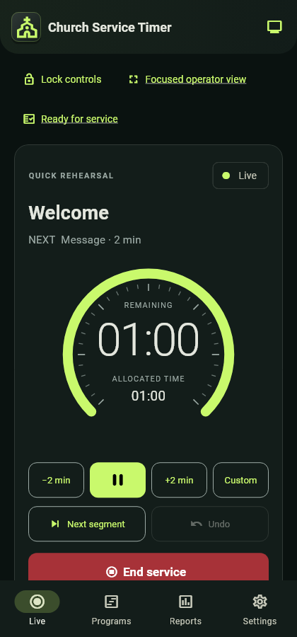

Use the labels as well as colour: normal time, warning and overtime have different meanings. In Royal Navy, the normal arc is green while the surrounding theme remains gold; warning is amber and overtime is red.

## 02 — Your first rehearsal

Allow about 15 minutes. Use the simulator so no practice cue reaches a real stage.

1. Install the supplied Android app. Check **Settings → About** for its version. This guide describes 0.18.0; update paired devices too when using its new screen layouts and Seen acknowledgements.
2. Open the top-right display icon and choose **Simulator**. Confirm the preview badge says Simulator.
3. On Live choose **Start service**, then load **Quick rehearsal**. Loading a program enters **Ready**; it does not start the countdown.
4. Review the first and next segment. Choose normal timing or Fast rehearsal while Ready. A program's Service/Rehearsal grouping is not its speed setting.
5. Select **Start first segment**, review the confirmation and start.
6. Try the pause icon, confirm, and observe the held timer. Resume, then try **Custom** to add or remove minutes and seconds. Read the proposed result before confirming.
7. Tap one prepared **Stage cue**. It sends immediately. The countdown continues underneath. Choose **Show timer** to restore the current timer, not the original starting time.
8. Tap **Blank screen**, then **Unblank screen**. Blanking hides output; it does not pause the service.
9. Use **Next segment** when the current activity is finished. If this was accidental, use **Undo** while it is available and review the confirmation.
10. Allow a segment to reach zero. Observe the operator's red overtime and the shared At Zero display behavior. Reaching zero does not automatically advance the program.
11. Choose **End service** and confirm. Live returns to Standing by after the report saves. Open **View last report**.

**You are ready for the next lesson when you can explain:** Ready versus running, Pause versus Blank, Show timer versus Next segment, and a display acknowledgement versus a physical check.

Fast rehearsal accelerates simulated service time. Reports identify it as rehearsal timing, and duration insights exclude rehearsals. Use normal speed for the supported physical LED countdown.

## 03 — Build a reusable program

Open **Programs → + New**. In **Program editor**, give the plan a useful **Program name**; “Youth sunday” is the example placeholder, not a mandatory name.

1. Select Service or Rehearsal as its group.
2. Add the segments in the order they will happen. Enter a name and whole-minute duration for each.
3. Add speaker names and **private operator notes** where useful: microphone changes, music cues or an agreed finish instruction.
4. Reorder segments using the editor's drag handles.
5. Review **End screen · this program**. Set the message and formatting for this program's conclusion.
6. Choose **Create Program** for a new plan, or save an existing plan after editing.

Example practice plan:

| Segment | Duration | Speaker / private preparation note |
| --- | --- | --- |
| Welcome | 2 min | Host · have microphone 1 ready. |
| Worship | 5 min | Worship lead · confirm final song with the team. |
| Message | 8 min | Speaker · send the agreed wrap-up cue. |
| Closing | 2 min | Host · confirm announcements before closing. |

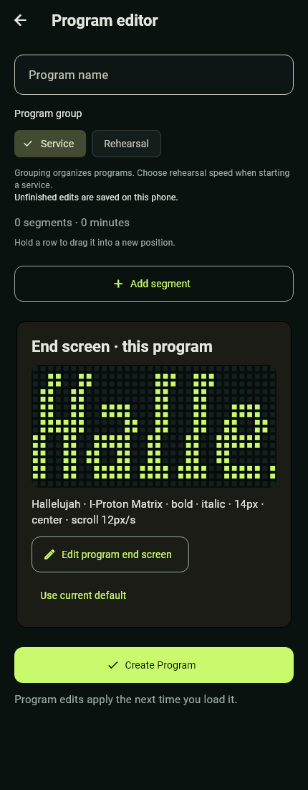

Open a row in Programs for **Program details**. Use **Edit Program**, Duplicate or the export actions. **Delete program** is at the bottom and requires confirmation. A duplicate is useful for a special service without overwriting a familiar plan.

Unfinished program edits are saved locally as drafts after a short delay. On reopening, choose **Restore draft**, **Discard draft**, or Cancel. Restoring is not the same as saving the program. If a save fails, keep the app open and use its retry action. The latest keystrokes can be lost if the phone kills the app before a pending write completes.

CSV import uses exactly `Segment Name,Duration (Minutes)` as its header. It carries names and durations only. Versioned JSON preserves richer program information such as speakers, notes and end-screen formatting. Imports are previewed before acceptance; current limits are 1 MiB and 200 segments, with durations of 1–99 whole minutes. The LED native countdown has a separate shorter limit explained in the LED lesson.

Global warnings and At Zero settings are shared on the receiving phone. Importing a program does not establish an independent set of warning rules for it. Keep exports containing private notes within the operator team.

## 04 — Choose the right display

Use the header display icon or **Change display** to open **Choose display**.

| Destination | Best use | What it needs |
| --- | --- | --- |
| Simulator | Training and checking the exact 32 × 16 LED layout on the operator phone. | No external screen. It does not send to hardware. |
| LED sign | A physical red LED countdown and short cues. | The supported W2 profile, sign Wi-Fi, and its device connection password. |
| Phone or tablet | A large stage countdown, rich Quick messages, recipient groups and Seen. | Another Android device with the app and a network allowing phone-to-phone traffic. |

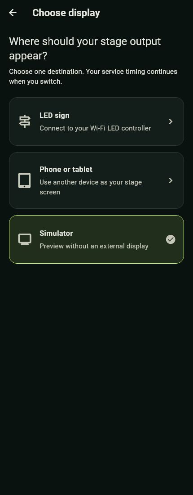

LED sign and Phone or tablet are **alternative stage-output destinations** in this build. Paired viewer/operator access is separate, so sharing controls does not itself require replacing the LED destination.

Changing destination preserves the service timer and stops LED reconnect attempts when another destination is chosen. When leaving a connected LED sign, choose whether to **Blank previous sign** or **Leave output**. A sign left displaying a countdown can continue on its own.

Always check the badge after changing output. A simulator preview, an authenticated LED connection and an acknowledged mobile screen are different states. Use **Test screen** where available and have someone confirm the intended physical screen before the service.

## 05 — Connect the LED sign

The hardware path has been tested with **Huidu W2, firmware V6.02.232, 32 × 16 red monochrome**. Do not assume every LED sign or every W2 firmware is supported. The app reads and validates the profile before publishing content.

1. Power the sign and connect the operator phone to the sign's Wi-Fi in Android.
2. Choose **LED sign** in Church Service Timer.
3. Scan, select the intended display, and enter its **device connection password**.
4. Leave **Remember password on this phone** checked if this is a trusted operator phone. It remembers the LED connection password, not the Wi-Fi password.
5. Tap **Connect selected display** and check the successful result and preview status.
6. Start a normal-speed service when ready. If restoring a service already in progress after an interruption, review its timer and use **Restore current output** when offered.

Connecting alone does not overwrite what the sign is currently showing. The stored connection password is encrypted locally with Android Keystore and excluded from portable backups. **Forget display** removes the app's remembered information; it does not reset the sign.

There are two different passwords:

| Password | Where it is used |
| --- | --- |
| Wi-Fi password | Android uses it to join the sign's wireless network. |
| Device connection password | The app uses it to authenticate to the LED controller. |

Supported native countdowns run up to **59:59**. The sign runs an accepted countdown independently and settles at 00:00. The app handles shared At Zero output and future segment changes. A brief blink at pause, resume, cue, warning or program replacement is expected on the tested controller; normal counting between replacements should be smooth.

An uploaded countdown can continue if Wi-Fi is lost. A static pause frame or cue may instead remain visible until it is replaced. Do not infer that the sign is current just because it is still lit. Read [connection recovery](#14-connection-recovery-and-troubleshooting) before using automatic recovery during a service.

## 06 — Pair a phone or tablet

Use one phone as the **host**. It owns the clock and saved data. The other devices join as stage displays, viewers or additional operators.

**Network first:** place devices on a normal router or a third device's hotspot that permits local traffic. Internet is not required. The tested LED sign's hotspot isolates its clients, so two phones on that hotspot could not pair with each other. QR codes do not bypass this restriction. Hosting on the same phone that supplies a hotspot is not verified in this build.

1. On the host, choose **Phone or tablet**, then **Share to stage screens**. To share viewer/operator access while retaining LED output, use **Settings → Paired devices → Share this service** instead.
2. On a stage phone's Live welcome card, choose **Join as stage screen**. For a viewer or operator role, open **Settings → Paired devices → Join another operator** and select the role.
3. Give the joining device a clear name, select the nearby host, and enter its **six-digit code**, including leading zeros. Alternatively, scan the host's QR code using **Scan QR code instead**.
4. The host reviews and approves the joining device. Knowing the code is not enough by itself.
5. For stage use, open **Use as stage display**. The receiver enters landscape full screen. Tap to reveal its overview/exit tools.
6. Check the host's recipient/connection list and use Test screen before going live. **Go to Live** returns from device management without ending sharing.

Invitations expire after ten minutes. If an invitation expires or PIN attempts are exhausted, use **New code** on the host. A new invitation does not remove already approved devices. Never publish a live pairing code or QR image in training materials.

| Role | Capability and privacy |
| --- | --- |
| Host | Owns timing, reports and output; approves devices and can reclaim control. Keep it powered and connected. |
| Additional operator | Initially observes; the host must explicitly give it control. Only one operator controls at a time. Private notes become available when control is granted. |
| Viewer | Observes service information without control or private operator notes. |
| Stage display | Shows large timer/cue/message content; no private notes or prepared-cue library. |

Handing over control does **not** move the service to the other phone. If that operator disconnects, control returns to the host. Reconnection does not silently restore its control grant.

For each saved screen, set a recognizable name, a group (**General, Preacher, Choir, Media desk**) and layout (**Timer only, Timer + current segment, Timer + next segment**). The host can choose which acknowledged screen to inspect in the preview.

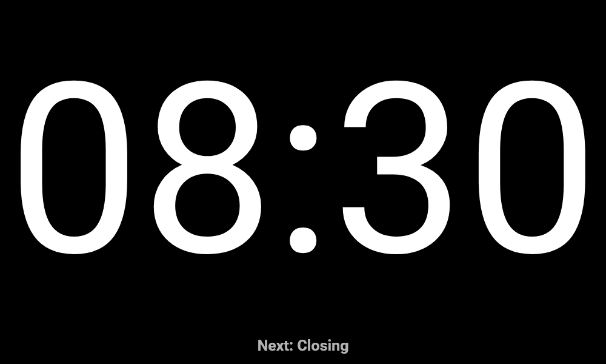

**Disconnect** keeps a device saved but pauses its service access. **Reconnect** on the host can restore it without another code when the receiver app is available on the same reachable network. **Forget device** revokes approval and requires pairing again. If the receiver deliberately leaves, it must choose **Reconnect saved host** to rejoin. Stop sharing is deliberate; host sharing does not automatically restart on app launch.

One host with three stage receivers is within the current eight-connection cap, which also counts pending connections. That cap is not a guarantee of performance on every router or phone; rehearse the exact setup.

## 07 — Operate a live service

Load the correct program, check its first segment and destination, then **Start first segment**. Program transitions remain manual: the app does not decide when worship, a message or an announcement is finished.

| Control or reading | What to do and expect |
| --- | --- |
| Pause / Resume icons | Confirm the action. Pause holds the service clock; Resume continues it. LED replacement can blink briefly. |
| −2 min / +2 min | Review the confirmation before changing the current segment's time. |
| Custom | Choose add or remove and enter minutes/seconds. Review the resulting timer; time can continue while the dialog is open. |
| Next segment | Confirm when the next real activity begins. It starts that segment's allocation and replaces the previous output. |
| Undo | Reverses the supported last segment advance when available; it is not a universal undo of every action. Review the confirmation. |
| Allocated time | The current segment's allotted duration, not the entire service length. |
| View / Hide private notes | Opens the current operator's notes; it does not publish them to stage displays. |
| Focused operator view | Keeps essential controls, timer, cues and display preview prominent. |
| Lock controls | Prevents accidental commands. Hold Hold to unlock to regain local controls. It does not pause time. |

Tap a row in **Service rundown · snapshot** to inspect its timing, speaker and private note. Opening that information does not advance to the row.

At zero, the operator view can enter **Overtime** and show red text while the display stays at 00:00 or the configured At Zero message. This is intentional. Start the next segment when appropriate; do not add time merely to hide an overrun from the report.

**Blank screen** is a toggle: tap again as **Unblank screen** to restore current output. It also works after End service. Timing and phone alerts continue while blanked, but automatic stage warnings are suppressed. The focused preview should remain present and identify intentional blanking.

## 08 — Prepared cues and automatic warnings

Prepared **Stage cues** are short reusable instructions such as WRAP UP or AMEN. Configure them before the service in **Settings → Stage cues**, or use the underlined **Manage cues** link on Live.

1. Create or edit a cue's text, font, height, bold/italic, alignment, effect and speed as available.
2. Save it. The Live cue buttons share this saved set across services.
3. During the service, **tap the cue once to send**. There is no editing step on Live; choose deliberately.
4. Select **Show timer** when the instruction has served its purpose. The timer has continued beneath the cue.

Changing the saved cue later does not rewrite content already on stage. Deleting an individual cue or warning offers an **eight-second Undo**, preserving its formatting. This Undo does not apply to clearing reports.

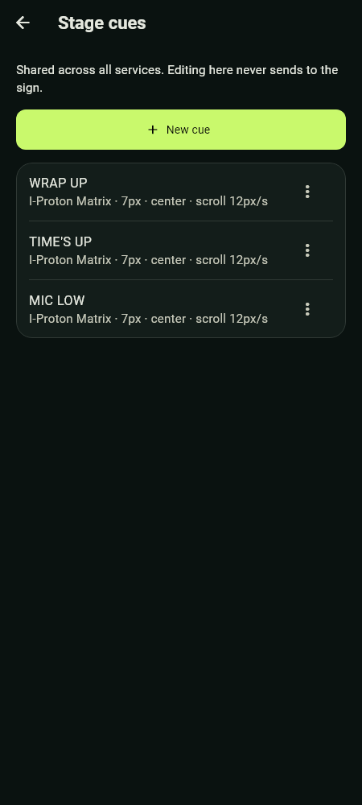

For LED text, choose **I-Proton Matrix**, **I-Proton Sq-Matrix**, or bundled **Tinos**. Matrix countdown digits are unchanged. Tinos has regular, bold, italic and bold-italic faces; no font import is needed. Tall 14 px preserves more serif detail. Short 7 px fits a smaller line. Static/flashing text must fit the LED width; scroll longer text. Changing square/circular LED preview cells does not change the actual sign's physical LEDs or glyph data.

Automatic rules live in **Settings → Warnings & alerts** and apply to **all services and rehearsals**. They trigger at **time remaining**, not time elapsed. In a ten-minute segment, a 01:30 rule triggers when eight minutes thirty seconds have elapsed under ordinary uninterrupted timing.

Set the threshold, cue and intended destination. Choose a fixed display duration of 1–120 seconds or one scroll cycle. A stage warning returns to the current countdown, or At Zero, after its duration. On the LED path, that duration begins after the controller acknowledges it.

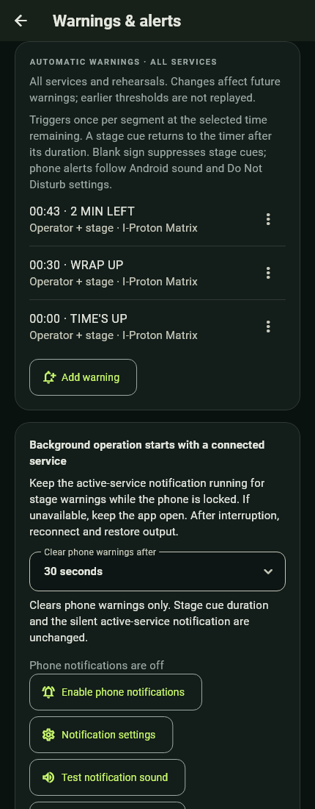

New manual cues, Blank, Next segment and End service supersede a warning. Passed thresholds are not replayed retroactively when rules change. If a manual Quick message covers every connected stage screen, automatic stage cues are consumed while it is present; phone warnings continue. With a targeted Quick message, other stage screens can still show warnings.

Phone notification lifetime is separate: choose **15, 30, 60 seconds or Until dismissed**, with 30 seconds as default. A segment change or service end clears obsolete warning notices. This does not shorten stage warning duration or remove the persistent active-service notification.

Enable Android notification permission and precise-warning access where offered, then use **Test notification sound**. Volume, the notification channel and Do Not Disturb still affect sound. Keep the active-service notification running for background delivery. Force-stopping the app is not a supported way to silence a service.

## 09 — Send rich Quick messages

Quick messages are for **Phone or tablet** stage output, not the LED sign. They let you send a longer, formatted instruction without changing the program.

1. Confirm sharing is enabled and the intended stage receivers are approved and synchronized.
2. In Live's **Quick message** card, choose **All connected stage screens**, one saved screen, or a screen group.
3. Write an optional headline and a body, or choose a preset and adapt it. The combined limit is **160 characters**, with a headline of at most 48 and up to six body lines.
4. Choose bold/italic, alignment, colour, size and duration: 5, 10, 15 or 30 seconds, or Until cleared. Use 15–30 seconds for longer instructions.
5. Inspect the preview and recipient count. Optionally enable **Request Seen acknowledgement**. Then tap **Send message**.

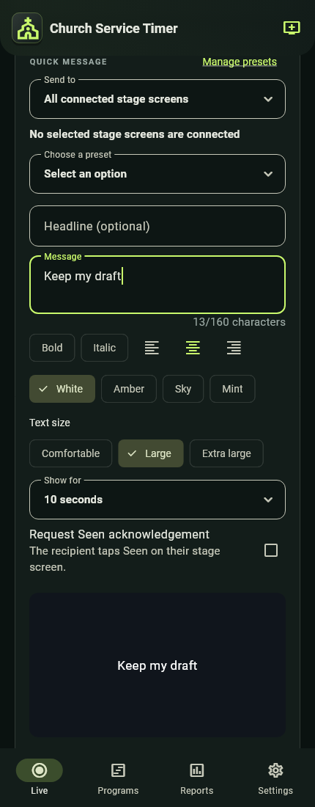

The recipients are fixed when you send. Newly joined or reconnected screens do not receive a replay of an earlier message. Other screens keep their normal output. When the message expires or you clear it, its recipients return to their current timer or preceding end/blank output. A segment change, manual cue, Blank, End service or disconnection can supersede the message.

**Seen means a person tapped Mark Seen.** A transport acknowledgement only says the app received data. If you require acknowledgement, watch the per-recipient status. Do not assume silence means agreement, and do not repeatedly resend without checking the recipient list.

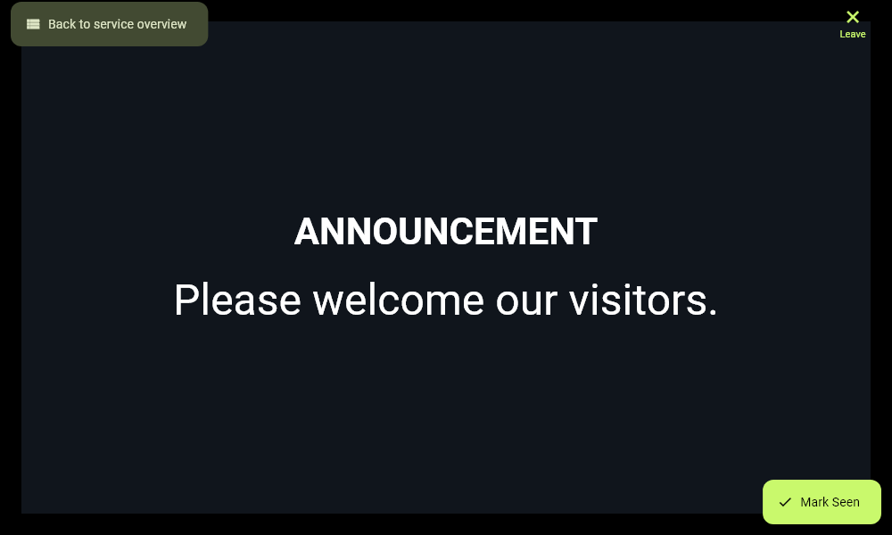

Use **Save as preset** or **Settings → Quick message presets** for repeatable messages with their formatting. Unsent Quick message drafts can be restored locally; restoring a draft never sends it. Sent messages are temporary and are not restored after restarting the app.

After End service, messages can still be sent while approved stage screens remain connected and this phone has control. The app asks you to confirm because the service has ended. Sending does not restart the service or change its report. Before any service has run, use **Test screen** for setup rather than a normal Quick message.

## 10 — Adjust the plan without losing control

Use **Service timing overview** to notice drift early. Its estimated finish assumes future segments use their allocations; pauses, overtime and manual advances can change the actual finish.

**Edit upcoming** changes only future segments in this running service. It does not rewrite the current/completed segments, saved program or historical reports. Confirm changes with the service leader before shortening important activities.

For a structured reduction, open **Recover time** from the Live rundown:

1. Enter how many minutes you want to recover.
2. Protect segments that must retain their duration.
3. Review each proposed before/after duration. Each remaining segment keeps at least one minute.
4. Choose **Apply reviewed adjustments** only after the proposal is suitable. If the service/control state has changed, review again.

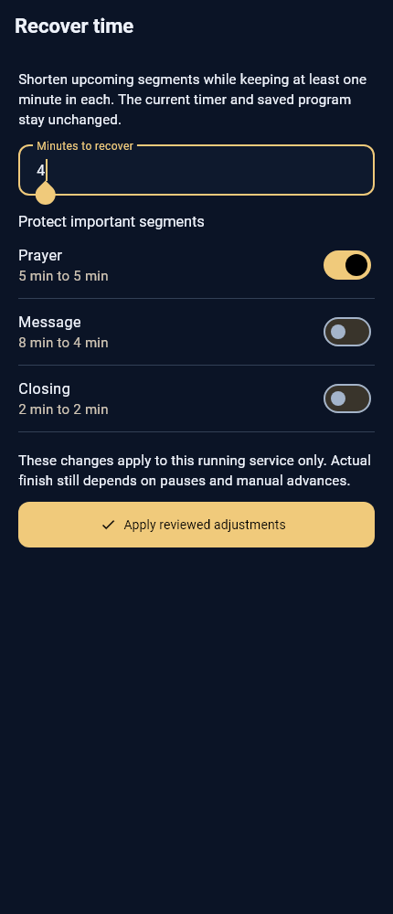

Recover time changes allocations; it does not automatically move to the next segment or guarantee a finish time. The current segment keeps running. Future program defaults remain unchanged.

After several comparable services, open **Reports → Timing insights**. The app requires at least three suitable observations and uses up to the five most recent comparable services for a program. It excludes rehearsals, incomplete/uncertain records, ambiguous segment names and paused time.

Suggestions use median active duration rounded up. In **Program editor → Learn from previous services**, select only the suggestions you want and **Apply to draft**, then Save. These are planning aids, not instructions to rush a speaker or evidence of why a service ran long.

## 11 — Finish and hand over cleanly

1. Confirm the service really is complete.
2. Choose **End service** and confirm.
3. Wait for the completed report to save. Live returns to the clean **Standing by** card with **Start service** and **View last report**; the active rundown and timing overview disappear.
4. Check the selected screen's program-specific end output. It remains connected. Blank/Unblank and Print Service remain available.
5. Open View last report, check the service date and segment timings, and export/print if required.
6. Stop sharing when the stage/viewer devices are no longer needed. Deliberately disconnect the LED if the equipment is being handed over or powered down.

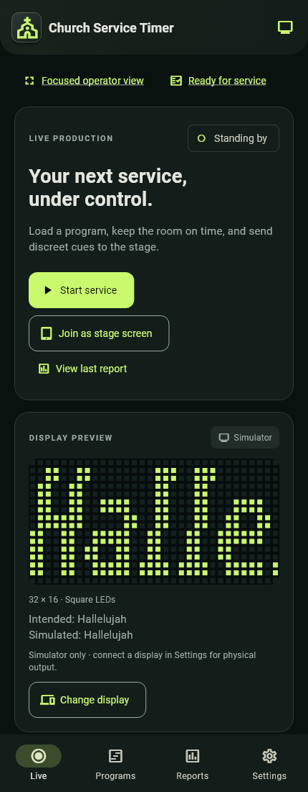

If saving fails, the app retains the completed information and offers **Retry saving report**. Retry rather than starting a duplicate service. It preserves the original finish time and saves one report; successful retry restores the welcome screen automatically. Pending save failure blocks service mutations. Do not clear app storage to remove the message.

An end screen belongs to the selected program. The default end screen in Settings seeds new programs; changing that default does not overwrite existing program-specific end screens.

## 12 — Read, export and print reports

Reports lists completed services as compact rows with their type, date and duration. Open a row for the segment breakdown and activity history. The Graph view helps compare records. Rehearsals are labelled so they are not confused with real service timing.

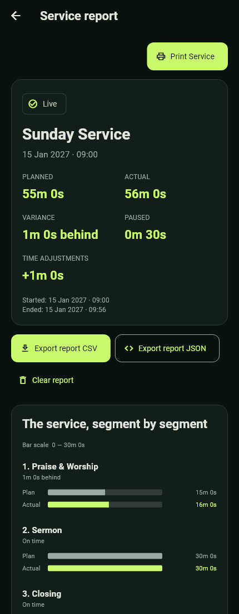

Read actual duration alongside planned and paused time. Activity records can help explain when an operator adjusted time, changed segment or experienced a send failure; they do not prove what a person on stage saw.

Export one record or all records as CSV/JSON using the available actions. JSON keeps richer report details. Clear one record or all records only after checking the confirmation; deletion has no report Undo. Export first if you need a permanent copy.

**Print Service** is available from program details, Live and report details. From a report, choose the historical service report or rundown. New records preserve the program snapshot, service date and church name used for that service, so editing today's program does not rewrite old speakers or notes. Older records may explicitly lack historical details.

Print choices:

| Option | Meaning |
| --- | --- |
| Stage copy | Excludes private notes. This is the appropriate starting point for distribution beyond the operator team. |
| Operator copy | Enables notes; you may still uncheck them before printing. Review the content before sharing. |
| Include church banner | Selected initially; uses the current configured banner. A historical service snapshot does not freeze the old image. |
| Church-name watermark | Checked by default. A faint bold diagonal church name is used when a name exists. An explicit opt-out is remembered. |
| Ink-saving | Suppresses banner and watermark for this output without erasing the stored watermark choice. |

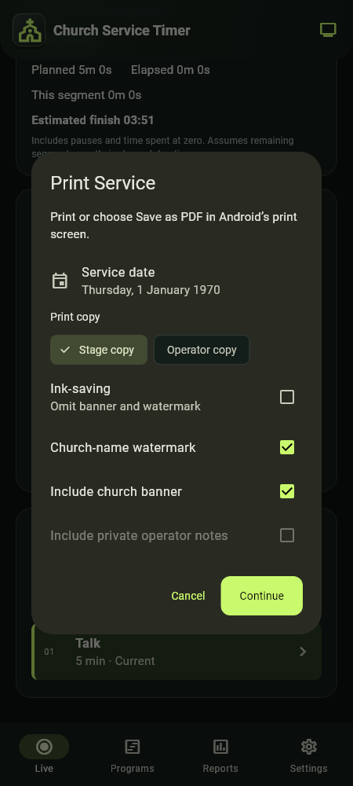

The PDF repeats table headings and reserves footer space on every page for **Church Service Timer · I-Proton** and **Page N of M**. The footer does not need its own page. Service date and the document's preparation date/time/timezone are separate. Rundowns omit Planned start; historical reports retain useful planned/actual/paused columns.

Continue to Android's print screen and select a printer or **Save as PDF**. Review the destination and final pages there. Printing a program before it has run offers a date selection. A PDF is an exported copy; later app changes do not update a file already shared.

## 13 — Make the workspace yours

Open **Settings → Church profile** to enter the church's name and choose a banner. Use a wide **3:1 image**, ideally **1200 × 400 px**, no larger than **5 MB**. The app crops it proportionally instead of stretching it. Keep essential details away from the edges because of cropping. A built-in banner is available if no custom image is selected.

The profile gives context to the Reports heading and printed documents. Individual reports retain their captured church name; the current banner is used when printing.

**Appearance** offers seven preset themes and a custom theme editor. Preview the choice, then Save; Cancel or Back discards the preview. Test readability in the actual room, including overtime and warning labels. A beautiful palette is not useful if the operator cannot distinguish a warning at a glance.

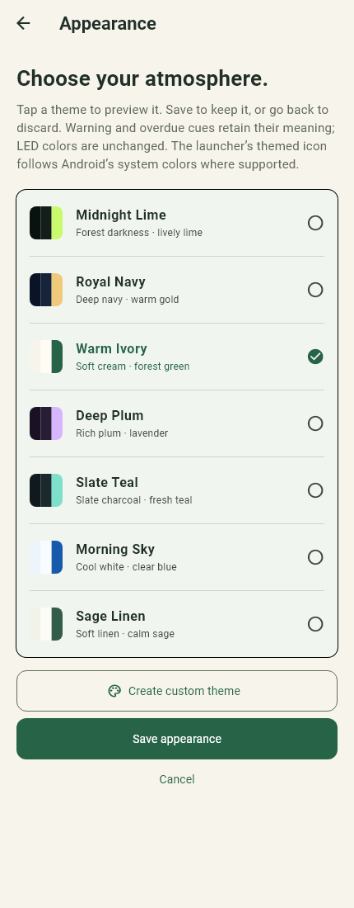

Other useful settings:

| Setting | Scope |
| --- | --- |
| At Zero | Shared by every service; normally 00:00 unless a message is configured. |
| Default end screen | Starting value for new programs; existing programs keep their own setting. |
| Warnings & alerts | Shared rules and phone notification behavior. |
| Stage cues | Shared prepared cue buttons and formatting. |
| Quick message presets | Saved rich messages for mobile stage screens. |
| LED preview shape | Square or circular visual cells; does not reconfigure physical hardware. |
| Keep screen awake | Prevents sleep while the app is visible; it is not a guarantee against force-stop or power loss. |
| About | Installed version, creator I-Proton and the consolidated open-source licenses. |

The simulator display profile is a preview assumption until supported hardware is connected and validated. Do not interpret a manually set preview width as a measurement of an unknown sign.

## 14 — Connection recovery and troubleshooting

Start with the destination badge, not repeated button presses. Identify whether the problem is the phone's network, the app's connection, a held output, or the receiver itself.

| Symptom | Check / next action |
| --- | --- |
| Arc counts, LED is unchanged | Confirm LED sign is selected, the phone is on sign Wi-Fi, and the connection is authenticated. Inspect held/stale status; review and Restore current output when offered. |
| App disconnects while Android remains on Wi-Fi | Allow its retry to the remembered controller. Use Reconnect display if required. Re-enter credentials if missing/rejected; do not change passwords as the first troubleshooting step. |
| LED counts after Wi-Fi is off | Expected for an accepted native countdown. Reconnect before expecting new cues, pause/resume or a new segment to reach it. |
| One brief blink at a change | Expected on the tested W2 during program replacement. Repeated blinking while a steady timer should run needs investigation. |
| Pairing host is not found | Same reachable network, host sharing enabled, no client isolation. Try QR if discovery alone fails. QR cannot fix blocked phone-to-phone traffic. |
| Mobile preview looks frozen/stale | Receiver may be disconnected. Keep its app open, check network and Saved devices, then reconnect. Do not treat stale output as a live countdown. |
| Cue command is rejected | Check who has control and whether the program, segment or selected cue changed. Refresh/review the current service instead of repeatedly pressing an old control. |
| Warning not visible on stage | Check enabled rule, time-remaining threshold, destination and connection. Intentional Blank suppresses stage warnings; all-screen Quick messages can take priority. |
| No notification sound | Check Android permission, channel sound, volume, Do Not Disturb and precise-warning access. Use Test notification sound. |
| Screen is blank but timer runs | Check for intentional Blank. Tap Unblank screen, or choose Show timer as appropriate. |
| Quick message send is disabled | Phone/tablet destination, sharing, approved synchronized recipients and control are needed. Before the first run, use Test screen. |
| Controller administration is disabled | Connect to sign Wi-Fi and authenticate the supported LED display; end the service and stop sharing. |
| Report save fails | Use Retry saving report. Keep the completed information; do not clear data or create a duplicate run. |
| Cannot find timing suggestions | At least three comparable completed services are needed. Rehearsals, ambiguous names and incomplete/uncertain records are excluded. |

The LED connection tolerates brief health-check misses before reconnecting. Retry delay rises from about two to thirty seconds. Within the same trusted active service, recovery restores the latest intended output against the original deadline; it does not replay every missed update.

**Deliberate Disconnect, Forget display, or another output selection stops LED retries.** A saved credential does not override that choice. Restarting the app, uncertain timing, a long absence or an existing output hold can require review before restoration.

For an interruption during worship: keep one responsible operator in control, establish what the stage is actually seeing, restore connectivity, check the timer against the real activity, and restore current output once. A second person should not open another independent LED app and compete for the sign.

## 15 — Protect data and manage the LED device

Use **Settings → Backup & restore → Export backup** before changing phones or replacing a setup. Backups include saved programs, cues, reports and preferences, including the reduced church banner. Keep exports containing private notes in an appropriate place.

Restoring replaces saved data on the target phone after review. Export its current setup first if it should be kept. Portable backups do **not** transfer an active clock, phone permissions, LED credentials, pairing approvals, local editing drafts or a live display connection. Reconnect and approve equipment again as needed.

**LED device management is for the sign, not the phone or tablet.** Its Open Wi-Fi and Connect/Reconnect LED display actions help reach the correct network and controller. Revealing a saved password shows the app's local copy; it does not retrieve an unknown current password from the sign. Saving a known Wi-Fi password locally does not change the sign's Wi-Fi configuration.

Changing the sign's Wi-Fi name or passwords requires a supported authenticated LED connection, the correct Wi-Fi, an ended service and stopped sharing. Reserve this for the equipment administrator outside a live service. Keep the current and intended new details available until reconnection verifies the change.

The administration setters have automated/packet validation, but physical password/Wi-Fi write-and-reconnect acceptance remains outstanding for this build. A controller acknowledgement is not proof that a new password works after reconnection. An uncertain result should be verified before retrying. Do not alter scan, polarity or firmware settings as part of normal operator onboarding.

For help, open **Settings → Feedback Center**. Enter a title, a clear description and your contact. Optional diagnostics can be reviewed before inclusion. The app opens a draft to **immanuelproton@gmail.com**; you must send it in your email app. **Copy feedback** is the fallback. No automatic support delivery or response time is promised.

Describe the app version, output type, steps, expected result and actual result. Avoid including passwords, pairing QR codes or private speaker notes. The feedback form is not saved after leaving/restarting, so copy important text before closing it.

## 16 — Trainer session and readiness checklist

Suggested coached session: 10 minutes explaining roles and output, 15 minutes of simulator practice, 15 minutes on the actual connected equipment, then 10 minutes of recovery and reporting. These are teaching estimates, not app timers.

### Before the service

- Confirm the installed version and the program, speakers, allocations and end screen.
- Choose the intended destination and confirm the physical screen with another person.
- Check phone power, network reachability and notification sound.
- Review shared warning thresholds and prepared cues with the service leader.
- Agree who hosts and who has control; name and approve receivers deliberately.
- Use **Ready for service** to review the app checklist. An isolated simulator test is not proof of physical delivery.
- Review stage-message recipients and screen groups; do not use a real congregation-facing screen for an unannounced test.

### During the service

- Watch both the current segment and the whole-service timing overview.
- Use Next segment when the real activity changes; do not rely on automatic advance.
- Read confirmation dialogs before time adjustments or ending.
- Keep cues concise; target rich messages carefully and distinguish Synced from Seen.
- Check any disconnected/stale/held indication before assuming output is current.
- Keep the host powered; control handover does not move the service to another phone.

### After the service

- End once, confirm the report saved, and inspect View last report.
- Print or export the right copy; inspect private-note inclusion before distribution.
- Stop sharing and deliberately disconnect equipment when appropriate.
- Record an issue or useful program improvement while it is fresh.
- Back up the configuration after significant changes.

### Competency drills

Ask the learner to demonstrate each task with the simulator first:

| Drill | Successful result |
| --- | --- |
| Load without starting | Explains Ready and starts only after checking the destination. |
| Pause versus blank | Shows that Pause stops time while Blank only hides output. |
| Cue and return | Sends a prepared cue and returns to the lower current countdown. |
| Overtime transition | Recognizes red overtime and starts the next segment correctly. |
| Message targeting | Names the recipients, sends a temporary message and explains Seen. |
| Recover time | Protects a segment, reviews changes and explains that the saved program is unchanged. |
| Connection interruption | Distinguishes network from app state and reviews before restoring output. |
| Close and print | Saves a single report and produces a Stage copy without private notes. |

The learner should be able to perform the routine controls and explain when to call the experienced operator. Repeat the exact church equipment setup before independent operation; a simulator pass alone is not the equipment check.

## 17 — Quick reference and knowledge check

| Term | Remember it as |
| --- | --- |
| Program | The reusable plan, not the running service. |
| Segment | One timed activity inside a program. |
| Ready | Loaded and reviewed, but not counting yet. |
| Host | The phone that owns the service clock, saving and output. |
| Stage cue | A prepared one-tap instruction with saved formatting. |
| Quick message | A richer temporary message for selected mobile stage screens. |
| At Zero | Shared output behavior when a segment expires. |
| End screen | The selected program's output after End service. |
| Controller accepted / Synced | Data acknowledged by the receiver; not optical verification. |
| Seen | An explicit human acknowledgement on a recipient stage screen. |
| Disconnect | Pause access/connection without necessarily forgetting saved identity. |
| Forget | Remove saved approval or credentials; setup is needed again. |

### Check your understanding

1. If the main arc moves, does that prove the LED sign is current? **No. Check connection/acknowledgement and the physical output.**
2. Does Blank screen pause the countdown? **No. It hides output while time continues.**
3. A ten-minute segment has a warning at 01:30. When does it trigger? **At one minute thirty seconds remaining, normally eight minutes thirty seconds after starting.**
4. Will a newly reconnected receiver replay a Quick message sent earlier? **No. Recipients are fixed at send time and missed messages are not replayed.**
5. Does changing the default end screen update all saved programs? **No. Edit an existing program's own end screen.**
6. Can a second operator take control just by pairing? **No. The host must approve it and grant control explicitly.**
7. What do you do if End service cannot save its report? **Use Retry saving report; preserve the completed information.**
8. Should a Stage print copy include private notes? **No. Operator copy is a separate deliberate choice.**

### Current scope

This guide covers Android 0.18.0. Desktop/iOS releases and universal LED compatibility are not provided by this build. The original Matrix glyphs and square-matrix glyphs are unchanged. Tinos is bundled; installed/imported font loading is not part of the workflow.

Physical checks have established the supported W2 countdown, expected one-blink transitions, scrolling warnings returning to the current timer, and Next segment after overtime. Full-service endurance, power-loss acceptance and controller administration writes still require controlled hardware validation. New 0.18 features passed automated checks; hands-on testing of that release remains the user's responsibility.

The online handbook and this Markdown guide are training materials, not a remote-control interface. Nothing in the handbook can connect to a sign, start a service or send a stage cue.
