# Church Service Timer — operator teaching guide

For app **0.39.0** on Android and Windows · Prepared **24 November 2026** · Creator **I-Proton**

This handbook teaches a new operator to prepare a program, run its timer, communicate discreetly with the stage, recover from common interruptions, and close the service with a useful report. Keep it beside the phone or the PC during your first rehearsal. Screenshots use example data from automated app previews; they are illustrations, not evidence that a particular physical display is connected.

**This handbook is for 0.39.0.** What 0.39.0 adds is listed at the top of the [release notes](release-notes.html). On a phone or PC still on 0.38.0 or earlier, those parts of this handbook do not apply until you update.

**The same app runs on a phone, a tablet and a Windows PC.** Programs, reports, settings and backups are the same everywhere. Where a step differs, this guide says "tap" for a phone or tablet and "click" for a PC, as the app itself does.

**Start with a simulator rehearsal.** Move to the church's actual equipment with an experienced operator before running a service alone. The app has tested support for one specific LED controller; reliable use still depends on the device, the network and the stage equipment.

## 01 — Understand the workspace

**A Program is a saved plan. A service is one run of that plan.** Editing a saved program prepares a future run. Adjusting a running service does not rewrite the saved program or old reports.

On a tablet or a PC the app has six main places, in this order: **Live, Slides, Screens, Programs, Reports, Settings**. They sit in a side rail, or across the top of the window, depending on the layout. What you use during a service comes first. On a phone there are five tabs along the bottom: **Live, Slides, Programs, Reports, Settings**. On a phone, **Screens** is a button on Live instead.

| Tab | Use it for |
| --- | --- |
| Live | Start and operate a service or a Quick timer, inspect output, send cues and messages, share to screens or join a service. |
| Slides | Keep song words, Bible verses and announcements in a Library, search the Bible, and show them on the screens. See [Show words with Slides](#15-show-words-with-slides). |
| Screens | One page for every screen: sort them into groups, choose what each group shows, and save scenes. Tablet and PC only; on a phone it is a button on Live. See [Choose what every screen shows](#06-choose-the-right-display). |
| Programs | Create reusable plans, arrange segments, add speakers and private notes, choose what each program shows when it ends, keep a segment library and version history. |
| Reports | Review completed services, compare durations, add review notes, export, share and print records. |
| Settings | Church profile, appearance, desktop or tablet layout, warnings and alerts, display settings, stage cues, Quick message presets, Screens & devices, LED device management, backups, Settings PIN and About. |

### The top of Live

| Part | What it does |
| --- | --- |
| Logo or mark, top left | Your church logo, or the built-in ring-and-cross mark. Select it to open the church profile. |
| App or service name | The loaded or running service, or Church Service Timer when none is loaded, with your church's name under it. On Slides, Screens, Programs, Reports or Settings, select either name to go straight back to Live, whether or not a service is running. Lock controls still stops it. |
| Display chip | Where the stage output is going, for example **LED simulator**, **Stage simulator**, **LED sign** or **Stage screens**. Select it to open **Choose display**. Choosing and connecting a display are separate from starting a service. |
| Screens | Opens the Screens page. On a phone, a tablet and in Classic it is a button under the display preview, beside **Change display** and **Slides**. In the other PC layouts it is an icon in the top bar. |
| Full screen | During a service or a Quick timer, shows the stage countdown on this device's own screen. On a phone the button is under the display preview instead. See [Second screen and full screen](#09-second-screen-and-full-screen). |
| Mini timer | On a PC only, and on every page: shrinks the app to a small window that stays above your slides. See [Run the service from a PC](#11-run-the-service-from-a-pc). |
| Lock | During a service, locks every control and key until you **Hold to unlock**. |
| **⋮** menu | **Focused operator view** and **Ready for service**. On a PC it also holds **Mini timer**, **Full screen**, **Commands** and **Keyboard shortcuts**. |

### Three readings to learn first

| Reading | What it tells you |
| --- | --- |
| Main progress arc | The operator's current segment time, allocation and warning/overtime state. |
| Display preview | What the selected output is simulating or last acknowledged. Check its badge and any stale or "Output paused after an interruption" indication. |
| Timing status and Service timing overview | Progress against the whole plan ("On time", "45 min behind" and so on); its estimated finish can change with pauses and manual advances. Select the status line for the full overview. |

**A running arc does not prove the sign is receiving updates.** Likewise, Controller accepted or Stage screens received means the receiving system acknowledged data; it is not a camera view of what a person can see.

Use the labels as well as colour: normal time, warning and overtime have different meanings. In Royal Navy, the normal arc is green while the surrounding theme remains gold; warning is amber and overtime is red.

### Moving around on a phone or tablet

Tap the bar, or swipe left or right anywhere on the page. Each tab keeps its place when you come back to it. While a service is loaded or running, Live stays put: leave it with the bar, and swipe back to it from any other tab. A running-service bar on the other tabs, and **Return to Live** on Settings pages, take you straight back. Swiping is off while the controls are locked or while programs or reports are being selected; a sideways list or slider still scrolls as before, and a swipe from the very edge of the screen is still Android Back. With reduced motion on, the new tab appears at once.

The **Back** key on Slides, Programs, Reports or Settings returns to Live. On Live it asks you to press Back again before leaving the app; during a service it asks for confirmation and explains that the timer keeps running.

### Moving around on a PC

In a window at least 1200 wide and 600 tall, Live fills the window with a **desktop layout**. A new install starts in **Mission control**, shown below. Click a tab in the side rail or the header, or click the app or service name at the top left, or your church's name under it, to return to Live. A smaller window uses the phone and tablet layout, and so does the focused operator view. A 10-inch or larger tablet held sideways gets the same layouts; a phone never does.

The timer, cues, display preview and rundown are the same ones the phone uses, arranged for a wide screen. The layouts are described in [Run the service from a PC](#11-run-the-service-from-a-pc), and the keys in [Keyboard, clicker and Commands](#12-keyboard-clicker-and-commands).

### Three safety rules that hold everywhere

1. **Every timer action asks you to confirm before anything changes.** That is true of a button, a key, a clicker on a PC and the Commands list.
2. **Lock controls blocks all input.** Buttons and keys do nothing until you **Hold to unlock**. Locking never pauses the timer.
3. **Blank screen hides the output; it does not pause the service.**

## 02 — Get started on Android

The app runs on phones and tablets with **Android 7.0 or later**.

1. On the phone, open the [download page](https://github.com/ImmanuelOkose/church-service-timer-guide/releases/latest) and download the file ending in `.apk`. From 0.35.0, the lines under each release's notes say which file is for Android and which is for Windows, and how to install each.
2. Open the downloaded file. Android asks whether to allow installs from your browser or file manager; allow it for this install.
3. Open **Church Service Timer**. It starts on Live with the **LED simulator**, so nothing reaches a real stage until you choose a display.
4. Check the version in **Settings › About**. This guide describes 0.39.0. An earlier version does not have what the [release notes](release-notes.html) list under 0.39.0, so update it first.

### Allow what the app asks for

The app asks for each of these only when it is needed. The first three protect warnings during a service.

| Android asks | Why it matters |
| --- | --- |
| Notifications | Shows warnings on the phone, and the lock-screen card with the countdown, Pause and Next. |
| Precise timing | Lets a warning arrive at its exact second. |
| Battery optimisation | Stops Android pausing warnings while the screen is off. **Ready for service** shows a Battery row with **Allow**. |
| Nearby devices or location | Lets the app find and rejoin the LED sign's Wi-Fi. |
| Camera | Only for **Scan QR code instead** when joining a service. |

Settle these before the service, not during it. **Live › ⋮ › Ready for service** lists anything still outstanding.

### Keep every device on the same version

Update every phone, tablet and PC your team uses together.

- Program files, backups and sent programs saved by 0.28 or later cannot be opened by 0.27 or earlier.
- A backup or program file made by 0.34 needs 0.34 or later to open if it holds any of the new cue settings: a screen colour, a banner, **Wrap long text**, its own screen speed, one of the new effects, long text with Flash or Pulse, or more than six cues. The cues a new install starts with use several of these.
- A backup or program file in which a program, or the default, is set to end on the **Clock** needs 0.35 or later to open. Earlier versions need an end screen and refuse the file. Programs and backups you already have are unchanged.
- A backup that holds songs, Bible verses or announcements in its Slides Library needs 0.38.0 or later to open. A backup with none, and every program file, is unchanged, so earlier versions open them as before.
- Screens, groups and scenes need 0.39.0 on the host. Groups and scenes travel in backups when you have scenes, and a backup that holds scenes needs 0.39.0 or later to open. Which screen is in which group stays on each device. A paired phone or tablet still on 0.38.0 or earlier does not know **Slides and timer** and shows the countdown instead.
- Slides need 0.38.0 on the host. A paired phone or tablet or a web screen still on 0.37.0 or earlier does not know slides, and keeps showing the countdown. See [Show words with Slides](#15-show-words-with-slides).
- Nothing in 0.37.0 changed programs or backups.
- The new stage looks need 0.37.0 on the screen as well as on the host (see [What a stage screen looks like](#06-choose-the-right-display)). A paired phone or tablet still on 0.36.0 or earlier shows the plain clock, not the flip clock, and, set to **Up next only**, it shows the segment name under the timer. A web screen always matches the app. A new screen with an older host shows the flip clock in white on black, with its own day and date.
- A paired phone or tablet still on an earlier version shows every cue in white and full screen, at the LED sign's speed, with the new effects as steady text and the next segment's name without its speaker and length.

### Check for updates

**Settings › About › Check for updates** asks GitHub whether a newer version has been published. It checks when you tap the row, and sends nothing about you or your church. It never checks by itself unless you switch on **Check for updates automatically**, described below.

| The row says | What to do |
| --- | --- |
| You have the latest version | Nothing. |
| Version … is available | Tap **Open the download page**, download the `.apk` and install as above. A phone or tablet never downloads or installs an update by itself. The version you have keeps working, so update when it suits you, not during a service. |
| Could not check. This device may be offline. | Try again with an internet connection. The app itself never needs the internet to run a service. |

A test (beta) version, such as 0.36.0-beta.1, is never offered as an update. You will not see one unless you were given it on purpose; if you are running one, you are still offered the real version that follows it.

Installing a newer version over the old one keeps your programs, reports and settings. Export a backup first all the same; see [Protect data and manage the LED device](#21-protect-data-and-manage-the-led-device).

### Check for updates automatically

Under Check for updates is a switch, **Check for updates automatically**. It is off to begin with, so the app contacts GitHub only when you ask.

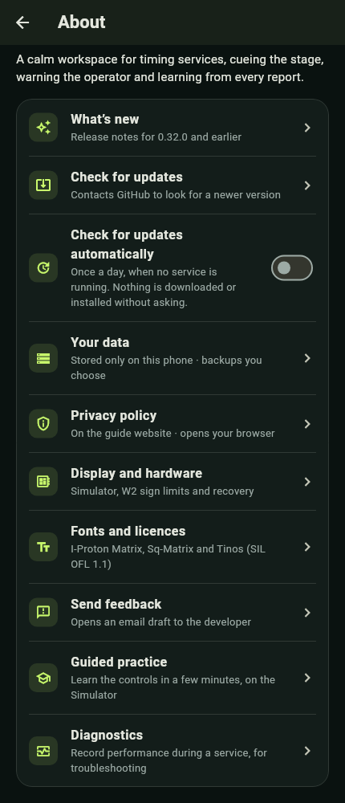

With the switch on:

- The app makes the same check by itself, **at most once a day**: about 30 seconds after it opens, and again when it comes back to standing by.
- **It never checks during a service**, a Quick timer, a rehearsal, guided practice or Check this service, while the controls are locked, or on a device that has joined another device's service.
- When a newer version has been published, Live shows a small notice while standing by, such as "Version 0.36.0 is available".
- If the check cannot reach GitHub it says nothing and tries again the next day. Tapping **Check for updates** still says when it could not check.

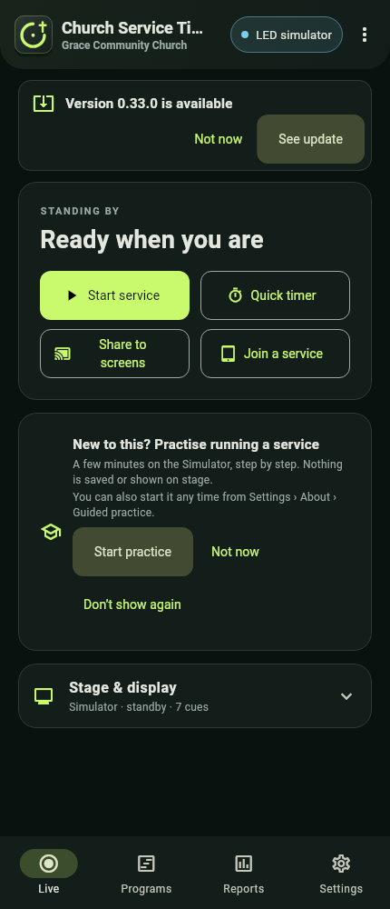

| On the notice | What it does |
| --- | --- |
| **See update** | Opens Check for updates, after the Settings PIN if one is set. From there you update as described above. |
| **Not now** | Hides the notice for that version. A newer version shows it again. |

**Nothing is downloaded or installed without asking.** The notice only tells you; you still choose when to update. It never shows during a service, on a stage screen, on the second screen or in full screen. The switch, and what the last check found, are kept on that phone, tablet or PC, and are not part of backups or program files.

### After you update

The first time the app opens on a newer version, Live shows a small notice while standing by: **Updated to 0.36.0**.

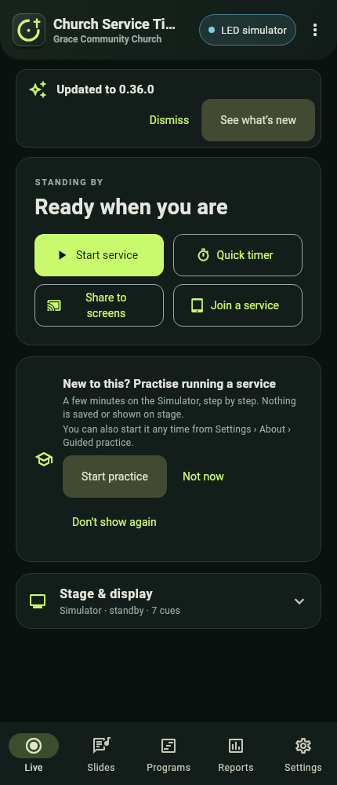

| On the notice | What it does |
| --- | --- |
| **See what's new** | Opens the What's new page, after the Settings PIN if one is set. |
| **Dismiss** | Hides the notice. |

- **It shows once for each version.** Opening it or dismissing it counts as seen.
- **A new install shows nothing.** So does going back to an older version.
- **It stays out of the way.** It never shows during a service, a Quick timer, a rehearsal, guided practice or Check this service, with the controls locked, while joined to another device's service, or on a stage screen, the second screen or full screen. If a service is running when the app starts, it waits for the next time the app is standing by.
- **If a newer version is also available,** that notice shows first, and this one after it is dismissed.
- Which version you last saw is kept on that device only, not in backups or program files. Nothing is sent anywhere.

## 03 — Get started on Windows

Church Service Timer also runs on a **Windows 10 or 11 PC** (64-bit), so a service can be run from the laptop at the media desk. It is the same app as on the phone: the same programs, reports, themes and settings. A backup made on a phone restores on the PC, and the other way round.

The Windows app is new. Rehearse on the actual PC, with its projector or screens plugged in, before you rely on it in a service.

### Install it

1. On the PC, open the [download page](https://github.com/ImmanuelOkose/church-service-timer-guide/releases/latest) and download the file ending in `windows-setup.exe`. From 0.34.0, each release lists the Windows installer and its checksum beside the Android `.apk`. An earlier release may list only the `.apk`. From 0.35.0, the lines under each release's notes say which file is for Windows, what to do if Windows shows **Windows protected your PC**, and that a PC already on 0.34.0 or later can use **Download and install** instead.
2. Run the installer. Windows may show **Windows protected your PC**, because the installer is not code-signed. Click **More info**, then **Run anyway**.
3. Follow the installer. It installs for your Windows account, so it does not need an administrator password. Tick the desktop icon if you want one.
4. Start **Church Service Timer** from the Start menu.

**The installer has a new look.** From 0.39.0 the setup window is dark and matches the app: a picture of the stage clock beside the Welcome page, a short plain explanation of what the app does, the app icon on the inner pages, and, while the files copy, a slideshow of six scenes with a line under each. The last page says "Church Service Timer is ready" and points to the guide. What is installed, where, and how updates and removal work are unchanged, and a silent install shows none of it.

Some releases also list a file ending in `windows-x64.zip`. Unzip it anywhere and run `church_service_timer.exe`; nothing is installed.

### The first time it opens

The app opens on Live with the **LED simulator**, so nothing reaches a real stage yet. In a wide window you see the Live home: your programs on the left, the chosen program's order of service in the middle, and the display preview and cues on the right.

- **The window is yours to arrange.** Resize it or move it to another monitor. It reopens where you left it.
- **Only one copy runs.** Starting the app again brings the open window to the front.
- **Windows may ask about the network.** The first time you share to screens, Windows Defender Firewall asks once whether to allow the app. Allow it on private networks, or phones and browsers cannot reach it.
- **Your data stays when the app is removed.** Uninstalling leaves your programs, reports and settings in place for the next install.

### What is different from the phone

| On a PC | What to know |
| --- | --- |
| Click, not tap | The app's own wording changes to "click", and "press and hold" becomes "click and hold". |
| Keyboard | Space, Page Down and other keys run the service. Every timer key asks first. See [Keyboard, clicker and Commands](#12-keyboard-clicker-and-commands). |
| Files | Import, export, backups and reports use the usual Windows Open and Save windows. Where the phone says Share, the PC saves the file where you choose. |
| Drag and drop | Drag one program file (`.json`) or spreadsheet (`.csv`) from a folder onto the window to import it. It opens in the usual review, and nothing is saved until you confirm. A drop is refused while a service is running or the controls are locked. |
| Open with | Right-click a program file, choose **Open with**, then Church Service Timer. |
| Printing | **Print** opens the Windows print window. |
| It stays awake | While a service runs, or screens are shared, the PC does not go to sleep. Whether its monitor stays on follows **Keep screen awake**: by default, while a service is running, so it may turn off when nothing is running. See [Keep screen awake](#19-make-the-workspace-yours). If the PC does sleep, for example when the lid is closed, the timer is still right when it wakes. |
| Closing the window | During a service the app asks **Close during the service?** Closing stops the timer on stage screens and the LED sign, and stops warnings. The service is saved, and opening the app again carries on from the clock. |
| Second screen | A projector or monitor plugged into the PC can show the stage full screen, with no network or pairing. See [Second screen and full screen](#09-second-screen-and-full-screen). |
| LED sign Wi-Fi | Join the sign's Wi-Fi in Windows' own Wi-Fi settings; the app does not switch networks for you. The PC can be on a network cable and the sign's Wi-Fi at the same time. |
| Not on a PC | Scanning a QR code with a camera (join with the six-digit code instead; the PC can still show a QR code for phones) and the phone's battery settings. |

### Warnings are silent on a PC

At each warning a Windows notification appears and the app's taskbar button flashes. **It makes no sound**, because a PC is often plugged into the sound system. **Click the warning** and the app comes to the front on Live, with the service still running exactly as it was; a minimised window is restored.

Under **Settings › Warnings & alerts › Alerts on this computer**:

| Row | What it does |
| --- | --- |
| **Windows notification at each warning** | **Test** shows one now. Windows holds notifications back while **Do not disturb** is on, and turns that on by itself when the screen is duplicated to a projector. The taskbar button still flashes. |
| **Play the Windows notification sound** | Off to begin with. Turn it on only if you want each warning to play the sound, through whatever the PC's sound goes to. |
| **Show the countdown in the notification area** | On to begin with. See below. |

These three choices are kept on that computer and are not part of a backup.

### The countdown beside the Windows clock

While a service or Quick timer runs, the app adds its ring-and-cross icon to the notification area, beside the clock.

- **Point at the icon** to read the time, for example "Sermon · 12:34 left", "Sermon · 01:10 over" or "Paused · Sermon · 12:34". This works while your lyrics or slides program is in front.
- **Click the icon** to bring the app's window forward.
- The icon only shows the time. It cannot change the service, and it goes when the service ends.
- Windows 11 puts new icons behind the small arrow beside the clock. Drag the icon out onto the taskbar to keep it in view.

If the same PC runs your slides, the **Mini timer** keeps the countdown and three buttons above them; see [Run the service from a PC](#11-run-the-service-from-a-pc).

### Update the PC

**Settings › About › Check for updates** checks when you click it, as on the phone. When a newer version has been published, a PC can fetch and start the installer for you.

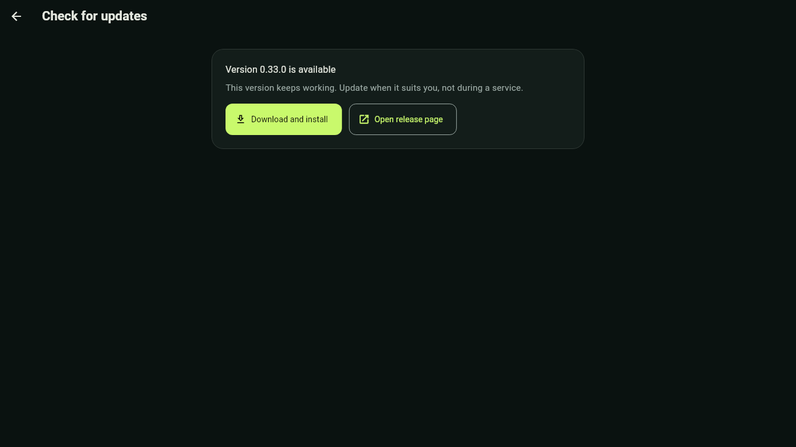

1. Click **Download and install**. A progress bar shows the download, and **Cancel download** stops it.
2. The app checks the file against the size and checksum published with the release. A file that does not match is deleted and nothing is installed.
3. The app asks "Install version …?". Click **Close and install**. Anything you are editing is saved first and offered again when the app reopens.
4. The app closes and the installer opens in its own window. Windows may show **Windows protected your PC**; click **More info**, then **Run anyway**.
5. Finish the installer and start the app. Your services, programs, reports and settings are kept.

| What you see | What it means |
| --- | --- |
| Only **Open release page** | That release has no Windows installer. Open the page and download whatever it lists. |
| "Finish or end the service first" | An update cannot be installed during a service. End the service, then try again. |
| The download is refused | The file did not match what was published. Try again later, or use **Open release page**. |

Nothing is downloaded or installed by itself. Update between services, never during one, and update the team's phones and tablets to the same version.

**The text looks a little different.** From 0.36.0 the app draws its own text in the Roboto font on every PC, as it already did on Android. Letters look slightly different from before, and labels, headings and buttons take the same room on a PC as on a phone, so a label no longer wraps or is cut short in a narrow window. Nothing in your programs, backups or settings changes.

**Let the PC check by itself, if you like.** Under Check for updates, **Check for updates automatically** is off to begin with. Switched on, the PC checks at most once a day, and never during a service. It works as on a phone; see [Get started on Android](#02-get-started-on-android).

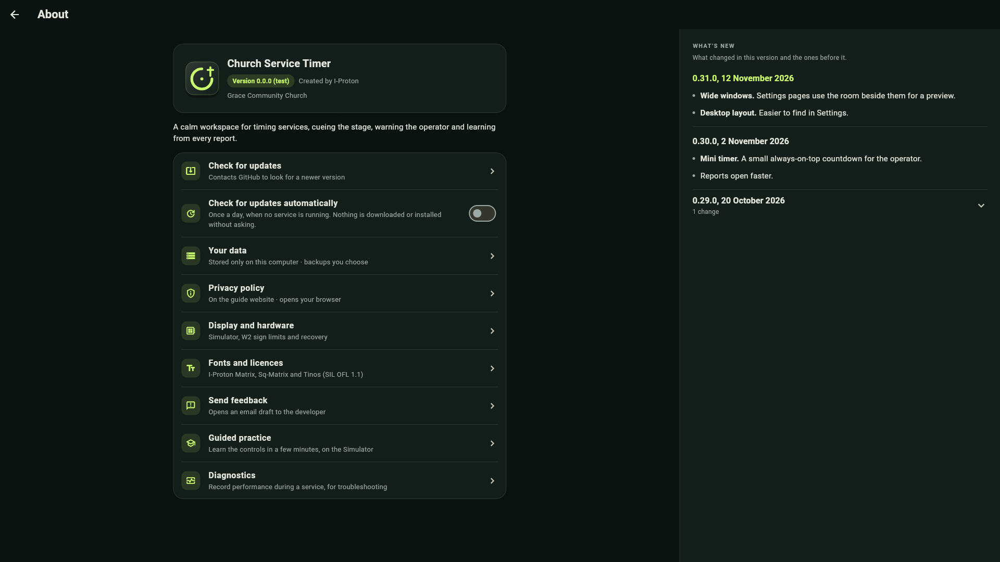

When the automatic check finds a newer version, the Live home shows a notice while standing by.

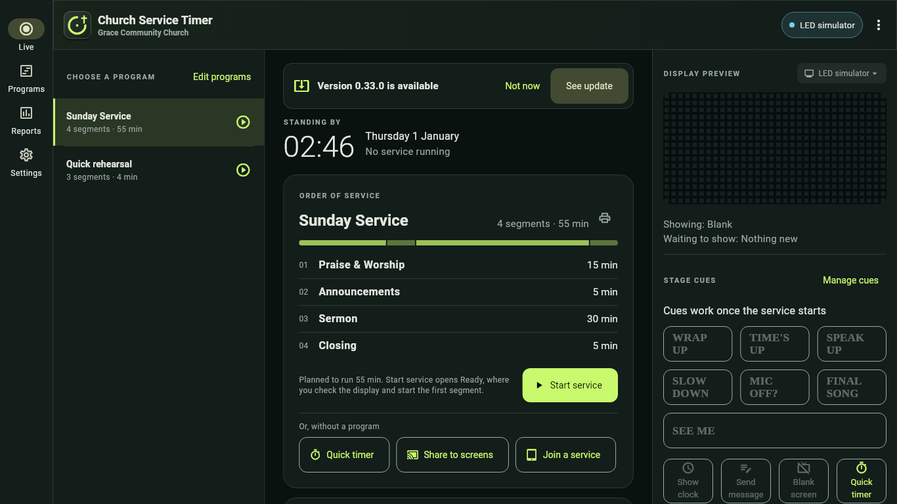

- **See update** opens Check for updates, after the Settings PIN if one is set. **Download and install** is there, and still asks before anything is installed.
- **Not now** hides the notice for that version. A newer one shows it again.
- The notice never shows during a service, on the second screen or in full screen.

**After an update,** the Live home shows a second notice once: **Updated to 0.36.0**, with **See what's new** and **Dismiss**. It works as on a phone; see [Get started on Android](#02-get-started-on-android).

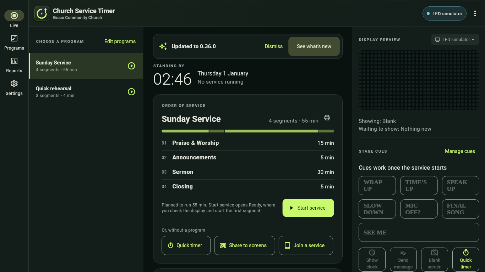

## 04 — Your first rehearsal

Allow about 15 minutes. Use the simulator so no practice cue reaches a real stage.

**The quickest start is guided practice.** On a new install, Live shows a card: "New to this? Practise running a service". Choose **Start practice**, **Not now** (hides it until the app is next opened) or **Don't show again**. You can start it any time from **Settings › About › Guided practice**.

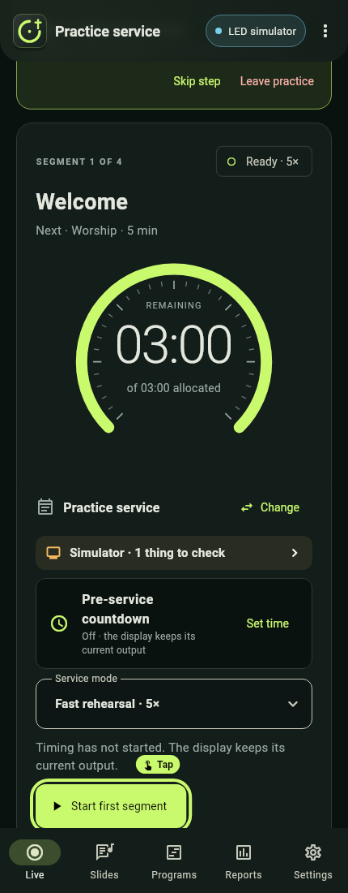

- Practice loads a built-in 17-minute **Practice service** that runs at 5× speed on the Simulator, so nothing appears on stage. It is never added to Programs, saves no report and leaves your programs, reports and settings alone.
- If another display is in use, practice asks **Practise on the simulator?** before switching, and offers to switch back when practice ends.
- A coach card lists eight steps, ticked off as you do them in any order: start, pause and resume, add and remove 2 min, next and Undo, a cue and the timer, blank and unblank, see overtime, and end. A pulsing ring and a small "Tap" badge show which control the current step needs; it never blocks a tap.
- Use **Skip step** or **Leave practice** at any time. At the end, a summary such as "8 of 8 steps done · about 4 min" offers **Practise again**, and About shows when this device last practised.
- Practice cannot start while a service is loaded or running, or on a device that has joined another device's service.

Then try the full workflow yourself. A step that says "tap" is a click on a PC.

1. Install the app; see [Get started on Android](#02-get-started-on-android) or [Get started on Windows](#03-get-started-on-windows). Check **Settings › About** for its version. This guide describes 0.39.0.
2. Tap the display chip at the top of Live and choose **Simulator**. The chip then reads **LED simulator**, or **Stage simulator** if you have chosen to simulate a stage screen.
3. On Live choose **Start service**, then load **Quick rehearsal** (a Pinned or Recent program card on Live loads straight away). In a wide window on a PC, click the program under **Choose a program**, then **Start service**. Loading a program enters **Ready**; it does not start the countdown. On a PC, Ready shows your layout's own timer with the first segment's full time, not counting.
4. Review the first and next segment. While Ready, choose **Service mode**: **Live timing · 1×** or a **Fast rehearsal** speed. A program's Service/Rehearsal grouping is not its speed setting. **Change** swaps in another program without leaving Ready.
5. Select **Start first segment**. When the display is connected and nothing needs attention, the service starts at once and **Undo start** is offered for 8 seconds; otherwise a confirmation explains what to check.
6. Tap **Pause**, confirm, and observe the held timer. Tap **Resume**, then try **Custom** to add or remove minutes and seconds. Read the proposed result before confirming.
7. Open **Stage & display** and tap one prepared **Stage cue**, such as WRAP UP. It sends immediately. The countdown continues underneath. Choose **Show timer** to restore the current timer, not the original starting time.
8. Tap **Blank screen**, then **Unblank screen**. Blanking hides output; it does not pause the service.
9. Use **Next** (**Next segment** on a tablet or PC) when the current activity is finished. If this was accidental, use **Undo** while it is available and review the confirmation.
10. Allow a segment to reach zero. Observe the operator's red overtime and the shared At zero display behaviour. Reaching zero does not automatically advance the program.
11. Choose **End service** and confirm. Live returns to Standing by after the report saves. On the **Last service** card, tap **View last service report**.
12. Tap **Quick timer** on Live, choose 5 min and start it. Notice there is no Ready step. Tap **End timer** when you have seen it count. See [Operate a live service](#10-operate-a-live-service) for details.
13. On a PC, run one more rehearsal from the keyboard. Press **Space**, then **Space** again, to pause. Press **Page Down** twice for the next segment. Press **?** to see every key.

**Before a real service, let the app run through it for you.** **Check this service** plays a whole program on the Simulator in about 18 seconds and lists every warning that will fire. See [Build a reusable program](#05-build-a-reusable-program).

**You are ready for the next lesson when you can explain:** Ready versus running, Pause versus Blank, Show timer versus Next, a Quick timer versus a service, and a display acknowledgement versus a physical check.

Fast rehearsal accelerates simulated service time (5×, 10×, 30× or 60×). Reports identify it as rehearsal timing, and duration insights exclude rehearsals. Use normal speed for the supported physical LED countdown.

## 05 — Build a reusable program

Open **Programs** and tap **New program**. (With no programs at all, Programs offers **Create program** and **Import**.) In **Program editor**, give the plan a useful **Program name**; “Youth sunday” is the example placeholder, not a mandatory name.

1. Choose Service or Rehearsal as its **Program group**.
2. Use **Add segment** for each activity, in the order it will happen. Enter a **Segment name** and set its duration in minutes and seconds, for example 5 min 30 s. Each segment stays within 59 min 59 s.
3. Add a **Speaker (optional)** and **Private operator notes** where useful: microphone changes, music cues or an agreed finish instruction. Notes are never shown on the sign.
4. Turn on **Protect duration** for a segment that time recovery must not shorten. A segment can also name a **scene**, so the screens change by themselves when it starts; see [Choose what every screen shows](#06-choose-the-right-display).
5. Reorder segments using the drag handles ("Drag the handle to reorder" appears once there are two or more).
6. Review the **When the service ends** card. A new program starts on **Clock**. Choose **End screen** instead if you want words; see below. The end screen reads "Uses the current default" until you give this program its own.
7. Choose **Create program** for a new plan, or **Save changes** after editing.

Example practice plan:

| Segment | Duration | Speaker / private preparation note |
| --- | --- | --- |
| Welcome | 2 min | Host · have microphone 1 ready. |
| Worship | 5 min 30 s | Worship lead · confirm final song with the team. |
| Message | 8 min | Speaker · send the agreed wrap-up cue. |
| Closing | 2 min | Host · confirm announcements before closing. |

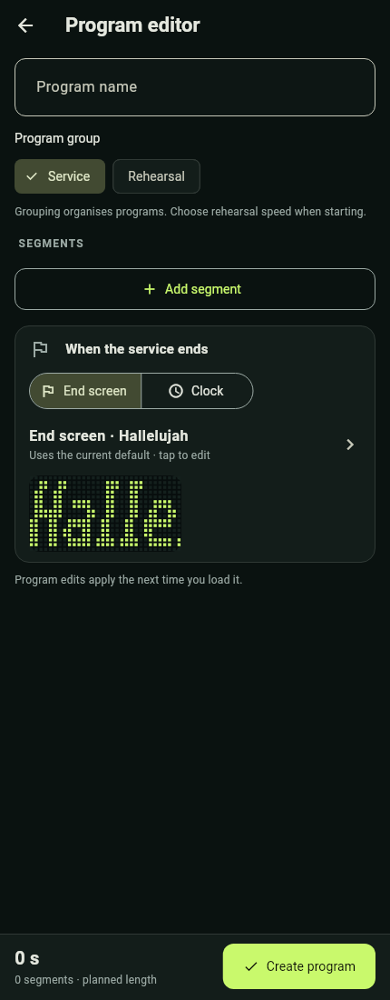

**When the service ends.** Each program chooses what every display shows after **End service**.

| Choice | What the displays show when the service ends |
| --- | --- |
| **End screen** | The program's end screen text, "Hallelujah" to begin with if you choose it. Tap the row under the switch to edit its text and style. |
| **Clock** | The time of day, in the 12 or 24-hour format you chose. The card says "No end screen. When you end the service, the sign and stage screens show the clock." |

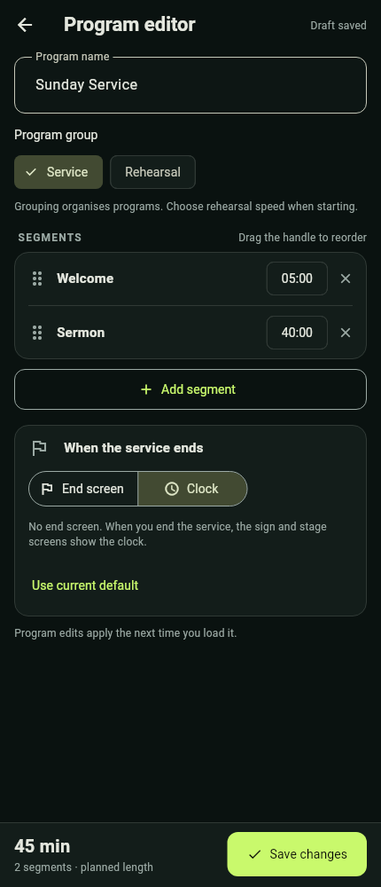

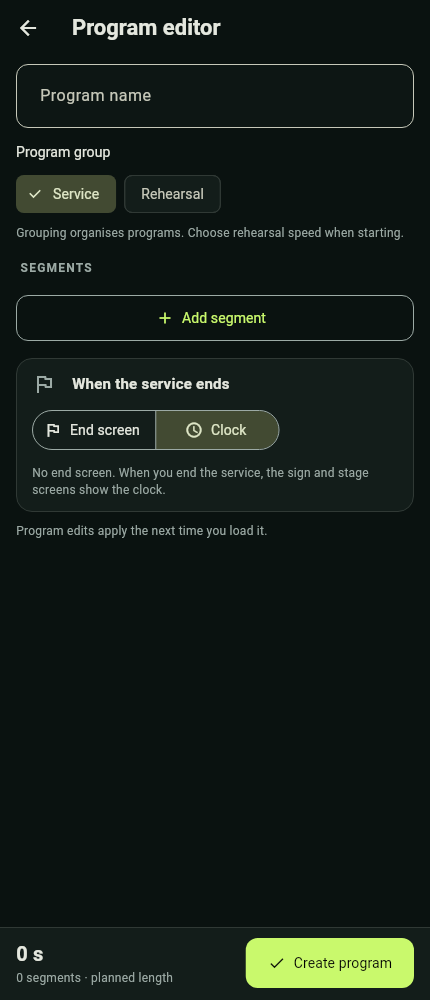

- **Services now end on the clock.** A new program, and a new install's default end screen, start on **Clock**: when the service ends, stage screens show the time of day as the flip clock.
- **Programs you already had** moved to the clock once, when you updated to 0.39.0, if they still had the plain Hallelujah that came with the app. An end screen you changed in any way, its words or its look, was kept, and so was the end screen of a service that was running.
- Choosing **End screen** again while the editor is open brings back the text you had. If you choose the plain Hallelujah again, it is kept.
- Program details, Programs on a PC and the import review say **No end screen** and **Shows the clock when the service ends** for such a program.
- What Live shows and says when such a service ends is in [Finish and hand over cleanly](#17-finish-and-hand-over-cleanly).

Open a row in Programs for **Program details**, with **Load into Live** and **Edit program** up front. Its **⋮** menu holds **Check this service**, Duplicate, Export JSON, Export CSV, **Print order of service**, **Send to paired phone** (while one is connected), **Version history** and **Delete program**, which asks for confirmation. A duplicate is useful for a special service without overwriting a familiar plan.

In the Programs list, the pin icon marks pinned programs, which Live offers first. **Press and hold** a program (click and hold on a PC) to start selecting; the bar at the bottom then offers **Pin**, **Share**, **Export** and, in red, **Delete** (with a 10-second Undo). Back or **×** finishes selecting.

**Segment library.** For segments you use often, such as Offering or Announcements, open the segment in the editor and tap **Save to library**. It keeps the duration, speaker, notes and protection. **From library** next to Add segment inserts one into any program, with search. Saving the same name again updates it. **Programs › ⋮ › Segment library** lists them and removes one, with Undo. Up to 50 are kept.

**Version history.** Each time you save a change, the version before it is kept, up to the last 10. **Program details › ⋮ › Version history** lists them with what changed (for example “Added “Offering”, +4 min in total”). Tap one to open it as "Earlier version" and choose **Restore this version**, with Undo. Restoring keeps the current name, and the version it replaces stays in history.

Unfinished program edits are saved locally as drafts after a short delay ("Draft saved" appears once you change something). On reopening, choose **Restore draft**, **Discard draft**, or Cancel. Restoring is not the same as saving the program. If a save fails, keep the app open and use its retry action. The latest keystrokes can be lost if the app is closed before a pending write completes.

**Importing.** Use **Programs › ⋮ › Import programs (JSON or CSV)**, or open a program `.json` or `.csv` file shared to the app. On a PC you can also drag one file from a folder onto the app's window. Every import goes to a review ("Preview program import") before you choose **Import program**.

| File | What it carries |
| --- | --- |
| Program JSON | Everything: segments, speakers, notes, protection and end-screen formatting. |
| Simple CSV | The header `Segment Name,Duration (Minutes)`, with an optional `Seconds` column. Names and durations only. |
| Any other spreadsheet (CSV) | Opens **Match spreadsheet columns**. The app guesses which column is the name, duration, speaker, notes or program, and reads durations written as `5`, `5.5`, `05:30`, `5 min` or `90s`. A live preview lists every problem by row number. The choice is remembered, so next week's sheet in the same layout needs one tap. Then **Continue to review**. |

Current limits are 1 MiB and 200 segments. Export Excel files as CSV first. The LED native countdown has its own limit, explained in [Connect the LED sign](#07-connect-the-led-sign).

**Sending a program to another phone.** While sharing to screens, **Program details › ⋮ › Send to paired phone** sends the program to the connected operator and viewer phones you tick (stage screens are left out). Private notes are optional. The other phone shows a "Program received" card with **Review**. If it already has a program with that name, **Update mine** replaces it and keeps its current version in Version history; **Save as copy** adds it with a numbered name. Received programs wait until reviewed, even after leaving the pairing (up to five), and are not included in backups.

### Programs on a PC

In a desktop layout, Programs uses the whole window.

| Column | What it holds |
| --- | --- |
| Left | Your programs, with search and the All, Pinned, Recent and Rehearsals filters, and **New program** under the list. |
| Middle | The chosen program as a table: each segment with its time, speaker and private note. |
| Right | **Load into Live**, the shape of the service, its total time, what past services say about the timings, the end screen (or **No end screen**) and the warnings. |

To change a program, click **Edit program** or double-click a segment. This opens the same Program editor, which shows the running order beside the form: when each segment starts and when the service ends. Changes never touch a service that is already running.

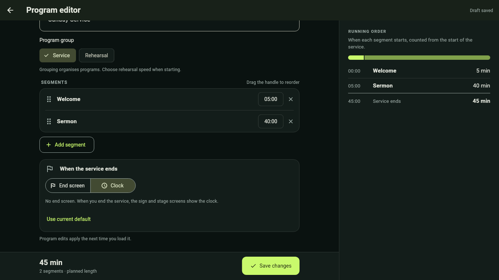

### Check this service

One button runs a whole program through at high speed on the Simulator, so you can see every automatic warning fire before Sunday.

| Where | When |
| --- | --- |
| **Programs**, on a program's **⋮** menu | Any time no service is running. |
| **Live**, beside **Start first segment** | While a service is set up in Ready. |

1. Choose **Check this service**. It starts at once, without the usual question, because it touches nothing real.
2. Watch the Simulator. The check takes about 18 seconds whatever the length of the service, and stops for a moment on each warning so you can read it. **Stop check** ends it at any time.
3. Read the checklist at the end, then choose **Done** or **Check again**.

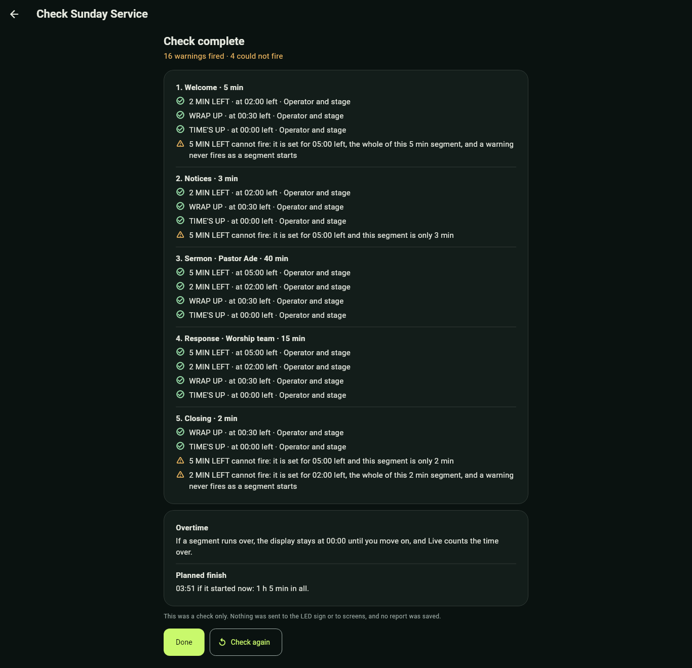

The checklist shows, for each segment:

- every warning that fired, the time left when it did, and where it showed: **Operator only** or **Operator and stage**;
- any warning that **cannot fire**, because it is set for the whole of the segment or for longer. A 5:00 warning cannot fire in a 3-minute segment, and does not fire as a 5-minute segment starts;
- then what the display does if a segment runs over, and the planned finish time.

**It is a check only.** It runs on the LED simulator or the Stage simulator, whichever the Simulator is set to. Nothing is sent to the LED sign, paired or web screens or the second screen, the service set up on Live is left as it was, and no report is saved. It is not available while a service is running, a service started from another device stops it, and locked controls block it.

### Shared settings travel with the device, not the program

Global warnings and At zero settings are shared on the receiving device. Importing a program does not establish an independent set of warning rules for it. Keep exports containing private notes within the operator team.

## 06 — Choose the right display

There are several ways to put the timer in front of people. This lesson lists them all, so you can pick the right one before the detail in the next three lessons.

### Every way to show the timer

| Screen | Best use | What it needs | Lesson |
| --- | --- | --- | --- |
| **Simulator** | Training, and checking what the stage will show, on your own device. | Nothing. It does not send to hardware. | This one |
| **LED sign** | A physical red LED countdown and short cues at the front of the church. | The supported W2 profile, the sign's Wi-Fi and its connection password. | [Connect the LED sign](#07-connect-the-led-sign) |
| **Phone or tablet stage screen** | A large stage countdown, rich Quick messages, screen groups and Seen. | The app on that device, pairing, and a network that lets devices reach each other. | [Pair a phone or tablet](#08-pair-a-phone-or-tablet) |
| **Web screen** | A laptop on a projector, a smart TV or people's own phones following in a browser. | Nothing installed; the same Wi-Fi as the host, and a guest or team code. | [Pair a phone or tablet](#08-pair-a-phone-or-tablet) |
| **Second screen** (PC only) | A projector or monitor plugged into the PC running the service. | Windows set to **Extend**. No network and no pairing. | [Second screen and full screen](#09-second-screen-and-full-screen) |
| **Full screen** | When your own screen is the one people watch: a laptop on a lectern, or a tablet on a stand. | A running service or Quick timer. | [Second screen and full screen](#09-second-screen-and-full-screen) |

Stage screens, web screens, a second screen and full screen all draw the same stage picture: a large countdown in your theme's colours, with cues, warnings, the clock and a blank screen as you send them. See [What a stage screen looks like](#what-a-stage-screen-looks-like). This guide calls them "screens" where the LED sign behaves differently.

**Words can go on these screens too.** With **Slides**, a song, a Bible reading or an announcement can take the place of the countdown on every screen in a group that is set to show **Slides**. The LED sign never shows slides. See [Show words with Slides](#15-show-words-with-slides) and [Choose what every screen shows](#choose-what-every-screen-shows).

**The time on these screens holds still.** Every digit has its own place, as wide as the widest digit, so the time keeps one size and nothing shifts as the seconds change. That is true during the service, in the countdown to a scheduled start, and on the clock shown before it. The time changes size only when it gains or loses a character, such as the + of overtime, or when the screen changes size. On a PC, the Stage simulator, the second screen, full screen and the large time in the mini timer use the app's own font, not Windows' font, so they look the same as on a phone. A web screen uses the browser's own font.

### What a stage screen looks like

**Stage screens follow your theme.** The countdown and the clock use the colours of the theme you chose in **Settings › Appearance**, light themes too. Before, a stage screen was always white on black. Cues, messages and Blank keep their own backgrounds. The LED sign is not changed.

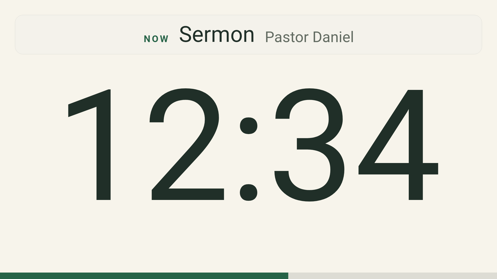

**Four layouts for the countdown.** The layout is what the screen shows while it counts down. The groups on the Screens page add two more choices, **Slides** and **Slides and timer**; see [Choose what every screen shows](#choose-what-every-screen-shows).

| Layout | What the screen shows |
| --- | --- |
| **Timer only** | The time, as large as the screen allows. |
| **Timer and segment name** | A **NOW** band across the top: the name large, the speaker quieter. |
| **Timer and up next** | An **UP NEXT** band along the bottom: the name, then who has it and how long. |
| **Up next only** | Only the next item: **UP NEXT**, its name large, then who has it and how long. No time at all. On the last segment, in a Quick timer or with no program, it shows the end screen set for the program, or the clock where there is none. |

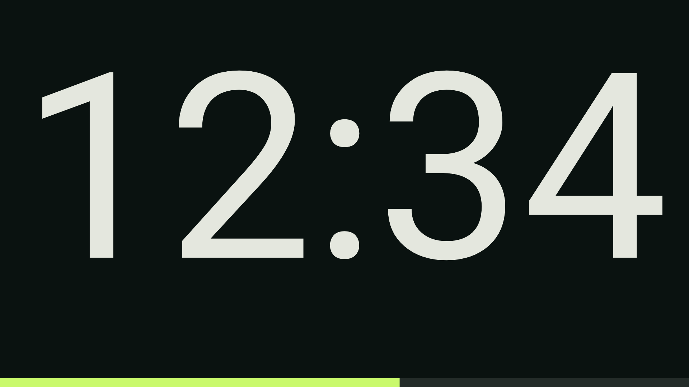

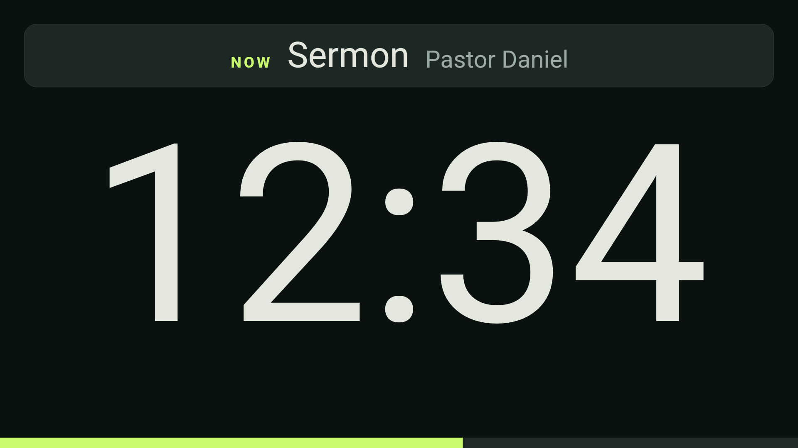

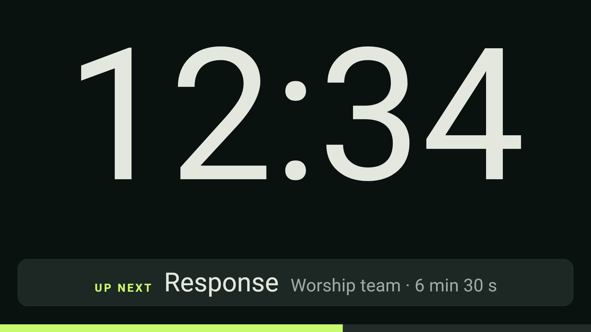

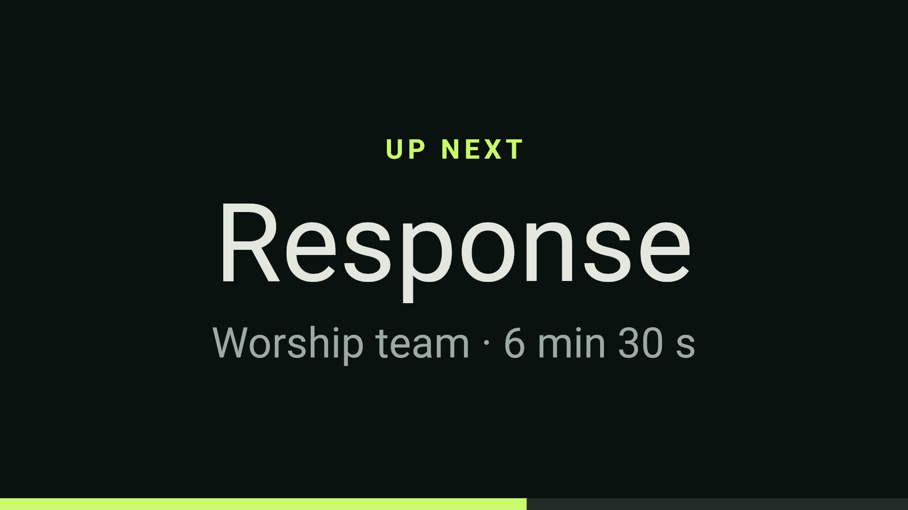

- A long name ends in "…" on a wide screen and wraps on a phone held upright.
- **A line along the bottom edge** shows how much of the segment has gone.
- **In the warning period** (the warning times you already set), the digits and the line turn amber.
- **A paused countdown** is dimmed and says **PAUSED**.
- **The digits keep a fixed width**, so they do not shift as they count.

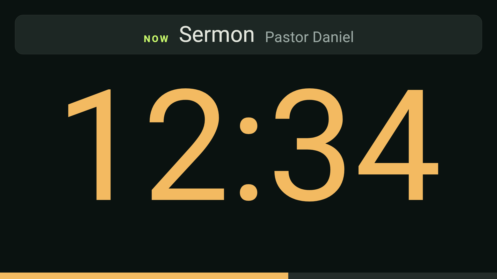

**Choosing a layout.** The layout is chosen for a whole group, on the Screens page, as picture tiles. Each tile is a small drawing of the layout, with its name and a tick on the one chosen. On a phone, and with large text, the tiles wrap to two to a row. The pictures below show the four layout tiles as they look wherever they appear.

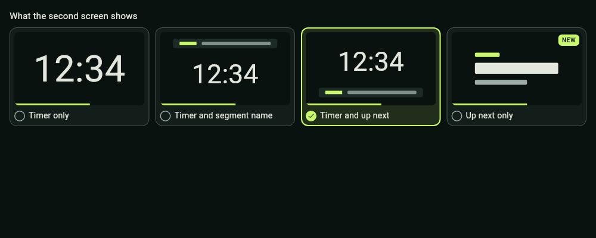

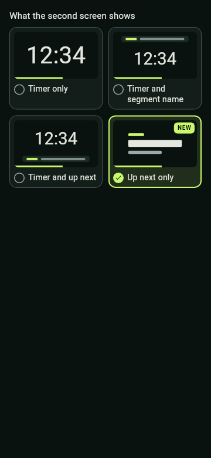

| Screen | Where to see and change it |
| --- | --- |
| Each paired phone or tablet | **Screen options** says which group the screen is in, with a **Screens** button. See [Pair a phone or tablet](#08-pair-a-phone-or-tablet). |
| Web screens | **Screens & devices › Web screens** says which group they are in, with a **Screens** button. |
| Second screen on a PC (and full screen on that PC) | **Settings › Screens & devices › Second screen** says which group it is in, with a **Screens** button. |
| Full screen on a phone or tablet | **Settings › Screens & devices › Full screen on this phone**, the same. |
| Stage simulator | **Simulate** in Choose display, the same. |

An older paired phone or tablet does not know **Up next only**: it shows the segment name under the timer. The LED sign is unchanged.

### Overtime on a stage screen

When a segment runs past 00:00, the whole stage screen turns solid red. Large dark digits count up, such as +0:42, and the screen says **OVER TIME**. It is steady and never flashes.

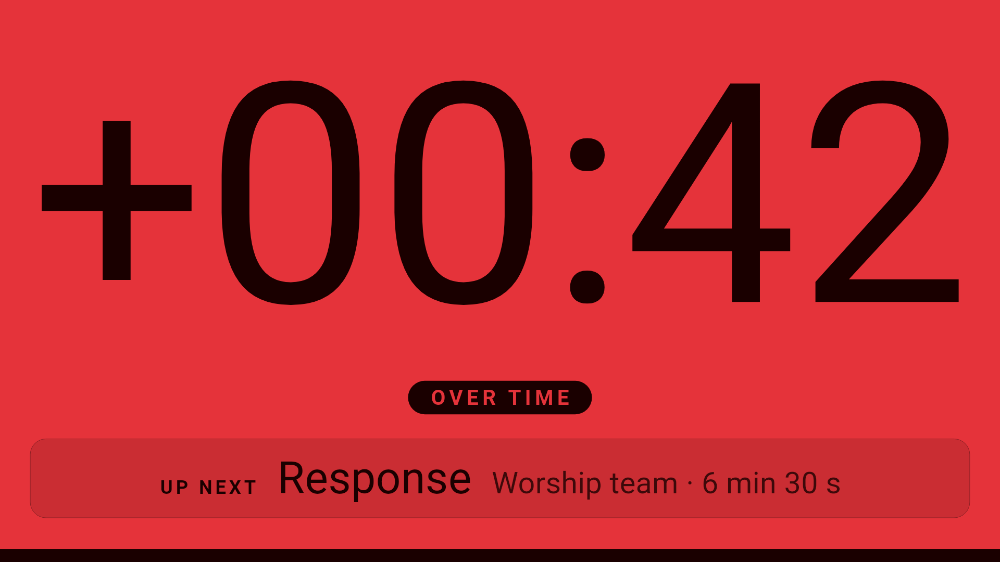

**Overtime alert** in **Settings › Display settings** (next to **At zero**) sets how strongly.

| Choice | What the stage screen does |
| --- | --- |
| **Gentle** | Keeps the theme's background, with red digits and a thick red frame. |
| **Strong** (the default) | The whole screen turns red, with large dark digits counting up. |
| **Strongest** | The same red screen, pulsing slowly about every two seconds. It stays steady when **Reduced motion** is on. |

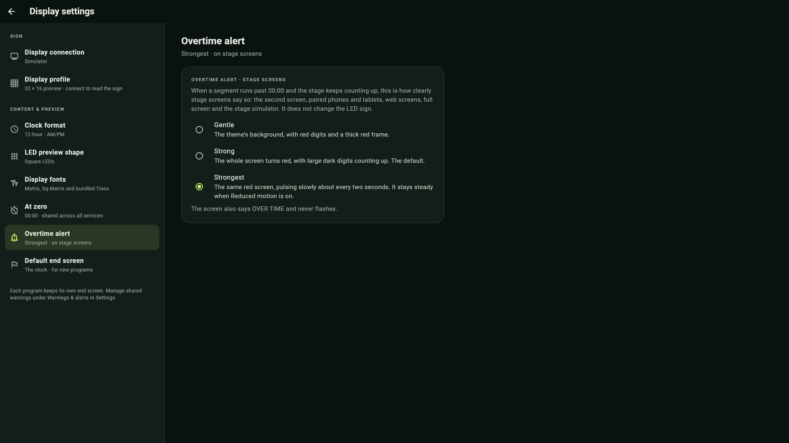

- **Up next only** shows no time, so overtime does not change it.
- The setting is kept on this device, not in backups. Older saved data reads as **Strong**.
- It changes stage screens only: the second screen, paired phones and tablets, web screens, full screen and the stage simulator. The LED sign is not changed.

### The flip clock

Wherever a stage screen fills with the time of day, it shows a flip clock: the hours and minutes on cards that fold over when a digit changes, with the weekday in the theme's colour and the date under them, such as *Monday* and *23 November 2026*.

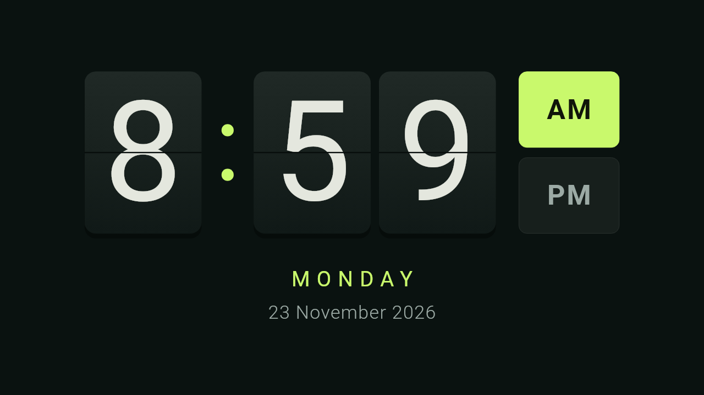

It shows:

- after **Show clock**;
- when a service or program ends on the clock (no end screen), and when a Quick timer ends on the clock;
- before a scheduled service, until the countdown to the start begins;
- under a banner cue, which still shows over the clock.

It follows **Clock format** in **Settings › Display settings**:

| Clock format | The flip clock |
| --- | --- |
| **12-hour** | No leading zero (8:59), with **AM** and **PM** tiles. The current one is lit. |
| **24-hour** | Two digits (08:59), and no tiles. |

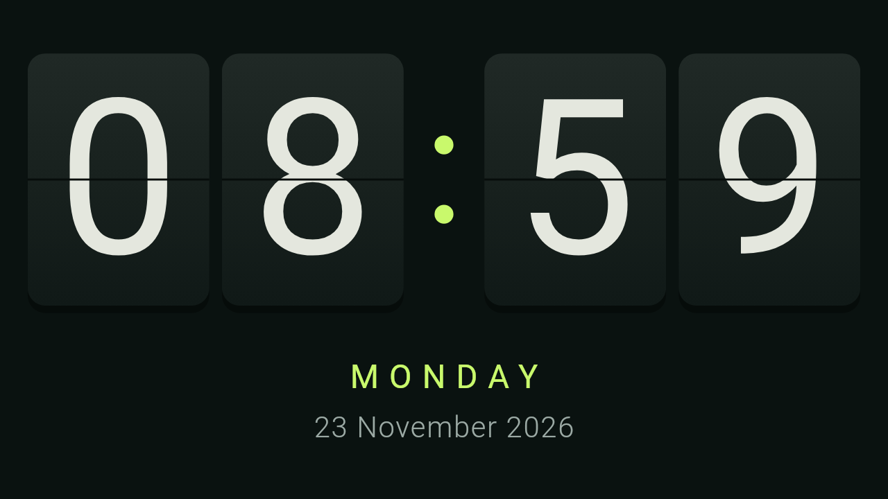

- Held upright, a phone keeps the hours and minutes in one row, with the AM and PM tiles in a row under them. On a wider screen the tiles stand beside the time.

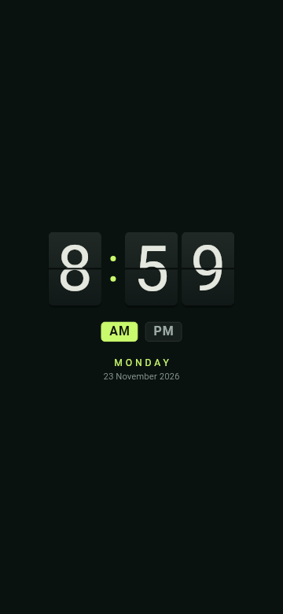

- It follows the theme, light themes included.
- It shows on the second screen, paired stage screens, web screens, full screen and the stage simulator. It does not show on the LED sign or its simulator, which keep their own clock.
- With **Reduced motion** on, the digits change without folding.
- The colon on the flip clock stays lit.

### Choose what every screen shows

**Screens is one page for every stage screen.** Instead of setting each screen on its own, you sort the screens into **groups** you name, and one tap sets what a whole group shows.

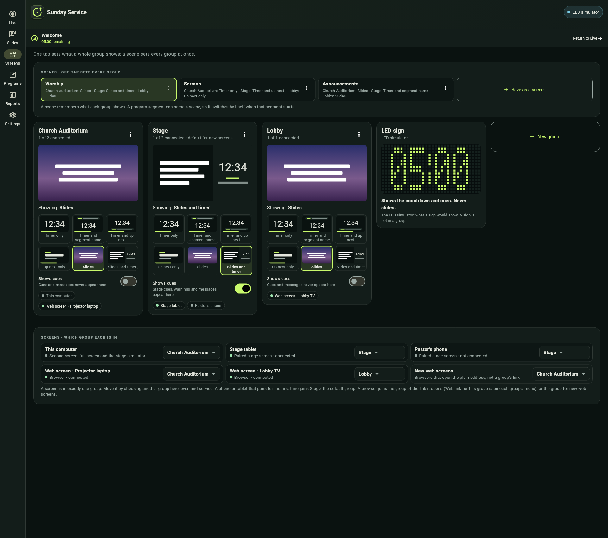

**Open it from:**

- the **Screens** button on Live, beside **Change display** and **Slides** (an icon in the top bar in a desktop layout);
- **Screens** in the side bar, or in the tabs along the top of a desktop layout, on a tablet or a PC. It sits between Slides and Programs;
- **Screens** in Commands (**Ctrl+K**);
- the **Screens** buttons in Slides and in Settings. All of them open the same page.

On a phone the bottom bar keeps its five places, so Screens stays a button on Live.

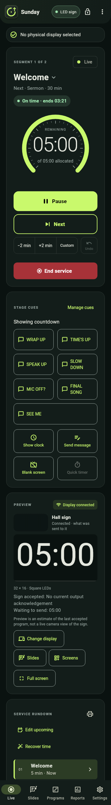

On a phone the page is one column, and a scene's card slides sideways.

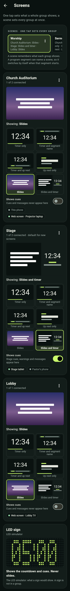

**Groups.** Each group is a card with a small picture of what it shows, the words **Showing:** and six picture tiles. Tap a tile and every screen in the group changes at once.

| Tile | What the screens in the group show |
| --- | --- |
| **Timer only** | The time, as large as the screen allows. |
| **Timer and segment name** | A **NOW** band across the top with the segment name. |
| **Timer and up next** | An **UP NEXT** band along the bottom. |
| **Up next only** | Only the next item, with no time. |
| **Slides** | The words of the slide on the screen, as set on the Slides page. |
| **Slides and timer** | See below. |

- **Nothing asks "are you sure".** Changing what a group shows, moving a screen or using a scene takes effect at once.
- **Add, rename or delete a group** from its **⋮** menu, or choose **New group**. A deleted group's screens go to the default group.
- **A screen is in exactly one group.** Under **Screens · which group each is in**, choose another group from the list beside any screen, even during a service. It shows that group's choice straight away.
- **Where a new screen goes.** A phone or tablet paired for the first time joins the group marked **default for new screens** (**Stage** to begin with). A browser joins the group of the **web link** it was opened from (each group has one), or the group set for **New web screens**.
- **The second screen, full screen and the stage simulator are one screen,** called **This computer**. The stage simulator now shows what this computer's second screen shows.

**Your screens keep showing what they showed.** The 0.39.0 update made the groups from your settings: **Church Auditorium** holds this computer's second screen (with full screen and the stage simulator) and the web screens, and **Stage** holds paired phones and tablets. Where screens that would have shared a group were set differently, they got a group of their own (**Web screens**, **Stage 2** and so on), and screens that were ticked under the Slides page's old **Send to** are in a group set to Slides.

**Slides and timer** is a confidence monitor for a worship leader or speaker facing the room. The words of the slide are large on the left. On the right is the countdown, amber in the warning time and red with the time over in overtime, as strongly as your Overtime alert, with the next slide's name and first line under it, such as "Chorus · It is well with my soul". Held upright on a phone, the words are on top. With no slide up, it shows the countdown. It works on the second screen, paired screens, web screens, full screen and the simulator. A paired screen on an older version shows the countdown instead.

**Scenes.** A scene saves what every group shows, and one tap sets them all again: Worship, Sermon, Announcements and so on. Choose **Save as a scene** to make one. Each scene's **⋮** menu renames, updates and deletes it. In the program editor, a segment can name a scene; when that segment starts (Start, Next, a jump or Undo), every group changes by itself, and you can still change any group by hand afterwards. A program from another device uses a scene of the same name here, or changes nothing, and the editor says so.

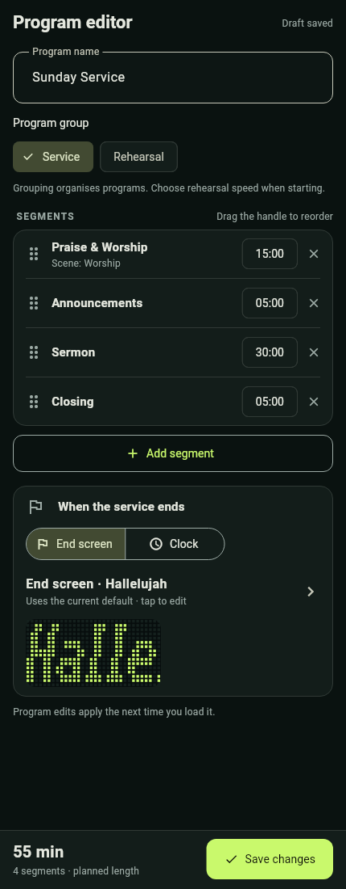

**Shows cues, for each group.** Each group has a **Shows cues** switch.

| Shows cues | What the group's screens do |
| --- | --- |
| **On** | They show stage cues, warning cues and quick messages. Over a slide, a cue is a band across the bottom (or the top, for a top banner cue) with the slide's words moved up to make room. In **Slides and timer** it appears in the timer's panel. |
| **Off** | They never show cues or messages, whatever they show. |

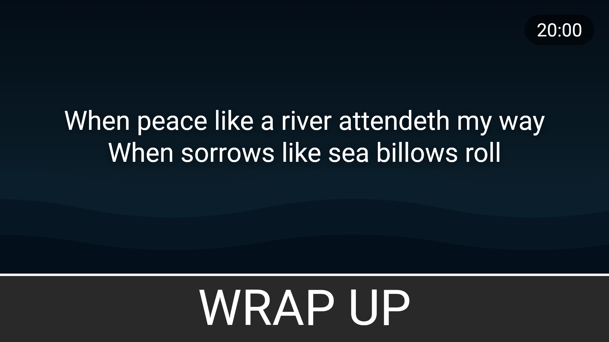

**Church Auditorium starts with Shows cues off.** Its screens usually face the congregation, so WRAP UP and other cues no longer appear on the second screen and web screens until you turn the switch on. One tap on Church Auditorium's switch brings them back. **Stage** starts with it on, and new groups start with it off. Scenes do not change it. The stage simulator on Live always shows cues, so you see what you send.

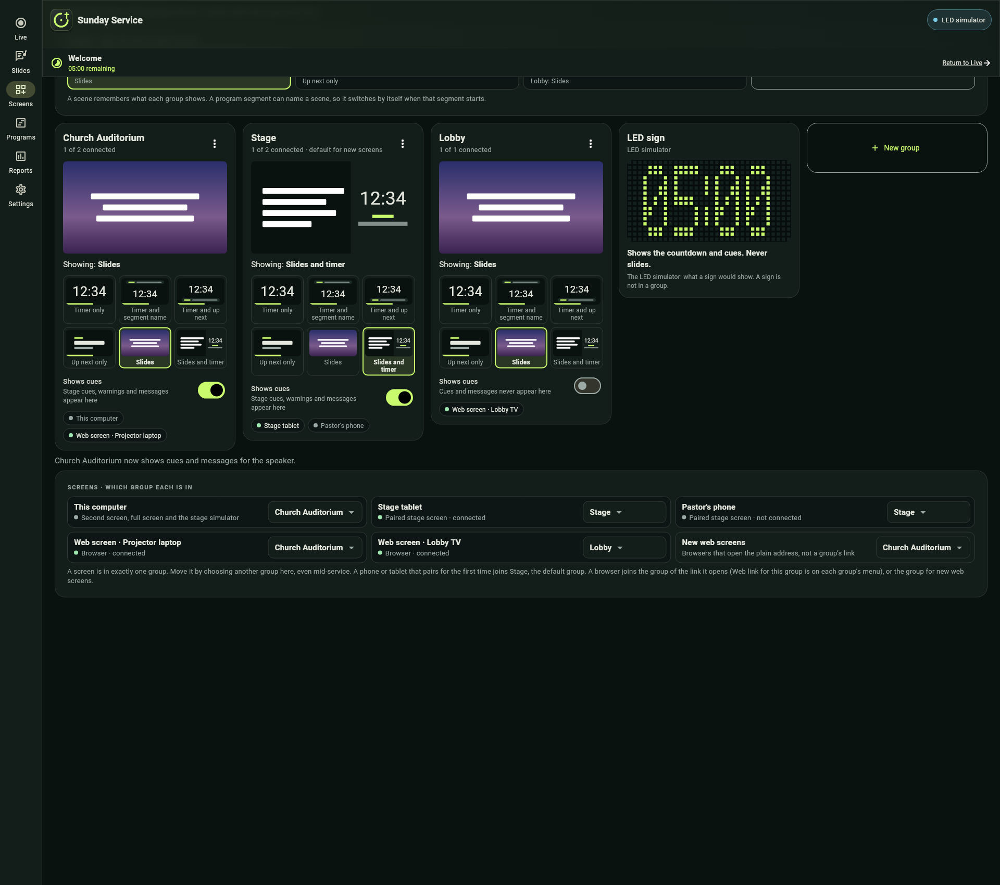

**The LED sign.** With an LED sign as the display, Screens has a card for it: "Shows the countdown and cues. Never slides." Live shows a small picture of what this app last sent to the sign above the stage preview. If the sign is not connected, both say so and the picture is dimmed. A sign is not in a group, and without a sign nothing changes.

**The page fills the window.** On a wide window the groups sit in as many columns as fit, and the scenes and the list of screens use the full width, so nothing is left empty at the right.

### Choose display

Select the display chip at the top of Live, or **Change display**, to open **Choose display**. It asks "Where should your stage output appear?" and offers one destination at a time. Each choice shows what is connected, for example "1 paired · 2 web connected".

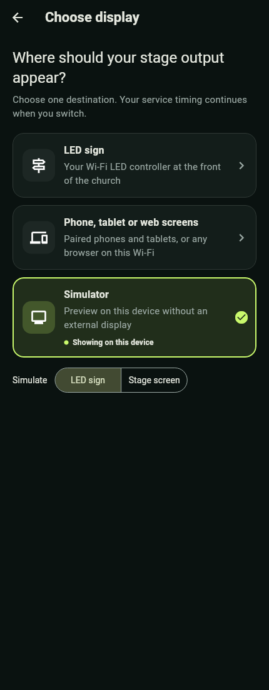

| Destination | The chip then reads |
| --- | --- |
| **LED sign** | LED sign |
| **Phone, tablet or web screens** | Stage screens, or Waiting for a screen until one joins |
| **Simulator** | LED simulator or Stage simulator |

LED sign and Phone, tablet or web screens are **alternative stage-output destinations**. Sharing to viewers, operators and web screens is separate, so sharing does not itself replace the LED sign. A second screen and full screen are separate too: they work whichever destination is chosen.

Changing destination keeps the service timer running and stops LED reconnect attempts when another destination is chosen. When leaving a connected LED sign, choose whether to **Blank previous sign** or **Leave output**. A sign left displaying a countdown can continue on its own.

### What the Simulator simulates

With no LED sign and no stage screens in use, the Display preview on Live shows a pretend display. You choose which kind:

| Choice | The preview shows | The chip reads |
| --- | --- | --- |
| **LED sign** | The exact 32 × 16 LED layout. A new install starts here. | LED simulator |
| **Stage screen** | The large countdown, cues, clock and blank screen as a phone, tablet, web or second screen would show them. | Stage simulator |

Change it in either place:

- In **Choose display**, under Simulator: **Simulate: LED sign | Stage screen**.
- On Live, select the chip beside **Display preview** and choose **Simulate an LED sign** or **Simulate a stage screen**.

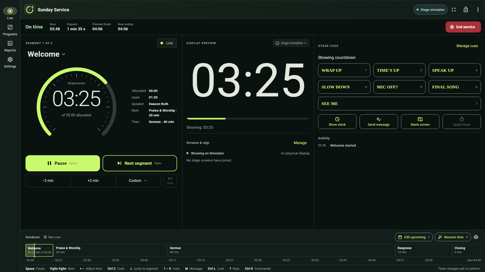

Nothing is asked when you switch. The choice is kept on that device and is not part of backups. Locked controls cannot change it.

The Stage simulator can also show what a stage screen set to any of the four layouts would show, **Up next only** included. Choose it under **Simulate** in Choose display. This too is kept on that device.

Scrolling cues move smoothly on the Stage simulator. The LED simulator moves a whole column at a time, as the sign does.

### Check the real screen

Always check the badge after changing output. A simulator preview, an authenticated LED connection and an acknowledged stage screen are different states. Use **Test screen** (or **Test 5 s** in the Quick message composer) and have someone confirm the intended physical screen before the service.

If a phone, tablet, PC or browser joins as a stage screen while your display is set to the Simulator or the LED sign, it has nothing to show. Live then shows a note with a **Show on stage screens** button, which sends the timer to those screens in one step. The waiting screen itself says what to do on the host.

## 07 — Connect the LED sign

The hardware path has been tested with **Huidu W2, firmware V6.02.232, 32 × 16 red monochrome**. Do not assume every LED sign or every W2 firmware is supported. The app reads and validates the profile before publishing content.

1. Power the sign and choose **LED sign** in Choose display. The **Connect the LED sign** page walks through three steps.
2. **Join the sign's Wi-Fi**: connect the operator phone to the sign's network in Android (**Wi-Fi settings**), then come back. On a PC, join it in Windows' own Wi-Fi settings; the app opens them for you but does not switch networks itself.
3. **Choose the sign**: tap **Scan for displays** and select the intended display.
4. **Sign in**: enter its connection password (the field is labelled "Display device password"; it may differ from the Wi-Fi password). Leave **Remember password on this phone** ("on this computer" on a PC) checked if this is a trusted operator device. It remembers the connection password, not the Wi-Fi password.
5. Tap **Connect selected display** and check the successful result and preview status.
6. Start a normal-speed service when ready. If restoring a service already in progress after an interruption, review its timer and use **Restore current output** when offered.

Connecting alone does not overwrite what the sign is currently showing. The stored connection password is encrypted on the device: with Android Keystore on a phone, and with Windows' own protection, tied to your Windows account, on a PC. It is left out of backups unless you choose to include saved passwords, encrypted with a passphrase. **Forget this sign** (in LED device management) removes the app's remembered information and saved passwords; it does not reset the sign.

There are two different passwords:

| Password | Where it is used |
| --- | --- |
| Wi-Fi password | Android or Windows uses it to join the sign's wireless network. |
| Connection password | The app uses it to authenticate to the LED controller. |

Supported native countdowns run up to **59:59**. The sign runs an accepted countdown independently and settles at 00:00. The app handles shared At zero output and future segment changes. A brief blink at pause, resume, cue, warning or program replacement is expected on the tested controller; normal counting between replacements should be smooth. The LED sign keeps a steady colon; the blinking colon is for paired and web screens.

**On a PC.** The PC can stay on a network cable while it joins the sign's Wi-Fi, so web screens and the sign can run together. The Tinos font is drawn slightly differently on Windows, most visibly at Short 7 px; check a Tinos cue on the real sign after moving from a phone to a PC.

An uploaded countdown can continue if Wi-Fi is lost. A static pause frame or cue may instead remain visible until it is replaced. Do not infer that the sign is current just because it is still lit. Read [connection recovery](#20-connection-recovery-and-troubleshooting) before using automatic recovery during a service.

## 08 — Pair a phone or tablet

Use one device as the **host**. It owns the clock and saved data. The host can be a phone, a tablet or a PC. Other phones, tablets and PCs join as stage displays, viewers or additional operators; browsers can follow as web screens.

**Network first:** put the devices on the same Wi-Fi or on the host device's own hotspot. Internet is not required. Some sign hotspots, guest Wi-Fi and church networks keep devices apart ("client isolation"), so phones on them cannot reach each other; the app's advice is then to use the host device's hotspot. QR codes do not bypass isolation. If the host moves to another network while sharing, for example when you turn its hotspot on, it shares again at the new address by itself; approved devices, the team code and joined browsers carry over.

1. On the host, tap **Share to screens** on Live (or **Settings › Screens & devices**). From Choose display › Phone, tablet or web screens, the button is **Share to stage screens**, which also turns on stage output. Sharing to screens alone keeps LED output.
2. On the joining device, tap **Join a service** on Live. Give it a clear **Device name** and choose **Use this device as**: **Service viewer**, **Stage display** or **Additional operator**.
3. Select the host under Nearby hosts and enter its **six-digit code**, including leading zeros, then **Join service**. Alternatively, use **Scan QR code instead** with the host's **Show QR code**. A PC has no camera scanning, so it joins with the code; it can still show a QR code for phones.
4. The host reviews and **Approve**s the joining device. Knowing the code is not enough by itself.
5. A stage display opens in landscape full screen. Tap to reveal its overview and exit tools (**Back to service overview**, **Open stage display**).
6. Check the host's Saved devices list and use **Test screen** before going live. **Return to Live** leaves Screens & devices without ending sharing.

A phone or tablet that pairs for the first time joins the Screens group marked **default for new screens**, **Stage** to begin with.

**On a PC.** Screens & devices has three areas: phones and tablets with the app, this computer (its [second screen](#09-second-screen-and-full-screen)), and browsers without the app. **Join a service** is three numbered steps: choose the host, name this device, enter the code. The first time the PC shares, Windows Defender Firewall asks once; allow the app on private networks or other devices cannot reach it.

**If a stage screen joins and shows only a waiting message**, your display is still set to the Simulator or the LED sign. Live shows a note with **Show on stage screens**; select it to send the timer to them.

When joining, a phone can offer **Rejoin this Wi-Fi automatically**: it notes the network it is on (church Wi-Fi, the host's hotspot or the sign's Wi-Fi) and rejoins only that network if the link drops.

Codes expire after ten minutes. If a code expires or its attempts are exhausted, use **New code** on the host. A new code does not remove already approved devices. Never publish a live pairing code or QR image in training materials.

| Role | Capability and privacy |
| --- | --- |
| Host | Owns timing, reports and output; approves devices and can take back control. Keep it powered and connected. |
| Additional operator | Initially observes and can **Request control**; the host must explicitly **Give control**. Only one operator controls at a time. Private notes become visible when control is granted. |
| Service viewer | Observes service information without control or private operator notes. |
| Stage display | Shows large timer/cue/message content; no private notes or prepared-cue library. |

Handing over control does **not** move the service to the other phone. If that operator disconnects, control returns to the host. Reconnection does not silently restore its control grant.

For each saved screen, use **Screen options** to set a recognisable name, and a **Message group** (**General, Preacher, Choir, Media desk**), which is how Quick messages can be aimed at some screens only. This used to be called the Screen group. **Screen options** also says which Screens group the screen is in, with a **Screens** button: that group decides what the screen shows, as described in [Choose what every screen shows](#06-choose-the-right-display). The host can choose which acknowledged screen to inspect in the preview. In a desktop layout, the screens list under the display preview keeps a paired screen that stops answering as "not answering", shows one you disconnected as "disconnected", and counts people following the order of service on the web on one line.

**Up next on stage.** A screen whose group is set to **Timer and up next** has an **UP NEXT** band along the bottom: the next name, then who has it and how long, such as "Response" and "Worship team · 6 min 30 s", so the band or the next speaker can get ready. A screen whose group is set to **Up next only** shows just that, large, with no time. See [What a stage screen looks like](#06-choose-the-right-display).

- Who has it is left out when a segment has no speaker. A name too long for the band ends in "…" on a wide screen and wraps on a phone held upright.
- The band is not shown on the last segment or during a Quick timer. **Up next only** shows the program's end screen, or the clock, then.
- What a screen shows is chosen once for its group, on the Screens page, as picture tiles. **Screen options**, the web screens, the second screen, full screen and the Stage simulator each say which group they are in, with a **Screens** button.
- A paired phone or tablet still on an earlier version shows only the next segment's name, and, set to **Up next only**, the segment name under the timer.

**Disconnect** keeps a device saved but pauses its service access. **Reconnect** on the host can restore it without another code when the receiver app is available on the same reachable network. **Forget device** revokes approval and requires pairing again. If the receiver deliberately leaves, it must choose **Reconnect saved host** to rejoin. **Stop sharing** is deliberate; host sharing does not automatically restart on app launch.

One host with three stage receivers is within the current eight-connection cap for paired devices, which also counts pending connections. That cap is not a guarantee of performance on every router or phone; rehearse the exact setup.

### Web screens in a browser

While sharing, **Settings › Screens & devices › Web screens** shows three ways for a browser on the same Wi-Fi to open the page:

1. **Easy name**, made from the church name, for example `grace-community.local:8080`. iPhones, iPads, Macs and most laptops open it; some Android phones do not. **Change easy name** edits it.
2. **QR code**, which any phone camera reads.
3. **Address**, the host's own address such as `192.168.1.23:8080`, as a last resort.

| Browser view | Shows | Needs |
| --- | --- | --- |
| Order of service | The rundown with the current item marked **NOW**; no times. Speakers only if **Show speakers in the order of service** is on. | The **guest code** (4 digits, the same each week until you tap **Change guest code**), or nothing if set to open. |
| Stage display | The full-screen countdown, cues and Quick messages. | The **team code**. |
| Service overview | Time left, ahead or behind, finish time and the rundown with durations and speakers. | The **team code**. |

**What a web screen shows** is set by its group on the Screens page. A browser joins the group of the **web link** it was opened from (each group has one, in the group's **⋮** menu), or the group set for **New web screens**. The web screens section of Screens & devices says which group, with a **Screens** button. A web screen always matches the app.

The 6-digit team code changes each time you share, or with **New team code**, and unlocks switching between all three views. Order of service access can be **Off**, **Needs the guest code** (the default) or **Open to anyone on this Wi-Fi**. Changing a code signs out the browsers that used the old one. No browser can control the service or see private notes.

**Export join slide** makes an image with the church name, a large QR code, the easy name, the guest code and the address, ready to project. Pick the screen it is for (16:9 HD or 4K, 16:10, 4:3, Portrait 9:16 or Square) and dark or light. If the host's address changes afterwards, the panel says the slide is out of date: export it again. A printed address or QR stops working if the router gives the host a new address, so ask for the address to be reserved on the router, or show the join slide instead.

A browser shows a red "Connection to the host device lost · reconnecting…" banner and fades the countdown within about five seconds of the host going quiet, and picks up again by itself when the host returns. On a web Stage display, the **Full screen** chip becomes **Exit full screen**.

### Requests from the stage

When **Requests from the stage** is switched on in Screens & devices (off by default), a presenter can quietly ask the operator for something during a service, from a paired stage screen or a team-code web Stage display. A small **Request** button offers three fixed choices: **Need 2 minutes**, **Ready to finish** and **Microphone issue**; there is no free text. How the operator answers is in [Operate a live service](#10-operate-a-live-service).

## 09 — Second screen and full screen

Two ways to show the stage countdown without pairing anything. A **second screen** is a projector or monitor plugged into the PC. **Full screen** uses the screen of the device that is running the service.

### Show the stage on a second screen (PC)

1. Plug the projector or monitor into the PC.
2. Press **Windows + P** and choose **Extend**. With Duplicate, Windows sees only one screen, so there is nothing to show the stage on.
3. On Live, look under the Display preview. A line says what the second screen is doing: "Second screen: not showing".
4. Click **Show on second screen**. The stage fills that screen, with no title bar or taskbar. With more than one extra screen, choose which from the list beside the button.
5. The line now reads, for example, "Showing on Screen 2 · 3840 × 2160", and the button becomes **Stop**.

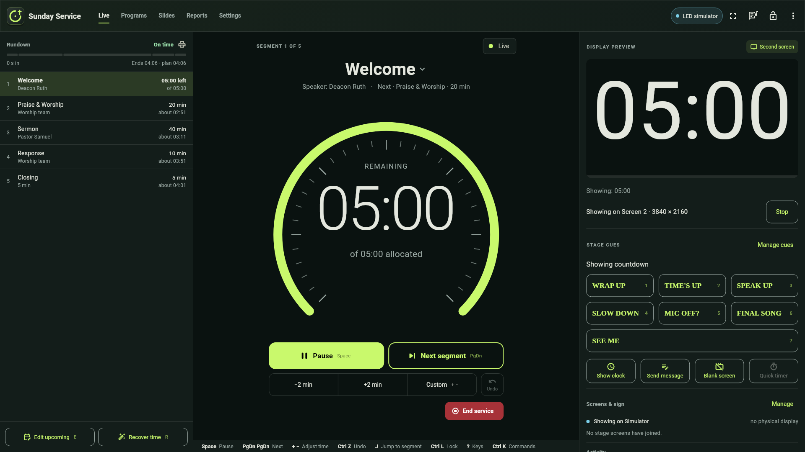

The second screen shows what a paired stage screen shows: the countdown, prepared cues, automatic warnings, messages from **Send message**, the clock and a blank screen. It needs no network or pairing, and it works whichever display you have chosen, the LED sign included.

**To stop**, click **Stop**, press **Esc** on that screen, or unplug it. Closing the app closes it too. With no extra screen connected, the line reads "No second screen connected" and there is no button. **Lock controls** disables the button like every other control.

**Show on second screen** is also in Commands (**Ctrl+K**).

### See the second screen on Live

While the second screen is showing, the Display preview on Live holds a small live copy of it, in that screen's shape and layout.

| Your display | Where the copy appears |
| --- | --- |
| Simulator | It takes the Simulator's place, and the chip beside **Display preview** reads **Second screen**. |
| LED sign, or phone, tablet or web screens | Their preview stays. The copy sits under it with its own **Second screen** heading. |

When the second screen stops, the preview goes back to how it was.

### Second screen settings

**Settings › Screens & devices › Second screen** has the same **Show** and **Stop** for each screen, and two more choices.

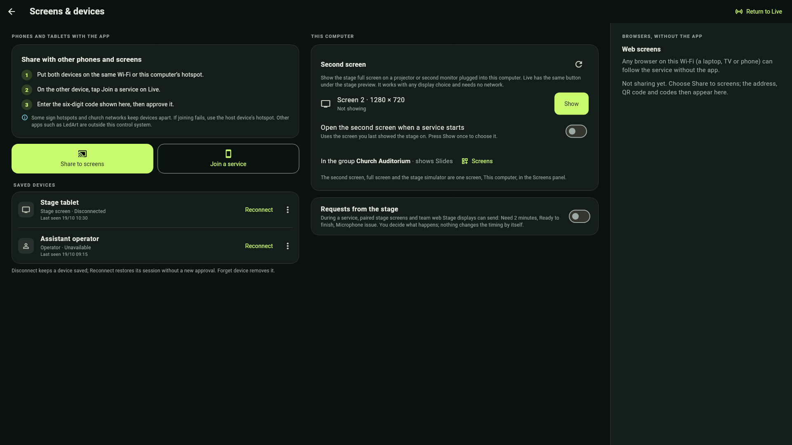

| Setting | What it does |
| --- | --- |
| **Open the second screen when a service starts** | Off to begin with. When on, starting a service or a Quick timer shows the stage on the screen you last used. If that screen is not connected, nothing opens and Live says so. It never opens on your own screen by itself, and guided practice does not open it. |
| **In the group …** | A line such as "In the group Church Auditorium · shows Slides", with a **Screens** button. What the second screen shows is set for its group on the Screens page. The second screen, full screen and the stage simulator are one screen, **This computer**. |

The app remembers the screen you last showed the stage on and offers it first next time. After changing the resolution or the arrangement of screens in Windows, click **Show** once to choose it again. These choices are kept on that computer and are not part of a backup.

Ending the service leaves the second screen open, showing the program's end screen, or the clock if the program has no end screen. Close it with **Stop** when the room no longer needs it.

### Full screen on the device running the service

Use this when your own screen is the one people watch. During a service or a Quick timer, Live can replace itself with the stage picture: the big countdown in your theme's colours, with warnings and cues as they appear on stage.

| To open it | Where |
| --- | --- |
| The Full screen button | At the top right of Live on a tablet or PC; under the display preview on a phone. |
| **⋮ › Full screen** | The Live menu. |
| **F11** | On a PC. |
| **Full screen** in Commands | On a PC, with **Ctrl+K**. |

**To leave**, press **Esc** or **F11**, or tap or click once and choose **Exit** in the tray that comes up. A small **Exit full screen** control also shows at the top right for the first few seconds. On Android, Back leaves it too. While the tray is showing, Esc or Back puts the tray away first; press it again to leave.

**When the service ends,** full screen on a phone or tablet closes by itself. On a PC it stays open on the end screen, or the clock. See [When the service ends](#when-the-service-ends) below.

**A phone or tablet turns sideways.** On Android, full screen turns the stage picture to landscape, so the countdown is as large as it can be. It follows the phone between the two landscapes, so turn it the other way round and the stage turns with it. This works even when the phone's auto-rotate switch is off. When you leave full screen, the screen goes back to how it was before. Windows is unchanged.

Nothing changes in what the LED sign, a second screen or paired screens receive.

### Running the service from full screen

You can run the whole service without leaving full screen: with gestures, with a small tray of controls, or with the keys on a PC. The same safety rules hold as on Live.

**Gestures.** Double tap, or double-click, one third of the screen.

| Where | It asks to |
| --- | --- |
| Left third | **Undo** the last segment change. With nothing to undo, a short "Nothing to undo" shows and fades. |
| Middle | **Pause**, or **Resume** when paused. |
| Right third | Go to the **Next segment**. On the last segment, a short "This is the last segment" shows and fades. |

**Each gesture asks first**, in the same small card the keys and buttons use. Nothing changes until you confirm, so a stray double tap can be cancelled.

**A tip the first time.** The first time full screen opens on a phone, tablet or PC, a short tip shows the three zones and what each does, and how to bring up the control tray: swipe up from the bottom or tap once on a phone or tablet; click once or move the mouse to the bottom edge on a PC.

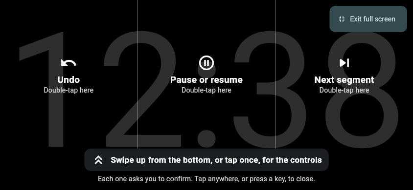

- It goes away with a tap or click, any key, or after about 8 seconds. It does not come back by itself, and the tap that closes it is not counted as part of a double tap.
- **Show gestures** in the control tray shows it again whenever you want.
- With the controls locked it does not show, so it never gets in the way of **Hold to unlock**. It is not used up, and shows the next time.
- With **Reduced motion** on, it does not fade.
- It shows on this screen only. Nothing of it goes to the LED sign, a second screen or paired screens. Whether it has been shown is kept on that phone or PC, not in backups or program files.

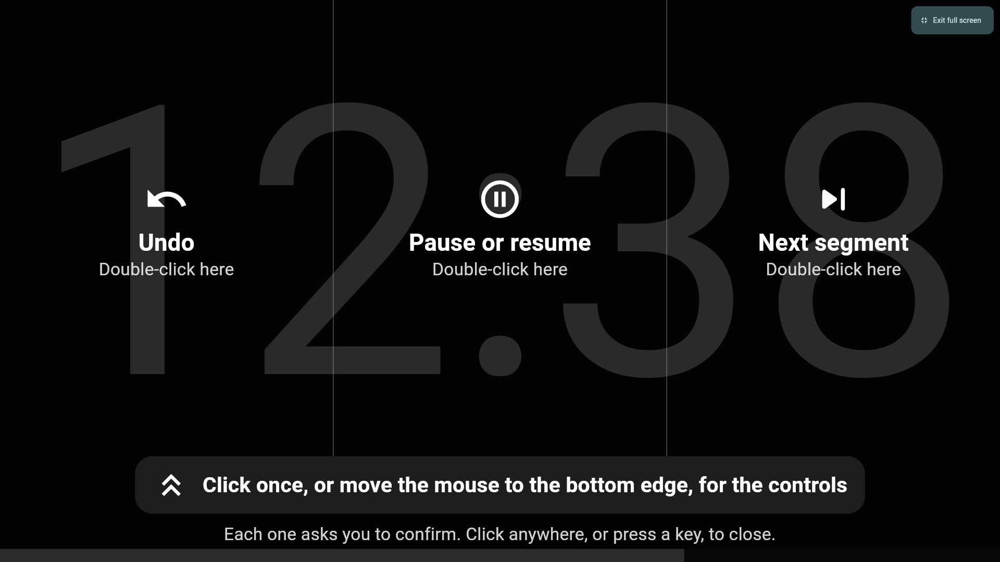

**The control tray.** A small tray along the bottom holds the controls. To bring it up:

- tap or click once anywhere. It waits a moment, so a double tap is not taken for it;
- swipe up from the bottom edge of the screen;
- on a PC, move the mouse to the bottom of the screen.

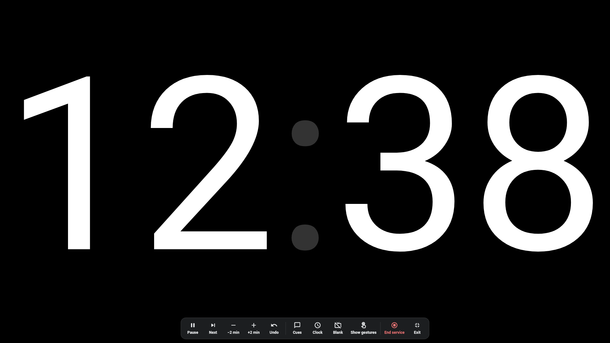

| In the tray | What it does |
| --- | --- |
| **Pause** or **Resume**, **Next**, **−2 min**, **+2 min**, **Undo** | The timer actions. Each asks first, as on Live. |
| **Cues** | Lists your prepared cues. Choose one to show it. Choose the one that is showing to go back to the timer. |
| **Clock** | Shows the time of day. The button then reads **Timer**, which goes back. |
| **Blank** | Blanks the screen. The button then reads **Unblank**. |
| **Show gestures** | Shows the gestures tip again. |
| **End service** | Asks just as it does on Live. For a Quick timer it reads **End timer**. |
| **Exit** | Leaves full screen. |

Cues, Clock and Blank do what they do on Live: they change what every display shows, not only this screen.

- **The tray hides after 6 seconds** untouched. It stays while the mouse is on it, or while a question from it is open.
- **Esc**, Back on Android, or a swipe down puts it away at once.
- With **Reduced motion** on, the tray appears without sliding.
- The tray, the cards and the short messages show on this screen only. Nothing of them is sent to the LED sign, a second screen or paired screens. People watching this screen will see them for a moment.

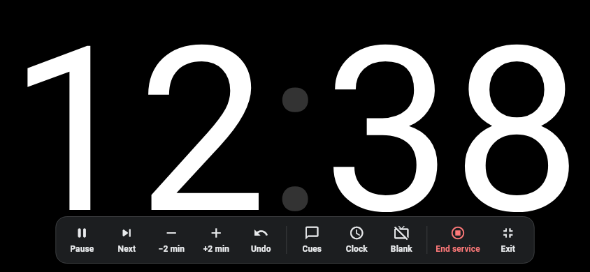

**Keys.** On a PC the keys work as they do on Live.

- **Every timer action still asks first**, in a small card over the stage.
- **Next segment** still needs its second press.

**With Lock controls on, none of this works.** The gestures and the tray do nothing, and every key is blocked, Esc and F11 included. A tap, a click or Esc shows **Controls locked** and **Hold to unlock** in place of Exit.

### When the service ends

What happens depends on the device.

- **On a phone or tablet,** End service closes full screen and turns the screen back to how it was before. This is the same whether you end it from the tray, from End service on Live, or from a paired device. You are back on Live.
- **On a PC,** full screen stays open, however the service ends. The people watching see the program's end screen, or the clock if the program is set to end on the **Clock**, not your Live page. It closes when the next service is set up.

On a PC:

- The timer buttons in the tray grey out. **Cues**, **Clock**, **Blank** and **Exit** keep working.
- With a program set to end on the Clock, **Clock** in the tray is greyed out, as the clock is already showing. Blank, cues and messages go back to the clock when they are cleared.
- Leave when the room no longer needs it: **Exit** in the tray, **Esc** or **F11**.
- Full screen cannot be opened after the service has ended. It needs a running service or Quick timer.

### What full screen shows

Full screen shows what its group shows, chosen on the Screens page: **Timer only**, **Timer and segment name**, **Timer and up next**, **Up next only**, **Slides** or **Slides and timer**.

| Device | Where to choose |
| --- | --- |
| PC | It is one screen with the second screen, **This computer**, so it uses that group's choice. **Settings › Screens & devices › Second screen** says which group. |
| Phone or tablet | **Settings › Screens & devices › Full screen on this phone** says which group this phone is in, with a **Screens** button. Which screen is in which group stays on each device and is not part of a backup. |

**Slides show in full screen too.** When this device's group is set to show Slides and a slide is up, full screen shows it in place of the countdown. **Clear slide** gives the countdown back. See [Show words with Slides](#15-show-words-with-slides).

A device that has joined another device's service as a stage screen already has its own full-screen stage display, so it is not offered this one. Full screen cannot be opened from the mini timer.

## 10 — Operate a live service

Load the correct program, check its first segment and destination, then **Start first segment**. Program transitions remain manual: the app does not decide when worship, a message or an announcement is finished.

**Before you start.** In Ready you can:

- Use **Change** to swap in another program (pinned first, with search); an 8-second Undo switches back.
- Set a **Pre-service countdown** (**Set time**). The time is chosen on a 24-hour clock; on a PC you can type the hours and minutes. The display shows the clock until the last hour, counts down to the start, then holds "STARTING SOON" at 00:00. On screens, that clock and countdown hold still: they do not shift or change size each second. It never starts the service by itself. Tapping Start first segment early asks "Start now?" first.
- Read the "Last time" review note if the same program has one.
- Run **Check this service**, beside **Start first segment**, to see every warning fire on the Simulator first. See [Build a reusable program](#05-build-a-reusable-program).

| Control or reading | What to do and expect |
| --- | --- |
| Pause / Resume | Confirm the action. Pause holds the service clock; Resume continues it. LED replacement can blink briefly. |
| −2 min / +2 min | Review the confirmation before changing the current segment's time. |
| Custom | Choose add or remove and set minutes and seconds. Review the resulting timer; time can continue while the dialog is open. |
| Next (Next segment on a tablet or PC) | Confirm when the next real activity begins. It starts that segment's allocation and replaces the previous output. |
| Segment title | Tap the current segment's name to **Jump to segment** further ahead, with a confirmation. |
| Full screen | Shows the stage countdown on this device's own screen, where gestures and a control tray run the service. See [Second screen and full screen](#09-second-screen-and-full-screen). |
| Undo | Reverses the supported last segment change when available; it is not a universal undo of every action. Review the confirmation. |
| "of 10:00 allocated" | The current segment's allotted time, not the entire service length. |
| View / Hide operator notes | Opens the current segment's private notes; it does not publish them to stage displays. |
| Focused operator view | In the **⋮** menu. Keeps essential controls, timer, cues and display preview prominent. |
| Lock controls | The lock icon blocks every button and every key. Use **Hold to unlock** to regain local controls. It does not pause time. |

Tap a row in **Service rundown** to inspect its timing, speaker and private note. Opening that information does not advance to the row. The rundown header also holds **Edit upcoming**, **Recover time** and a print icon for **Print order of service**.

At zero, the operator view enters **Overtime** and shows red text while the display stays at 00:00 or the configured At zero text. This is intentional. Start the next segment when appropriate; do not add time merely to hide an overrun from the report. On stage screens, overtime turns the whole screen red, as **Overtime alert** in Display settings says; see [Overtime on a stage screen](#06-choose-the-right-display).

The **Stage & display** panel holds Stage cues (three across where there is room), **Show clock**, **Send message**, **Blank screen** and **Quick timer**, plus the display preview. **Show clock** puts the time of day on the display (12 or 24 hour, set in Display settings › Clock format); on stage screens it is a flip clock, with the weekday and the date; **Back to clock** or **Show timer** returns. **Send message** opens a window with the same **LED sign | Stage screen** switch as the cue editor; see [One editor, two displays](#13-prepared-cues-and-automatic-warnings). **Blank screen** is a toggle: tap again as **Unblank screen** to restore current output. It also works after End service. Timing and phone alerts continue while blanked, but automatic stage warnings are suppressed. The preview should remain present and identify intentional blanking.

**Lock-screen controls.** On a phone or tablet, during a service, a notification shows the current segment with a live countdown (counting up in overtime), with Pause/Resume and Next; Next needs a second tap. It is on by default in **Settings › Warnings & alerts › During a service**, and it obeys Lock controls. **Tapping the card, or the countdown warning that pops up, opens the app on Live,** in front of whatever else you were doing, with the service still running as it was. The app is not restarted and no second copy opens. The card's Pause and Next buttons work as before.

**Slides.** Under the display preview, the **Slides** button opens the Slides page. While a slide is on the screens, a line says what it is, for example "On the screens: Amazing Grace · Verse 4", with **Clear slide**. In a PC layout that fills the window, the button is an icon in the top bar. Beside it is **Screens**, which opens the page where you choose what each group of screens shows; see [Choose what every screen shows](#06-choose-the-right-display). See [Show words with Slides](#15-show-words-with-slides).

**Keyboard, clicker and foot pedal.** On a PC, Space, Page Down and other keys run the service, and each timer key asks first. A clicker or foot pedal can drive Live on a phone, tablet or PC. Both are in [Keyboard, clicker and Commands](#12-keyboard-clicker-and-commands).

**On a PC.** While another program is in front, the countdown is beside the Windows clock, and the mini timer keeps it above your slides. Under the display preview, one line and one button show the stage on a projector or second monitor. See [Get started on Windows](#03-get-started-on-windows), [Run the service from a PC](#11-run-the-service-from-a-pc) and [Second screen and full screen](#09-second-screen-and-full-screen).

**Requests from the stage.** If a presenter sends a request, the phone vibrates briefly and a card on Live shows it with **Acknowledge** and **Dismiss**. "Need 2 minutes" also offers **Add 2 min**, the normal adjustment with Undo; nothing changes the timing by itself. The presenter's screen shows "Sent", then "Seen by operator" or "2 minutes added". One request per screen at a time, at most one every 5 seconds, and requests expire after 2 minutes. The service report lists each request and what you did.

### Quick timer

For a prayer meeting, a break or a talk that isn't a whole service, use **Quick timer** instead of a program. It is available when no service is loaded or running: on the Standing by card next to **Start service**, or as the tile beside Show clock, Send message and Blank screen.

1. Choose **5 min**, **10 min**, **15 min**, **30 min** or **45 min**, or **Custom…** for any length up to 59 min 59 s. Your last three timers appear under **Recent** as one-tap choices.
2. Optionally give it a **Name (optional)**, such as "Prayer meeting".
3. Leave **Save as a report** off unless you want a record. Off, nothing is saved when it ends; on, it is saved in Reports, marked Quick timer.
4. Tap **Start 5 min timer** (the button names the length). It starts straight away, with no Ready step.

It counts down on the LED sign, stage screens, web screens and a second screen together, with Pause, ±2 min, overtime, warnings, full screen and the lock-screen controls as usual. **End timer** stops it and shows the default end screen, which is the clock to begin with, or the words you chose instead. Saved Quick timers are left out of service averages and length suggestions.

## 11 — Run the service from a PC

In a wide window, on a PC or a 10-inch or larger tablet held sideways, Live fills the screen instead of scrolling one column of cards. Everything works as in [Operate a live service](#10-operate-a-live-service): every timer action still asks first, and **Lock controls** still blocks them all. This lesson covers what the wide screen adds.

### The Live home, before a service

With no service loaded, a wide window shows three areas.

| Area | What it holds |
| --- | --- |
| Left: **Choose a program** | Your programs. Click one to see it in the middle. **Edit programs** opens Programs. |
| Middle | The time of day, then the chosen program's order of service with each segment, speaker and length, a small **Print** button beside the summary, and one **Start service** button. Under it: **Quick timer**, **Share to screens** and **Join a service**. The **Last service** card follows. |
| Right | The display preview and stage cues, already open. |

**Start service** opens Ready, where you check the display and start the first segment. Nothing counts until then; see [Ready in each layout](#ready-in-each-layout). The picture of this page is in [Get started on Windows](#03-get-started-on-windows).

### Choose a desktop layout

**Settings › Desktop layout** lists five layouts. (On a tablet the row is **Tablet layout**; see below.) Each arranges the same timer, cues, display preview and rundown. Choosing a layout also sets the theme it comes with; you can pick any theme afterwards.

| Layout | What it is like | Comes with |
| --- | --- | --- |
| **Mission control** | Everything on one screen, with the rundown as a timeline. A new install starts here. | Midnight Lime |
| **Three panes** | Rundown on the left, timer in the middle, stage and cues on the right. | Midnight Lime |
| **The dial** | The whole service as a ring, with the countdown inside. | Royal Navy |
| **Keys** | Dense and keyboard-first: the timer in a strip, the rundown as a table. | Graphite |
| **Classic** | One column of cards, as on a tablet. | Your current theme |

Click a layout, then **Save appearance**. If you already used the app before Mission control became the starting layout, your layout stays as it is.

A window narrower than 1200 or shorter than 600 uses Classic, the phone and tablet layout, whatever layout is chosen. So does the focused operator view.

**Windows display scaling makes the window smaller than the screen.** A 1920 × 1200 screen at 150% gives the app about 1270 × 790, which is wide enough for every layout. A 1366 × 768 screen at 125% gives about 1093 × 614, which is under 1200 wide, so the app uses Classic.

### On a tablet

The same setting is called **Tablet layout** on an Android tablet, with the line "Used when the tablet is in landscape".

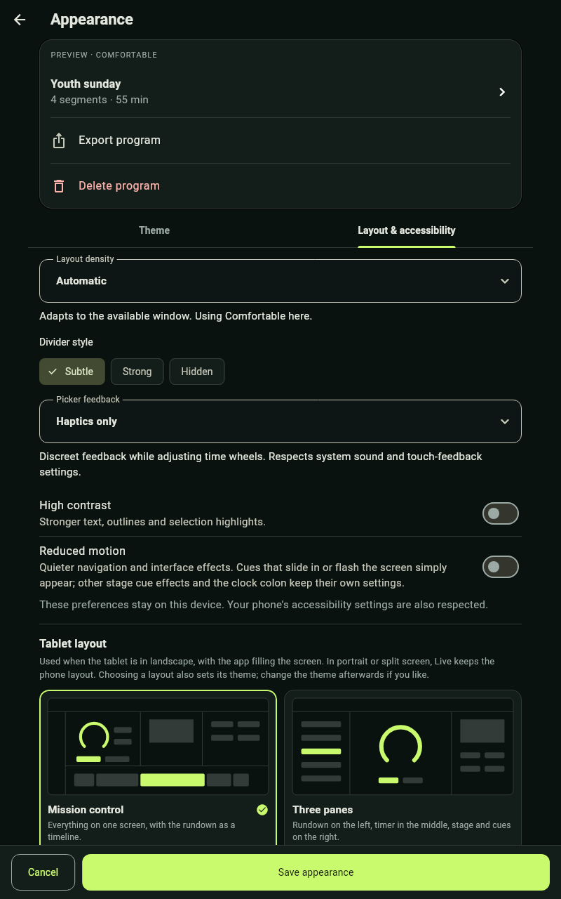

| Device | What Settings shows |
| --- | --- |
| PC | **Desktop layout**. |
| Tablet of 10 inches or more | **Tablet layout**. It is used with the tablet in landscape and the app filling the screen. In portrait or split screen, Live keeps the phone layout. |
| 7 or 8-inch tablet, or a phone | Nothing. The screen is never wide enough, so Settings, Settings search and Appearance do not offer a layout. Saved looks and keyboard keys on buttons are still there. |

The layout you had already chosen is kept.

### Mission control

For seeing the whole service at a glance.

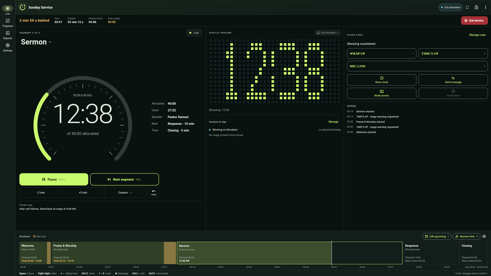

- **The strip across the top** says how far ahead or behind the service is, the time now, the time elapsed, the planned finish and when it is now set to end, with **End service** beside it.
- **The timer, the display preview and the cues** sit side by side.
- **The rundown is a timeline** along the bottom. Each segment is as wide as the time it takes. Finished segments show how long they really took, with the part that ran over marked. A line shows where the service is now. Click a segment for its details.
- **The keys** that work on Live are listed along the bottom edge, **J Jump to segment** among them.
- In a tall window it also lists the screens that have joined, under the display preview, and the service's latest activity, under the cues.

### Three panes

The whole rundown is on the left, with how long each finished segment really took and how far ahead or behind the service is running. The timer and its controls are in the middle, with the private note in view. The display preview, cues and messages are on the right. Live, Slides, Screens, Programs, Reports and Settings become tabs in the header. The keys are listed along the bottom of the middle pane, as they are in The dial, wherever there is room: on every common screen from 1280 × 720 up.

### The dial

Built around the app's own mark. The whole service is a ring, with a piece for each segment, running round to end at the cross. Finished segments fill in, with any overrun marked. Inside it, a second ring shows the time left in the running segment, with the countdown in the middle and the time the service is now set to end beside the cross. An **Up next** box above the rundown gives the next item, its length, who leads it and roughly when it starts. Click any part of the ring for that item's details.

### Keys

Dense, and made to be run from the keyboard. The running segment is one strip across the top: its name, a large countdown, how far ahead or behind the service is, when it will end, and the timer controls. Below it the rundown is a table, with a column each for speaker, planned time, start, actual time, how far over or under, and state. The private note sits underneath. A status line along the bottom shows where the output is going and whether the controls are locked.

Before the first segment starts, Keys shows the same strip with the Ready controls in it; see [Ready in each layout](#ready-in-each-layout). In a window as small as 1200 × 600, **Recover time** and **Print** move to a second line under **Edit upcoming**, so nothing runs off the pane.

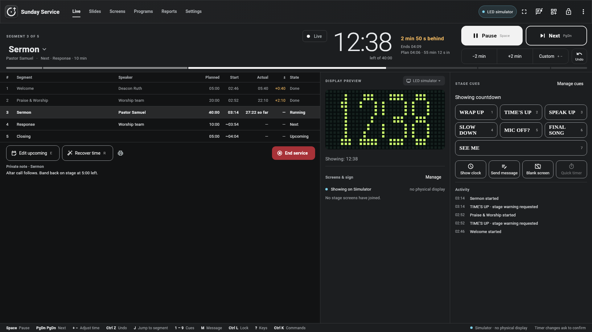

### Classic

The side rail and one column of cards, as before the desktop layouts. In a very wide window the rundown has a column of its own beside the timer and the display, so the whole service is in view without scrolling.

In a window 1200 or more wide and less than 1000 high, such as a 1366 × 768 laptop, Classic puts the controls beside the ring. Pause, Next, the time adjustments and End service, or the Ready form and Start first segment, are then in view without scrolling.

**Classic in a window under 1200 wide.** Such a window always uses Classic: a 1366 × 768 screen at 125% scaling, a window that does not fill the screen, or a 1024 × 768 screen. Classic there is set out to keep the ring large.

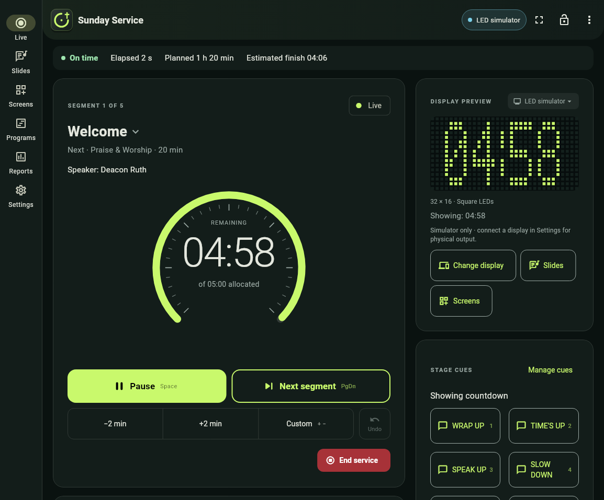

- The ring sits under the segment's name, with Pause, Next segment, the time adjustments and End service across the card under it. In a shorter window the segment's name sits beside the ring. The app uses whichever gives the larger ring.
- The ring fills the height, so the card reaches the foot of the window. In Ready, the form takes the place of the controls.
- **Custom** stays on one line. Where there is no room for its key beside it, the key is left out; in the narrowest windows Pause and Next do the same.
- The **DISPLAY PREVIEW** heading shortens to **PREVIEW** when there is no room, here and in the other layouts, so neither it nor the display's badge is cut short.
- Cue buttons are never so narrow that a word breaks across lines.
- **The columns balance.** Classic measures its cards and places them in two columns that end at about the same height, so there is no large empty gap under the timer card. The rundown goes under the timer card when that fills the space. Windows from about 740 wide (820 when under 1000 high) use two columns; narrower ones use one.
- **The controls stay in view.** From 600 wide up, the ring and the controls fit the window height, so Pause, Next segment and End service need no scrolling in a window 700 or more high.
- **Custom**, **Pre-service countdown** and the other labels shrink a little in a tight space rather than breaking a word or ending in "…".

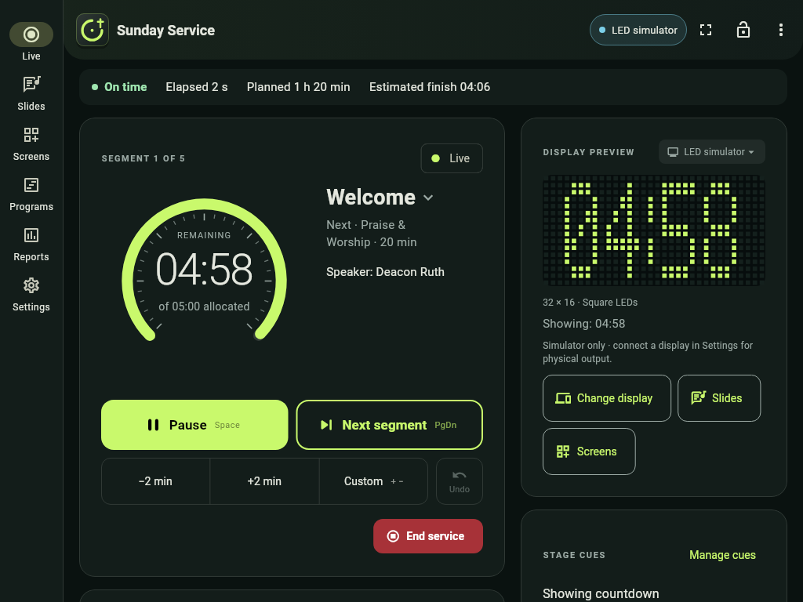

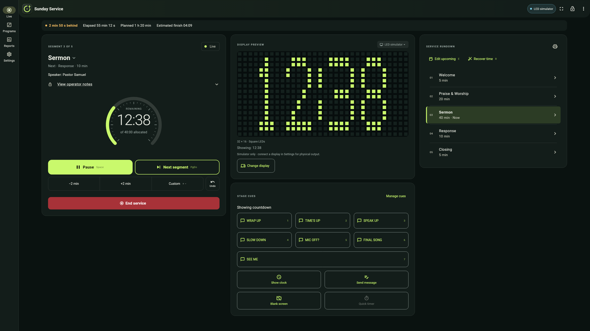

### Ready in each layout

**Start service** loads the program into Ready. Each layout shows its own timer in Ready, at the size and in the place it has once the service is running, with the first segment's full time and not counting. Nothing jumps when you start.

The Ready form takes the place of the timer controls. It holds the program with **Change**, the readiness row (for example **Simulator · all set**), the **Pre-service countdown**, the **Service mode**, a line saying timing has not started, and three buttons: **Start first segment**, **Cancel setup** and **Check this service**.

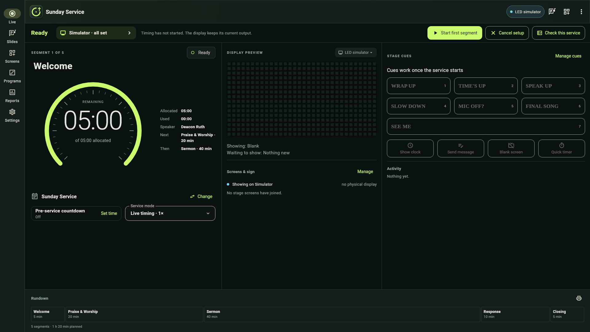

| Layout | What Ready looks like |
| --- | --- |
| **Mission control** | The strip across the top says **Ready**, with the readiness row, the line and the three buttons where End service goes. The program, the pre-service countdown and the service mode are under the dial. In a window under 760 high, the program and the service mode sit beside the dial in place of its figures. |
| **Three panes** | The ring in the middle pane, with the form two to a row under it, where Pause and Next segment go. |
| **The dial** | Its service ring with the first segment marked, and the same form under it. |
| **Keys** | Its own countdown strip, with Start first segment, Cancel setup and Check this service where Pause and Next go. The rundown says Ready for the first segment, and the form is under it. |
| **Classic** | The ring in its card with the form in place of the controls: under the ring, or beside it in a laptop window. |

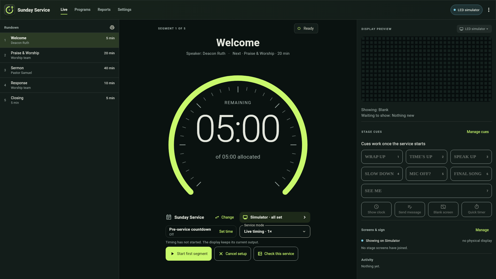

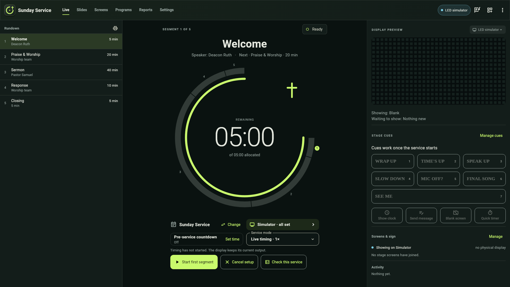

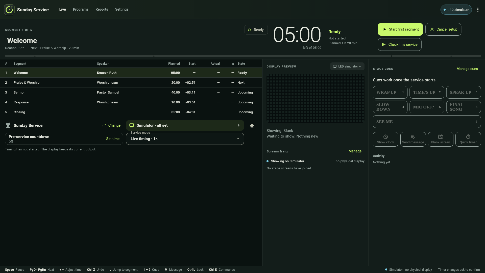

**The line under the form** says what the display is doing until you start.

| Pre-service countdown | The line reads |
| --- | --- |
| Off | "Timing has not started. The display keeps its current output." |
| A start time is set | "Timing has not started. The display shows the pre-service countdown until you start the first segment." |

Starting the service works as it always has, and nothing about timing changes; see [Operate a live service](#10-operate-a-live-service).

### On a large monitor

The layouts grow with the window, at every size.

| Layout | As the window grows |
| --- | --- |
| Three panes and The dial | The ring grows with the height of the middle pane, as large as fits while the segment name, Pause, Next segment, the time adjustments and End service stay in view without scrolling. In a wider window, such as 2560 × 1440, the ring sits at the left with the segment name, the controls, the private note and End service in a column at its right. |
| Mission control | The dial grows into spare height. In a tall window the timeline is taller and each block adds the speaker, the planned time and how long the segment took or when it should start. |
| Classic | From about 1840 wide, the rundown gets its own column. |

- **The line of keys shows on laptop screens too.** In Three panes, The dial, Mission control and Keys it sits along the bottom wherever key labels are on and it fits: every common screen from 1280 × 720 up, 1366 × 768 and 1270 × 790 included. The ring gives up a little height for it.
- The ring keeps the same size in Ready and once the service starts, because Ready leaves room for the line of keys.
- Where a block of its own would leave the ring too little room, as in a 1366 × 768 window, a segment's private note takes one line under the title.
- Only a window 600 high leaves the line of keys out. It is too short for Three panes, The dial and Mission control to show every control without scrolling.

### Keys on the buttons

On a PC, Pause, Next segment, Custom and the cue buttons show the key that presses them. Turn this on or off with **Show keyboard keys on buttons**, under **Settings › Desktop layout**.

The line of keys along the bottom of Mission control and Keys, and along the bottom of the middle pane of Three panes and The dial, follows the same switch. Classic has no such line; it shows each key on its button. It reads, for example, "Space Pause · PgDn PgDn Next · + − Adjust time · Ctrl Z Undo · J Jump to segment · 1 – 9 Cues · M Message · Ctrl L Lock". When the line is too long for the room, the least needed keys are left out, but **? Keys** and **Ctrl K Commands** always stay, at the end, so you can always find the list of keys and Commands. With **Clicker and foot pedal** switched off, it stops listing Space and Page Down; see [Keyboard, clicker and Commands](#12-keyboard-clicker-and-commands).

### Saved looks

**Save this look** keeps the layout, theme, finish, spacing, contrast and key labels together under a name, such as "Sunday morning", so you can go back to it in one step. Up to 8 are kept, and they are included in backups. **Reset to default** returns to Mission control with Midnight Lime and the Flat finish.

### The mini timer (Windows)

If the same PC runs your lyrics or slides, the mini timer keeps the countdown in view above them.

**To open it**, click the mini timer button at the top of the window. It is there on every page: Live, Slides, Screens, Programs, Reports and Settings. You can also press **Ctrl+M** from any page, choose **⋮ › Mini timer** on Live, or pick it from Commands.

The app shrinks to a small window that stays on top of other programs. It shows:

- the current segment and the time left, amber near the end and red with a "+" when over;
- what is next, and whether the service is ahead or behind;
- **Pause** or **Resume**, **Next**, your first prepared cue, and **Expand**.

Pause, Next and closing the window ask before acting, as usual, in a compact form. The cue button turns into **Show timer** while that cue is on stage. Adjusting time needs the full window. With **Lock controls** on, the buttons give way to **Hold to unlock**. Dragged very narrow, the window shows only the name and the countdown.

**With no service running** the mini timer still opens. It shows the time of day and, when a service is loaded, its name and start time, counting down in the last hour before it. There is nothing to pause, so it has only **Expand**.

**To leave it**, click **Expand** or press **Ctrl+M** again. The full window comes back exactly where it was. It also comes back by itself when the service ends.

Test the mini timer with your slides program on your PC before relying on it in a service.

### Slides, Screens, Programs, Reports and Settings in a wide window

- **Screens** fills the window: the groups sit in as many columns as fit, and the scenes and the list of screens use the full width. See [Choose what every screen shows](#06-choose-the-right-display).
- **Programs** lists your programs on the left, with **New program** under the list, the chosen program's segments as a table in the middle, and a summary with **Load into Live** on the right. See [Build a reusable program](#05-build-a-reusable-program).
- **Slides** has three columns: the Library on the left, the slides of the chosen item in the middle, and **On the screens now** on the right, with the buttons and the look. See [Show words with Slides](#15-show-words-with-slides).
- **Reports** lists saved services down the left and opens the chosen one beside them. See [Read, export and print reports](#18-read-export-and-print-reports).
- **Settings** runs across a wide window, in three columns when there is room, instead of stopping at 1200 pixels. **Screens & devices** fills its panes the same way, and most pages put a preview or a summary beside the settings. See [Make the workspace yours](#19-make-the-workspace-yours).
- Quick timer, Print, Export, Version history, Segment library, Recover time and Edit upcoming open as dialogs in the middle of the window, not as sheets across the bottom.

## 12 — Keyboard, clicker and Commands

On a PC the whole service can be run from the keyboard. Two rules hold for every key:

1. **Every timer action asks you to confirm before anything changes.**
2. **Lock controls blocks every key until you hold to unlock.** <kbd>Ctrl</kbd> <kbd>L</kbd> locks; it cannot unlock.

### Keys on Live

| Keys | What it does | How it confirms |
| --- | --- | --- |
| <kbd>Space</kbd> or <kbd>B</kbd> | Pause or resume | Asks first |
| <kbd>Page Down</kbd> or <kbd>→</kbd> | Next segment | Press twice to confirm |
| <kbd>+</kbd> or <kbd>−</kbd> | Adjust time | You choose, then confirm |
| <kbd>Ctrl</kbd> <kbd>Z</kbd> | Undo the last segment change | Asks first |
| <kbd>J</kbd> | Jump to a later segment | You choose, then confirm |
| <kbd>R</kbd> | Recover time | You choose, then confirm |
| <kbd>E</kbd> | Edit upcoming | You edit, then save |
| <kbd>Ctrl</kbd> <kbd>L</kbd> | Lock controls | At once; hold to unlock |
| <kbd>1</kbd> to <kbd>9</kbd> | Show a prepared cue | At once; press again to go back to the timer |
| <kbd>M</kbd> | Send message | You type, then send |
| <kbd>Ctrl</kbd> <kbd>K</kbd> | Commands | A list of everything you can do now |
| <kbd>Ctrl</kbd> <kbd>M</kbd> | Mini timer | A small window on top; press again to leave it |
| <kbd>F11</kbd> | Full screen | The stage on this screen; press again, or Esc, to leave it |
| <kbd>?</kbd> or <kbd>F1</kbd> | Keyboard shortcuts | Opens the list of keys |
| <kbd>Enter</kbd> or <kbd>Space</kbd> | Confirm the question on screen | Not End service, which must be clicked |
| <kbd>Esc</kbd> | Cancel or close | Nothing is changed |

**Pausing takes two presses.** <kbd>Space</kbd> asks, for example, “Pause Sermon?”; a second <kbd>Space</kbd>, or <kbd>Enter</kbd>, confirms; <kbd>Esc</kbd> cancels. **End service** and the other destructive questions must be clicked, so a stray key can never end a service.

### When the keys work

- **Timer and stage keys** (from Space down to M in the table) work on Live while a service is running, with no question or other page on top. The cue numbers and <kbd>M</kbd> also need a display connected.
- <kbd>Ctrl</kbd> <kbd>Z</kbd> needs a segment change to undo. <kbd>J</kbd> needs a later segment to jump to.
- <kbd>Ctrl</kbd> <kbd>K</kbd> and <kbd>?</kbd> work on any tab, but not under a dialog. <kbd>Ctrl</kbd> <kbd>K</kbd> and <kbd>Ctrl</kbd> <kbd>M</kbd> also work when a text box had the keyboard.
- **Ctrl keys keep working.** In earlier versions Ctrl+K could work once and then only now and then. A key pressed again after a pause now always counts, and the app checks which keys are held whenever the window changes, for example after the mini timer had the keyboard.
- <kbd>Ctrl</kbd> <kbd>M</kbd> works on every page, with or without a service. <kbd>F11</kbd> works whenever a service is running. In full screen, the timer and stage keys work as they do on Live, and <kbd>Esc</kbd> puts the control tray away first if it is showing. Full screen also has gestures and a tray for a mouse or a touch screen; see [Second screen and full screen](#09-second-screen-and-full-screen).
- **On the Slides page the same keys mean something else.** <kbd>→</kbd>, <kbd>Space</kbd> or <kbd>Page Down</kbd> is the next slide, <kbd>←</kbd> or <kbd>Page Up</kbd> the one before, <kbd>Esc</kbd> clears the slide and <kbd>B</kbd> turns the screens black. They act at once and ask nothing, because they never touch the timer. On Live, those keys keep their Live meanings. See [Show words with Slides](#15-show-words-with-slides).
- <kbd>Space</kbd>, <kbd>B</kbd>, <kbd>Page Down</kbd> and <kbd>→</kbd> follow the **Clicker and foot pedal** switch; see below.
- **No key does anything while you are typing in a field.** A question mark typed into a field is still a question mark.
- The <kbd>+</kbd> key works without Shift, and the number pad's keys work too.

### The shortcuts list

Press <kbd>?</kbd> or <kbd>F1</kbd> to see every key and what it does, grouped as **During a service**, **Stage** and **Moving around**. It is also under **Keyboard shortcuts** in Commands, in the Live **⋮** menu and in Settings search. <kbd>Esc</kbd> closes it. It does not open while the controls are locked.

### Commands

Press <kbd>Ctrl</kbd> <kbd>K</kbd>, or choose **Commands** in the **⋮** menu on Live, to open a list of everything you can do right now.

1. Start typing, for example "pause", "wrap up" or "settings".
2. Use the arrow keys to move, and press <kbd>Enter</kbd> to choose.
3. <kbd>Esc</kbd> closes the list.

What is most likely needed is suggested first, such as **Recover time** when the service is running behind. Each command shows its key. **Go to Slides** and **Screens** are in the list, so is **Search the Bible**, and so is **Clear slide** while a slide is on the screens. A command is listed only while its button would work, and anything that changes the timer still asks you to confirm, exactly as its button does.

### Clicker and foot pedal

A clicker or pedal works like a small keyboard: each button sends one key.

| The clicker sends | On a PC | On a phone or tablet |
| --- | --- | --- |
| Page Down or Right arrow | Next segment: press twice to confirm | Next segment: press twice, within 4 seconds, to confirm |
| B or Space | Pause or resume: asks first, and Space or Enter confirms | Pause or resume **at once, without asking** |
| Page Up, Left arrow, F5 and others | Nothing | Nothing |

One switch turns these keys on or off on every device: **Settings › Warnings & alerts › During a service › Clicker and foot pedal**. It is on to begin with.

- **On a phone or tablet** a clicker's pause acts at once, because there is no screen in the hand to confirm on. Give the clicker only to someone who understands that.
- **On a PC** the switch works too. Turn it off when a stray pedal, or the clicker that drives your slides, would otherwise reach the timer.

**A PC cannot tell a clicker from its keyboard.** With the switch off, <kbd>Space</kbd>, <kbd>B</kbd>, <kbd>Page Down</kbd> and <kbd>→</kbd> do nothing from the keyboard either.

| With the switch off on a PC | What happens |
| --- | --- |
| Space, B, Page Down and → | Do nothing on Live, from a clicker or the keyboard. |
| The buttons on screen | Still work, and still ask first. |
| +, −, Ctrl Z, M, the number keys and the other shortcuts | Still work. |
| The Pause and Next buttons, the line of keys and Commands | Stop showing Space and Page Down. |
| The shortcuts list and Test a clicker or pedal | Say those keys are switched off. |

### Test a clicker or pedal

Before the service, find out what each button really sends.

1. Open **Settings › Warnings & alerts › Test a clicker or pedal**.
2. Press each button on the clicker or pedal.
3. The page names the key ("Page Down", "Right arrow", "F5") and says what that key does on Live, or that the app does not use it. It keeps the last few presses.

**Nothing pressed on that page reaches a running service**, so it is safe to test mid-service. The page works on phones, tablets and PCs. Many pedals can be set to send a different key with the maker's own program.

## 13 — Prepared cues and automatic warnings

Prepared **Stage cues** are short reusable instructions such as WRAP UP or SPEAK UP. Configure them before the service in **Settings › Stage cues**, or use the **Manage cues** link on Live.

1. Create or edit a cue's text, choose **Bold** or **Italic**, and pick an **Effect**. Then set how it looks on the LED sign and on screens; see below.
2. Save it. The Live cue buttons share this saved set across services.
3. During the service, **tap the cue once to send**. On a PC, the keys **1** to **9** send the first nine cues, and pressing the number of the cue that is showing goes back to the timer. There is no editing step on Live; choose deliberately. Before a service starts, Stage cues says "Cues work once the service starts".
4. Select **Show timer** when the instruction has served its purpose. The timer has continued beneath the cue.

Changing the saved cue later does not rewrite content already on stage. Deleting an individual cue or warning offers an **eight-second Undo**, preserving its formatting. This Undo does not apply to deleting reports.

### The cues you start with

A new install has seven cues, on keys 1 to 7. They are a starting set: change them, delete them or add your own.

| Key | Cue | On screens | On the LED sign |
| --- | --- | --- | --- |
| 1 | **WRAP UP** | Amber banner at the bottom, pulsing | A word at a time |
| 2 | **TIME'S UP** | Red, full screen, flashing | Flashes, a word at a time |
| 3 | **SPEAK UP** | White banner at the top | Scrolls |
| 4 | **SLOW DOWN** | White banner at the top | Scrolls, a little slower |
| 5 | **MIC OFF?** | Amber banner at the top | Scrolls |
| 6 | **FINAL SONG** | Green banner at the bottom | Scrolls |
| 7 | **SEE ME** | Your theme's colour, full screen, sliding in | Scrolls |

On the LED sign they use the tall 14-pixel letters, which read best from a distance. On screens each is set to wrap, so it holds still and is as large as fits.

**If you already use the app**, the earlier WRAP UP, TIME'S UP and MIC LOW, where still as they came, are replaced by these seven, followed by any cues you added. Cues and warnings you changed are left alone.

### Effects

The **Effect** list says what each effect does. The names that end in "(must fit)" need text short enough for the LED sign. The words "(must fit)" show only when a sign is the display in use. With stage screens, the second screen or the Stage simulator, the list says just **Static** and **Flash then hold**.

| Effect | On screens | On the LED sign |
| --- | --- | --- |
| **Static (must fit)** | Holds still. | Holds still. The text must fit the sign. |
| **Scroll long text** | Moves across. | Moves across. |
| **Flash** | Blinks on and off until cleared. | The same. Long text shows a few words at a time. |
| **Flash then hold (must fit)** | Flashes three times, then stays steady. | The same, and flashes three times again every 5 minutes while the cue stays up. The text must fit the sign. |
| **Pulse** | Gently brightens and dims, about every two seconds. | The sign cannot dim, so it shows the text steady. Long text shows a few words at a time. |
| **Slide in** | Slides in from the bottom edge as it appears, then holds still. A banner slides in from its own edge. | Steady, or scrolls if too wide. |
| **Countdown bar** | A thin bar in the cue's colour, just under the words, empties as the cue's time runs out. | Steady, or scrolls if too wide. |
| **Screen flash** | Washes the whole screen once with a deep shade of the cue's colour (red for a white cue) as it appears, then settles. In a banner only the band flashes. | Steady, or scrolls if too wide. |

- **Long text with Flash or Pulse.** Text too wide for the sign is split into groups of whole words that fit, shown one after another, over and over. "PLEASE WRAP UP NOW" may show as "PLEASE", then "WRAP", then "UP NOW". Screens step through the same groups at the same time, unless **Wrap long text** is on, when they show the whole message at once. This works for up to 60 characters; for longer text the editor suggests **Scroll long text**. A single word too wide for the sign still has to be shortened.
- **Slide in, Countdown bar and Screen flash are for screens.** The LED sign cannot draw them, so it shows the cue steady, or scrolls it at **Speed on the LED sign** when the text is too wide.
- **The countdown bar needs a time to count.** That is a warning's time, or the time chosen when a cue is sent for a set time. A cue shown until cleared has no bar.
- **Reduced motion.** With it on, a cue that slides in simply appears, and Screen flash gives the screen a coloured edge instead of a flash.
- The countdown under a banner never moves or changes with any effect.

### One editor, two displays

Over the editor's preview is a small switch, **LED sign | Stage screen**. It starts on the display you are using. It changes the preview, and it also chooses which settings the editor shows. A line under the switch says which.

| The switch is on | The editor shows |
| --- | --- |
| **LED sign** | The group **On the LED sign**: the display font, **Tall · 14 px** (switch it off for the shorter 7-pixel letters), the alignment and **Speed on the LED sign**. |
| **Stage screen** | The group **On screens**: colour, position, **Wrap long text** and **Speed on screens**. |
| Either | The text, **Bold**, **Italic** and **Effect**. These change both displays. |

Nothing is lost by switching: the hidden settings are kept and saved. Editing a warning's text has the same switch, so a warning can have its own effect, colour, banner and screen speed.

**The same switch is on four more windows,** and it starts on the display in use: **Stage screen** with the Stage simulator or stage screens, **LED sign** otherwise.

- **Send message**, below the stage cues. Stage screen shows colour, position, speed and **Wrap long text**. LED sign shows the display font, **Tall**, the alignment and the LED speed. The text, **Bold**, **Italic** and **Effect** show on both.
- **Edit end screen** in Settings › Display settings, and the end screen in the program editor, **Edit upcoming** included.
- **At zero**, with Custom text, in Settings › Display settings.

It only changes what you see while you write. What is sent and saved is the same as before, so a message or end screen set up on either side reaches the sign and the screens as it always did, and older paired screens are not affected. The **Clock** choice for **When the service ends** is untouched.

### How a cue looks on screens

The LED sign is small, red and one colour. Stage screens, web screens, a second screen and full screen are large and can do more. The **On screens** group is for them. Nothing in it changes the LED sign.

**Whether a screen shows cues at all** depends on the **Shows cues** switch of its group on the Screens page. With it off, the group never shows cues, warnings or quick messages. Church Auditorium starts with it off; see [Choose what every screen shows](#06-choose-the-right-display).

| Setting | Choices |
| --- | --- |
| **Colour** | **White** (as before), **Amber**, **Red**, **Green** or **Theme colour**. |
| **Position** | **Full screen**: the cue takes the place of the countdown. **Banner at the top** or **Banner at the bottom**: the cue shows in a band and the countdown, or the clock, stays in view. |
| **Wrap long text** | Shows the cue on up to 3 lines (2 in a banner), centred and as large as fits, instead of scrolling it or shrinking it onto one line. A scrolling cue then holds still on screens while the LED sign keeps scrolling it. |
| **Speed on screens** | How fast a scrolling cue moves on screens, up to 48, twice the sign's fastest. Until you move it, screens follow the sign. **Same as the LED sign** puts it back. |

**Keep wrapped text short.** Text that would be too small to read on 3 lines scrolls instead, so nothing is cut off. With more than 60 characters the editor warns that long text is hard to read from a distance; you can still save it.

**A banner** keeps the countdown in view.

A banner needs a running service to sit over. After the service has ended, a banner cue fills the screen. Bold, italic and every effect work in a banner too.

**A coloured cue that fills the screen** sits on a warm charcoal background with a band of its colour along the bottom edge. Red, Green and Theme colour cues have their words in that colour; Amber cues have warm white words. White cues stay white on black.

**Wrap long text and the countdown bar together:**

Scrolling cues move smoothly on paired screens, web screens, a second screen and full screen, and carry on from where they were when the host sends an update.

In a wide window, the pane beside **Settings › Stage cues** and beside **Warnings & alerts** shows every cue and warning as your display will show it: **On the LED sign** with an LED sign or the LED simulator, and **On the stage screen** with stage screens or the Stage simulator. Point at a scrolling cue to play it.

Cues, backups and program files you already have look the same as before. A paired phone or tablet still on an earlier version shows every cue in white and full screen, at the sign's speed, with the new effects as steady text.

### Text for the LED sign

Switch the editor to **LED sign** for these. Choose **I-Proton Matrix**, **I-Proton Sq-Matrix**, or bundled **Tinos**. Matrix countdown digits are unchanged. Tinos has regular, bold, italic and bold-italic faces; no font import is needed. Tall 14 px preserves more serif detail. Short 7 px fits a smaller line. Changing square/circular LED preview cells does not change the actual sign's physical LEDs or glyph data.

The sign is 32 columns wide, which is not much: in bold, TIME'S alone is too wide for it.

**The width check applies only when a sign is in use.** That means the LED sign, or the Simulator standing in for it. With stage screens, the second screen or the Stage simulator, any width can be sent, and a short note says if the text would be too wide for a sign: "Too wide for the LED sign's 32 pixels with this effect. Fine for stage screens; before sending it to a sign, choose Scroll long text or make it shorter." If you later switch to a sign, a message or cue that is too wide is refused with the same explanation as before. Nothing already saved is rejected or changed. The same applies to the stage cue editor, the end screen and zero screen editors, warning cues, the program editor and importing a program.

| Effect | Text too wide for the sign |
| --- | --- |
| Static, Flash then hold | Must fit when a sign is in use. Shorten the text or choose another effect; for Flash then hold the editor suggests Flash. |
| Scroll long text | Scrolls. |
| Flash, Pulse | Shows a few words at a time. |
| Slide in, Countdown bar, Screen flash | Scrolls on the sign. |

### Automatic warnings

Automatic rules live in **Settings › Warnings & alerts** and apply to **all services and rehearsals**. They trigger at **time remaining**, not time elapsed. In a ten-minute segment, a 01:30 rule triggers when 8 min 30 s have elapsed under ordinary uninterrupted timing.

A new install has four warnings, for the operator and the stage. **Use suggested warnings** puts the suggested set back.

| At | Warning | On screens | Stays up for |
| --- | --- | --- | --- |
| 5:00 | **5 MIN LEFT** | White banner at the top | 12 seconds |
| 2:00 | **2 MIN LEFT** | Amber banner at the bottom | 12 seconds |
| 0:30 | **WRAP UP** | Amber banner at the bottom | 10 seconds |
| 0:00 | **TIME'S UP** | Flashes the screen red once, then stays red on the whole screen | 10 seconds |

On the LED sign each scrolls, and stays up long enough to pass twice.

**When a warning fires.** Each warning fires once in each segment, when the countdown comes down to its time.

- **It never fires as a segment starts.** A 5-minute segment does not begin with 5 MIN LEFT, and a 3-minute segment never shows it. A 6-minute segment shows it at 5:00.
- **TIME'S UP** at 0:00 still fires at zero.
- If you add time so that more is left than a warning's time, a warning that has not yet fired in this segment fires when the countdown comes down to it. One that has already fired does not fire again.
- Removing time past a warning's time fires it.
- Rehearsal speeds, phone notifications and **Check this service** follow the same rule. The check lists every warning that cannot fire in a segment; see [Build a reusable program](#05-build-a-reusable-program).

### Edit a warning

Tap or click a warning, or **Add**, to open **Edit warning** or **New warning**. It is set out as questions.

| Question | What you set |
| --- | --- |
| **When** | The time left, in large figures and coloured as in the list. **Change** sets it. |
| **What it shows** | A preview that plays by itself, with the LED sign and Stage screen switch, a line saying how the text looks, and **Edit text and style**, which opens the same editor a cue has. |
| **Where** | **Operator only**: in the app and as a notification, while the stage keeps showing the timer. **Operator and stage**: also on the LED sign and stage screens, which then go back to the timer. |
| **How long** | **Stays up for**, up to 120 seconds. For text that scrolls, **Scroll once, then back to the timer** is offered too; while it is on, the time is set by one scroll. |
| **On or off** | Switch a warning off without deleting it. |

- **On a PC** a wide window shows the editor in two columns, with **Delete warning** at the bottom left and **Cancel** and **Save warning** at the bottom right.
- **On a phone** the editor uses the whole screen, with **Save** at the top.
- **Two warnings cannot share a time.** If another warning already fires at the time you choose, the editor says so straight away and Save waits for a different time.
- Deleting still asks first.

A stage warning returns to the current countdown, or At zero, after its time. On the LED path, that time begins after the controller acknowledges it.

New manual cues, Blank, Next and End service supersede a warning. Passed times are not replayed when rules change. If a manual Quick message covers every connected stage screen, automatic stage cues are consumed while it is present; phone warnings continue. With a targeted Quick message, other stage screens can still show warnings.

### Alerts on the phone

Under **Phone alerts**, **Clear phone warnings after** is separate: choose **15, 30, 60 seconds or Until dismissed**, with 30 seconds as default. A segment change or service end clears obsolete warning notices. This does not shorten stage warning duration or remove the active-service notification. Phone warnings use a distinct vibration pattern, which Wear OS watches mirror. **Tapping a warning,** or its entry in the notification shade, opens the app on Live in front of whatever else you were doing, with the service still running. If the app was in the background it simply comes back.

Turn on Android notifications (**Turn on**) and **Precise timing** (**Allow**) where offered, then use **Test** on the **Sound and vibration** row. Volume, the notification channel and Do Not Disturb still affect sound. **Background operation** starts with the LED sign or sharing and keeps warnings running while locked; if Live says background operation is unavailable, keep the app open. Ready for service also shows whether Android **battery optimisation** could pause warnings with the screen off, with **Allow** to fix it. Force-stopping the app is not a supported way to silence a service.

### Alerts on a PC

A PC shows a Windows notification at each warning and flashes the app's taskbar button. **It plays no sound unless you turn on Play the Windows notification sound.** The details are in [Get started on Windows](#03-get-started-on-windows).

## 14 — Send rich Quick messages

Quick messages are for paired and web stage screens, with **Phone, tablet or web screens** as the destination. They are not for the LED sign. A group on the Screens page with **Shows cues** off never shows them. They let you send a longer, formatted instruction without changing the program. (The **Send message** tile in Stage & display is different: it sends a simple text message to whichever display is selected, the LED sign included. On a PC, **M** opens it.)

1. Confirm sharing is on and the intended stage screens are approved and connected.
2. On Live, in the **Quick message** section of Stage & display (shown while Phone, tablet or web screens is the destination), tap **Write a message**. In **Send to**, choose **All connected stage screens**, one screen, or a message group. Only connected screens are listed; one that drops off while you write stays listed as "offline" and can't be picked.
3. Write an optional headline and a message, or use **Choose a preset** and adapt it. The combined limit is **160 characters**, with a headline of at most 48 and up to six message lines.
4. Under **Style**, choose bold/italic, alignment, colour and text size. Set **Show for** on the wheel, or 00:00 for Until cleared. For a longer message, consider 15 or 30 seconds.
5. Inspect the preview and recipient count. Optionally tick **Request Seen acknowledgement**. Use **Test 5 s** to check it reaches the screens in Send to, then tap **Send message**.

The recipients are fixed when you send. Newly joined or reconnected screens do not receive a replay of an earlier message. Other screens keep their normal output. When the message expires or you clear it, its recipients return to their current timer or preceding end/blank output. A segment change, manual cue, Blank, End service or disconnection can supersede the message. If Send is unavailable, the composer says why.

**Seen means a person tapped Mark seen.** A transport acknowledgement only says the app received data. If you require acknowledgement, watch the "Seen N of M" count and per-recipient status. Web screens show the message but have no Seen button; they are listed as "On screen (web, no Seen)" and left out of the count. Do not assume silence means agreement, and do not repeatedly resend without checking the recipient list.

Use **Save preset**, or **Manage presets** and **Settings › Quick message presets**, for repeatable messages with their formatting. Unsent Quick message drafts can be restored locally; restoring a draft never sends it. Sent messages are temporary and are not restored after restarting the app.

After End service, messages can still be sent while approved stage screens remain connected and this device has control. The app asks you to confirm because the service has ended. Sending does not restart the service or change its report. Before any service has run, use **Test 5 s** or **Test screen** for setup rather than a normal Quick message.

### Send message and the LED sign's width

The **Send message** tile in Stage & display no longer insists on text that fits the sign when no sign is in use. The sign is 32 pixels wide, so a message such as "Thank you" held still (**Static**) is too wide for it. Before, **Continue** stayed off until you changed the effect, even when the message was only going to stage screens.

- The width check applies only when the display in use is an LED sign, or the Simulator standing in for one.
- With stage screens, the second screen or the Stage simulator, the effect list says **Static** and **Flash then hold** without "(must fit)", and any width can be sent.
- A short note says if the text would be too wide for a sign. Choose **Scroll long text** or make it shorter before you use a sign.
- The message a new user starts with, "Thank you" with **Scroll long text**, already fits the sign and is unchanged.

## 15 — Show words with Slides

**Slides puts song words, Bible verses and announcements on the screens.** You keep them in a **Library**. In the service, you click or tap one slide at a time. Slides needs app **0.38.0** or later on the phone or PC that runs the service. This lesson describes 0.39.0, which made the Slides page tidier and added Bible search.

### What Slides is for, and where it is

Use Slides when the people in the room should read something: a song, a Bible reading or a notice. The words go to the screens in every group that is set to show Slides (see [Choose what every screen shows](#06-choose-the-right-display)). They never go to the LED sign.

- **The Slides tab** comes second, right after Live. On a phone it is in the bar along the bottom. On a tablet or a PC it is in the side rail, or across the top of the window. The order is Live, Slides, Screens, Programs, Reports, Settings; a phone has the same without Screens, which is a button on Live.
- **The Slides button on Live** opens the same page. On a phone, a tablet and in Classic it sits next to **Change display**, under the display preview. In the other PC layouts (Mission control, Three panes, The dial and Keys) it is an icon in the top bar, lit while a slide is showing.
- **No service needed.** You can show slides before the service, with the app standing by.

On a PC the page has three columns. On the left is the **Library**. In the middle are the **Ready** tray and the slides of the song you chose. On the right is **On the screens now**, with the buttons and three rows: **Screens**, **Background** and **Look**.

On a phone it is one column: a search field, a small preview, the song, its slides, and a bar along the bottom with **Previous**, **Next**, **Clear** and **Black**. The Screens, Background and Look rows are under the preview.

### The Library

The Library keeps every song, set of Bible verses and announcement you save. It is the same for every service. The one you used last is at the top. The Library holds up to 300 items.

**Tabs.** Along the top of the list are **Songs**, **Bible verses**, **Announcements** and **All**. **All** is chosen to begin with, so nothing you have is hidden. On a phone, or with large text, the tabs scroll sideways rather than cut a name. Each tab says what to do when it is empty, and the tab you chose is remembered on this device.

- **The search box** finds a title, or any words inside an item, and also searches the Bible; see below. Search looks through everything, whichever tab is open.
- The **⋮** beside each item has **Edit** and **Delete…**. Delete asks first. It cannot be undone.
- Along the bottom of the Library is one small row of buttons: **+ Song**, **+ Bible verses** and **+ Announcement**.

### Add a song

1. Choose **+ Song**.
2. Type the **Song title**. **Written by** is optional and shows only in the list.
3. Fill in **Words**. Type them, paste them, or choose **Open a text file** and pick a file of words.
4. Look at **The slides this makes**. It shows each slide as you type.
5. Choose **Save song**.

**Two rules shape the slides.**

| Rule | What it does |
| --- | --- |
| A blank line | Starts a new slide. |
| A line such as **Verse 1**, **Chorus**, **Bridge**, **Refrain**, **Pre-chorus**, **Intro**, **Outro**, **Tag** or **Ending** | Names the slide. The name is **not shown** on the screens. It shows in the app, on the small slide. |

A block with no such line is called **Slide 3**, **Slide 4** and so on. A name line in the middle of a block starts a new slide.

**Repeat marks show as written.** Words pasted from a website or a chat often mark italics with underscores, such as `_(x2)_`. The slide now shows **(x2)**, on the slide cards, the preview and every screen, even a screen running an older version. The same goes for `*stars*` and `**double stars**` round words. The words you saved are unchanged.

**The slide cards line up.** In the Slides page and in the song, Bible verses and announcement editors, the cards in a row are all the same height, whatever the length of each slide. The slide name and the **On screens** badge no longer crowd each other, and the slide number sits at the right edge of every card.

**Lines on a slide** has three choices. **As typed** keeps each block whole. **2** or **4** cuts each block into slides of that many lines. Use 2 or 4 for a small room or a big font.

### Add Bible verses

1. Choose **+ Bible verses**. **Find in the KJV** is chosen to begin with.
2. Type a **Reference** and choose **Find**. Examples: `John 3:16`, `John 3:16-18`, `Psalm 23`, `1 Cor 13:4-7`. Common short names work, and the app is forgiving; see below.
3. Look at the slides it makes, then choose **Save verses**.

The **King James Version** comes with the app, so no internet is needed. Each slide has a few verses, as large as fit. The reference shows under them in gold, for example **John 3:16-17 · KJV**.

**Type it the way you would say it.** A misspelt book is put right (Jhon 3 16, Genisis 1:1, Isiah 53:5, Phillipians 4:13, Revelations 22:21, Psalms 23), and the line under the box says what was understood, such as "Showing John 3:16". Words work too: **John chapter three verse sixteen**, **first corinthians chapter thirteen verses four to seven**, **psalm one hundred and nineteen**, **romans eight twenty-eight**, **John 3 16 to 18** and **John 3:16 through 18**. Also accepted are **john3v9**, **John 3 vs 9**, **I Kings 3:9**, **1st Corinthians 13:4**, **First John 4:8**, a translation after the reference (**John 3:16 KJV**, **(KJV)**; the verses shown are always the King James Version), long dashes in a range, and spare spaces or full stops. A name that already worked works as before; **Is** and **Isa** now mean Isaiah.

**When a short name could be several books,** nothing is guessed. **Did you mean:** shows each one as a button, and one tap finds it. **Jo 3:1** could be Job, Joel, John, Jonah or Joshua.

If the chapter or verse does not exist, the app says how many there are. For example: "John 3 has 36 verses, so there is no verse 99."

**Another translation, such as the NLT.** These are under copyright, so they do not come with the app. Choose **Paste your own**. Type the **Reference** (for example `Romans 8:28`), the **Translation** if you like (NIV, NLT, ESV and so on) and the **Verse text**. Paste only text your church may show. A blank line starts a new slide, and long text is split by length. The reference and the translation show under the words.

### Search the Bible, and the Ready tray

The box at the top of the **Library** searches your songs and the whole King James Bible as you type. Nothing is downloaded and no internet is needed.

- **A reference:** `John 3:16`, `john 3 16`, `1cor13 4-7`, `psalm 23`, `John 3:16-4:2`.
- **Any words from a verse, in any order:** `shadow valley death` finds Psalm 23:4. Quote a phrase to find just that wording. Spelling slips and modern words still find the old wording: `he who believes` finds "he that believeth", and `you` finds "thee" and "ye".
- **The start of a book** shows the books (`jo` offers Job, Joel, John, Jonah and Joshua). Type a book first to stay in it (`rom faith`), or a name such as `the Lord's Prayer` or `the Beatitudes`.
- Matched words are marked in each result.

**Ready** is a short list on the Slides page for passages you have found.

| To do this | Do this |
| --- | --- |
| Put a passage in Ready | Press **Enter**, or tap a result. |
| Show it on the screens | Press **Send** in Ready. It goes out like a slide from the Library, with the same background and Dim, to the same screens, and **Clear slide** works as usual. |
| Show it at once | Press **Ctrl+Enter**, tap a result a second time, or use the play button on a result. |
| Take in more | **+ next verse** or **Whole chapter**. |
| Keep it | **Save to Library** keeps it as Bible verses. |

Ready is kept while the app is open and starts empty after a restart.

**Keys.** **/** or **Ctrl+F** goes to the box from anywhere on the Slides page. **Up** and **Down** move between results, and **Esc** clears the box. **Search the Bible** is also in Commands (**Ctrl+K**). On a phone, the search field at the top of Slides opens a full-height list of results.

### Add an announcement

Choose **+ Announcement**. Fill in a **Title** and the **Words**. **Date, time or place** is optional. The title shows large in gold, the words under it, and the date line smaller at the bottom.

### Show slides in a service

1. Choose a song in the Library. Its slides appear.
2. **Click or tap a slide.** It goes to the screens at once.
3. Move on with the buttons or the keys.

Two marks tell you where you are:

| Mark | Meaning |
| --- | --- |
| A **red ring**, and **On screens** | This slide is on the screens now. |
| A **dashed line** | This slide is next. |

**On the screens now** has four buttons in one row, all the same size, with **Next** the widest. On a computer each shows its key, and the row stays in one row on a small phone with large text. On a phone they are along the bottom. The line under the preview stays on one line and says, for example, **Amazing Grace · Verse 2 · 2 of 4**.

| Button | Key on a PC | What it does |
| --- | --- | --- |
| **Previous** | Left arrow, or Page Up | Goes back one slide. |
| **Next** | Right arrow, Space or Page Down | Goes to the next slide. |
| **Clear slide** (**Clear** on a phone) | Esc | Takes the slide off. Every screen goes back to what it showed before. |
| **Black** | B | Turns the screens black. Press it again to bring the slide back. |

**The keys work on the Slides page only.** On Live, **Space** and the **arrow** keys keep their Live meanings: Space pauses (after it asks), and the arrow moves to the next segment. A key never changes a slide on Live, and never touches the timer on the Slides page. No key works while you type in a box.

**Clear slide is also on Live,** next to the line "On the screens: Amazing Grace · Verse 4". In Commands (Ctrl+K), it appears whenever a slide is showing. **Go to Slides** is there too.

### Screens: choose where slides go

Slides go to every screen in a group that is set to show **Slides** (or **Slides and timer**) on the Screens page. See [Choose what every screen shows](#06-choose-the-right-display).

On the Slides page, the **Screens** row says which groups show slides, for example **Church Auditorium · Stage**. Open it for an **Open Screens** button, which takes you to the page to change them. It replaces the old Second screen, Web screens and Stage screens choices.

- **If no group shows slides,** the row says **No screens are showing slides**. **Show slides in Church Auditorium** fixes it in one tap, under the row and under what is on the screens.
- **After the update,** screens that were ticked under the old **Send to** are in a group set to Slides.
- **Passages sent from Ready** go to the same screens as slides from the Library.

**What the LED sign shows.** Nothing changes. **The LED sign never shows slides.**

**Clear slide gives back what each screen showed before:** the countdown, the clock, a cue or the end screen. A **quick message** to the stage still shows over a slide, so a speaker always sees it, on groups with **Shows cues** on. A cue over a slide is a band across the bottom (or the top), with the slide's words moved up to make room.

A slide covers the countdown layouts, including Up next only, and the red overtime screen, but only on the screens in groups set to show Slides. Slides do not stop the service. The timer keeps counting under them.

### Backgrounds and the look

The look is on the right of the page, under the preview and the buttons. One look is used for every slide. It is split into three rows, **Screens**, **Background** and **Look**. **Background** and **Look** start closed: tap a row, or press **Tab** then **Enter** or **Space**, to open it. This phone or PC remembers which you left open (not in backups), and a screen reader is told whether each row is open.

| Choice | What it does |
| --- | --- |
| **Background** | The picker has **Designs**, **Nature**, **People** and **Your picture** as buttons along the top. **Designs** are twelve drawn looks (Black, Midnight, Aurora, Sunrise, Mountain dusk, Starry night, Candlelight, Ocean, Forest mist, Stained glass, Royal velvet and Linen). **Nature** and **People** are 23 photos that come with the app. Choose **Photo credits** to see who took them. **Your picture** is one photo from your own device. |
| **Dim** | Darkens the background so words are easy to read. It starts at 70% and goes up to 90%. Linen has dark words and is never dimmed. |
| **Text** | **S**, **M** or **L**. This is the largest size allowed. Words are as large as fit and never cut off. |
| **Centre** or **Left** | Where the words sit. |
| **Motion** | **Still**, or **Gentle**: a slow zoom, drift or shimmer, twinkling stars or rising embers. Gentle is never used when **Reduced motion** is on. |
| **Countdown in the corner** | A small countdown on the slide while a service runs. In overtime it turns into a red chip with the time over, for example +0:42. |

Three slides, three looks. The first is the Aurora design:

**Your picture does not reach phones and tablets acting as stage screens.** They show Midnight in its place, and the page says so under the backgrounds. Your picture does show on the second screen, full screen and web screens. It stays on this device. A photo from the app's own groups works on every screen.

### How it fits the rest

- **The screen stays awake while a slide is showing.** With **Keep screen awake** on **While a service is running**, a slide or Black on a screen holds the device awake. When you clear it, it lets go.
- **The page follows your Finish.** The page is cards like Live and Settings, in the Finish you chose. The slides themselves never use a finish.
- **Typing in the editors keeps working.** In Add or Edit a song, Add Bible verses and Add an announcement, clearing a box and quickly typing the same words again could once break the preview beside the form, so that the boxes stopped taking your typing and **Tab** no longer moved. That is fixed, and so is the same fault when you press **Next** and **Previous** quickly.
- **Ending a service keeps everything.** The Library and the look stay as they were.
- **Backups carry the Library and the look.** Your picture is not in a backup. A backup that has songs in it needs 0.38.0 or later to open. A backup with none opens as before.
- **An older screen keeps the countdown.** A phone, tablet or web screen on an earlier version does not know slides. It keeps showing the countdown, and a paired screen on an older version shows the countdown for **Slides and timer** too.
- **Lock controls** greys out the slide buttons.

Test the slides on the real screens before the service. Look at the room, not only at the preview on your phone.

## 16 — Adjust the plan without losing control

Use **Service timing overview** to notice drift early. Its estimated finish assumes future segments use their allocations; pauses, overtime and manual advances can change the actual finish.

**Edit upcoming** (**E** on a PC) changes only future segments in this running service. It does not rewrite the current/completed segments, saved program or historical reports. Confirm changes with the service leader before shortening important activities.

For a structured reduction, open **Recover time** from the Live rundown (**R** on a PC). When the service is running behind, Commands suggests it first.

1. Set **Time to recover**.
2. Protect segments that must retain their duration (segments with **Protect duration** start protected).
3. Choose **Review adjustments** and check each proposed before/after duration. Each remaining segment keeps at least one minute.
4. Choose **Apply reviewed adjustments** only after the proposal is suitable. If the service/control state has changed, review again.

Recover time changes allocations of upcoming segments for this running service only; it does not automatically move to the next segment or guarantee a finish time. The current segment keeps running. Future program defaults remain unchanged.

After several comparable services, open **Reports › ⋮ › Timing insights**. The app requires at least three suitable observations and uses up to the five most recent comparable services for a program. It excludes rehearsals, Quick timers, incomplete/uncertain records, ambiguous segment names and paused time. **Open in program editor** appears when there is a suggestion.

Suggestions use median active duration rounded up. In **Program editor › Learn from previous services** (offered only when past services can suggest a duration), select only the suggestions you want and **Apply to draft**, then save. These are planning aids, not instructions to rush a speaker or evidence of why a service ran long.

## 17 — Finish and hand over cleanly

1. Confirm the service really is complete.
2. Choose **End service** and confirm. In full screen, End service is in the control tray.
3. Wait for the completed report to save. Live returns to the **Standing by** card ("Ready when you are") with **Start service**, **Quick timer**, **Share to screens** (or **Manage sharing** while sharing) and **Join a service**, and a **Last service** card with **View last service report**. The active rundown and timing overview disappear.
4. Check the selected screen's end output: the program's end screen, or the clock if the program has no end screen. It remains connected. The **Stage & display** panel starts closed after a service; open it to blank or unblank, or to send a message or cue after the service.
5. Open View last service report, check the service date and segment timings, add a review note if useful, and export or print if required.
6. **Stop sharing** when the stage, viewer and web devices are no longer needed. Deliberately disconnect the LED if the equipment is being handed over or powered down.
7. Full screen on a phone or tablet closes when the service ends, and the screen turns back as it was. On a PC it stays open on the end screen, or the clock. Leave it with **Exit** in its tray, **Esc** or **F11**; it also closes when the next service is set up.
8. On a PC, a second screen stays open on the end screen, or the clock, until you click **Stop**. The mini timer closes by itself when the service ends, and the countdown icon beside the Windows clock goes.

If saving fails, the app retains the completed information and offers **Retry saving report**. Retry rather than starting a duplicate service. It preserves the original finish time and saves one report; a successful retry restores the Standing by card automatically. A pending save failure blocks service changes. Do not clear app storage to remove the message.

An end screen belongs to the selected program. The **Default end screen** in Settings › Display settings seeds new programs and is used by Quick timers; changing that default does not overwrite existing program-specific end screens. On a new install the default is the clock.

### No end screen: show the clock

A program can end on the clock instead of an end screen. Choose **Clock** under **When the service ends** in the Program editor; see [Build a reusable program](#05-build-a-reusable-program). **Settings › Display settings › Default end screen** has the same choice, for new programs and Quick timers. Both start on **Clock**.

When a service with no end screen ends:

- **Every display shows the clock:** the LED sign, paired phones and tablets, web screens, the second screen, full screen and both simulators, in the 12 or 24-hour format you chose. On a stage screen it is the flip clock, with the weekday and the date; see [The flip clock](#06-choose-the-right-display).
- **The End service question says so.** It asks to "show the clock" where it would name the end screen, and with the LED sign it says the sign will show the clock.
- Live says **Showing the clock**.
- **Show clock** is greyed out, as the clock is already showing.
- Blank screen, cues and messages sent after the end go back to the clock when they are cleared. The button that would bring back the end screen says **Back to clock**.

**Services end on the clock by default.** The Settings row reads **The clock · for new programs** when there is no end screen. When you updated to 0.39.0, programs that still had the plain Hallelujah moved to the clock once, and so did the default end screen. An end screen you changed in any way, its words or its look, was kept, in a program and in Settings, and a service that is running keeps its own. A backup made by an older version gets the same one-time change when you restore it.

To use an end screen again, choose **End screen** under **When the service ends** in a program, or under Default end screen in Settings › Display settings. If you choose the plain Hallelujah again it is kept. A paired phone or tablet on an earlier version shows the clock too, but a backup or program file with this setting needs 0.35 or later to open.

## 18 — Read, export and print reports

Reports lists completed services as rows with a date badge, the length and start time, and an outcome chip: **On time**, **N min over** (amber) or **N min under** (blue), or "Partial" for an incomplete record. Rehearsals and saved Quick timers are labelled so they are not confused with real service timing. A finished service or segment is always on time, over or under in Reports; Live keeps "ahead" and "behind" for a service still running.

Above the list:

| Part | What it shows |
| --- | --- |
| **Last live service** tile | How the latest live service compared with its plan, for example "1 min over". With several services it reads "Last N live services" and adds "avg". It leaves rehearsals out. |
| **On time** tile | How many of those services finished on time, for example "0 of 1". |
| **Most over** tile | The segment that ran over most. |
| Search and **Dates** | Find a service by name, or limit the date range. On a PC, Dates opens a calendar; see below. |
| Filters | **All**, **Live only**, **Rehearsals**, and **Quick timers** once one has been saved. |
| **List** / **Graph** | The Graph starts with bars of minutes over or under plan for the last few services, each date under its own bar. Tap a bar to see that service, for example "Ran 21 min · planned 25 min" with "4 min under", and **Open report**. Planned-vs-actual rows follow below. |

Open a row for its **Service report**: planned, actual, variance, paused time and time adjustments, then **Print report** at the foot of that summary card, **Review notes**, the **Segment breakdown** and the **Activity timeline**.

### Reports on a PC

In a desktop layout, your saved services are listed down the left, and the one you choose opens beside them. The newest report shows until you choose another.

- **At the top:** planned and actual time, how far over or under it ran, paused time and time adjustments.
- **Planned against actual:** a planned row above an actual row, with the part that ran over marked. With The dial layout it is a ring ending at the cross.
- **The table:** every segment with its planned time, actual time and a small bar showing whether it ran under or over.
- **In a large window:** review notes and the activity timeline sit beside the timings, and the Graph tab puts its summary beside the charts.

**Print report**, export and review notes are all still there.

### Filter by date on a PC

In a wide window, **Dates** opens a small calendar, **Filter service dates**, with two months side by side.

1. Click the first day, then the last. The days between fill in, and the range is written out in words above **Apply**.
2. Or click a ready-made range: **Last 4 weeks**, **This month**, **Last month**, **This year**, or **All dates**, which clears the filter.
3. Click **Apply**.

A dot marks each day that has a saved report. Weeks start on Monday. The arrows beside the month names move between months. From the keyboard, the arrow keys move between days, Enter chooses, Page Up and Page Down change the month, and Esc cancels. A phone or a narrow window keeps the picker it had.

### Reading a report

Read actual duration alongside planned and paused time. Activity records can help explain when an operator adjusted time, changed segment, answered a stage request or experienced a send failure; they do not prove what a person on stage saw. "Partial or uncertain timing" means the record should be reviewed before comparing it.

**Review notes** are an after-service reflection, such as “Reduce the Announcements time from next week”, kept apart from the recorded timings. Use **Add a review note** (or **Edit**). The note shows as "Last time" when the same program is next loaded into Ready, and is optional when exporting or printing.

**Export and share.** A report's **⋮** menu has **Export report CSV**, **Export report JSON** and **Delete report**. To handle several, press and hold a row (click and hold on a PC) to select, then use **Share** (Bluetooth, messaging or email) or **Export**: pick a format (report file, spreadsheet or printable PDF) and whether to include review notes. JSON keeps richer report details. **Reports › ⋮ › Export all reports** covers every saved report. On a PC, Share and Export open the Windows Save window: one file is saved where you choose, and several go into a folder you choose. Deleting selected reports offers a 10-second Undo; **Delete report** and **Delete all reports** cannot be undone, so export first if you need a permanent copy.

**Print report** is on a report; **Print order of service** is on program details and on Live (the print icon in the Service rundown header, and the **Print** button beside the program's summary on the Live home in a wide window). From a report, choose the **Document**: Service report or Service rundown. New records preserve the program snapshot, service date and church name used for that service, so editing today's program does not rewrite old speakers or notes. Older records may explicitly lack historical details.

Print choices open as a sheet:

| Option | Meaning |
| --- | --- |
| Stage copy | Excludes private notes. This is the appropriate starting point for distribution beyond the operator team. |
| Operator copy | Enables private notes; you may still untick **Include private operator notes** before printing. Review the content before sharing. |
| Ink-saving | Omits banner and watermark for this output. It is remembered from your last print. |
| Church-name watermark | A faint bold diagonal church name, used when a name exists. Ticking it turns Ink-saving off. |
| Include church banner | Uses the current configured banner; a historical service snapshot does not freeze the old image. Ticking it turns Ink-saving off. |
| Include review notes | Offered for a report that has one. |

The PDF repeats table headings and reserves footer space on every page for **Church Service Timer · I-Proton** and **Page N of M**. Service date and the document's preparation date/time/timezone are separate. Rundowns omit Planned start; historical reports retain useful planned/actual/paused columns.

Choose **Print** to continue to Android's print screen, or the Windows print window on a PC, and select a printer or **Save as PDF**, or **Share PDF** to send the sheet directly. Review the destination and final pages. Printing a program before it has run offers a **Service date**. Its calendar reads the date the way the app writes it, "Fri 20 Nov 2026", starts the week on Monday and takes a typed date as 20/11/2026. A PDF is an exported copy; later app changes do not update a file already shared.

## 19 — Make the workspace yours

Open **Settings › Church profile**, or tap the logo or mark at the top left of any page. A preview of the page header sits at the top, then three sections and one **Save church profile** button.

| Section | What to do |
| --- | --- |
| **Logo** | **Choose logo**, then crop it to a square: drag to move, pinch to zoom, then **Use logo**. It replaces the built-in mark at the top left of every page. **Use built-in mark** puts the original back. The home-screen app icon is unchanged. |
| **Church name** | Shown at the top of every page, on the opening screen and on new service reports. Services already loaded and older reports keep the name they had. |
| **Banner** | **Choose banner**, then crop it to its 3:1 shape (three times as wide as it is tall), so you choose which part of the photo shows. It is used on printed services and reports. **Use built-in banner** is always available. |

Choose a JPEG, PNG or WebP photo up to 5 MB and 40 megapixels. The app saves exactly what is inside the crop frame, and a transparent background stays transparent. Keep essential details away from the edges. The logo and banner are included in backups.

**Appearance** offers thirteen preset themes and **Create custom theme**: Midnight Lime, Royal Navy, Warm Ivory, Deep Plum, Slate Teal, Morning Sky, Sage Linen, Ocean Deep, Cobalt Night, Graphite (clean white, for dark booths), Paper & Ink (near-black ink, for well-lit rooms), **Paper & Ink (blue)** (ink-blue buttons) and Meadow. Preview the choice, then **Save appearance**; Cancel or Back discards the preview. Test readability in the actual room, including overtime and warning labels. A beautiful palette is not useful if the operator cannot distinguish a warning at a glance. Stage screens use the same theme. Under the themes, **Finish** chooses what the app's background and panels look made of; see [Finish](#finish).

The **Layout & accessibility** tab sets the **Desktop layout** (**Tablet layout** on a 10-inch or larger tablet; a phone has neither), **Show keyboard keys on buttons** and **Saved looks** (all three are described in [Run the service from a PC](#11-run-the-service-from-a-pc)), then **Layout density** (Compact, Comfortable, Spacious or Automatic, the default), **High contrast**, **Reduced motion** and the divider style. With Reduced motion on, a cue that slides in simply appears, and Screen flash gives the screen a coloured edge instead of a flash. On a PC or a large tablet, **Settings › Desktop layout** (or **Tablet layout**) opens straight on this tab and names the layout in use, and the Theme tab has a button that switches to it.

Other useful settings:

| Setting | Scope |
| --- | --- |
| At zero | Display settings. Shared by every service: **Show 00:00** or **Custom text**. |
| Overtime alert | Display settings, next to At zero. How strongly stage screens show overtime: **Gentle**, **Strong** (the default, a solid red screen) or **Strongest** (the red screen pulsing slowly). See [Overtime on a stage screen](#06-choose-the-right-display). |
| Default end screen | Display settings. **Clock** to begin with, or **End screen**, for new programs and Quick timers; existing programs keep their own setting. |
| Clock format | Display settings. 12 or 24 hour for the clock on stage (the flip clock shows AM and PM tiles in 12 hour, none in 24 hour), and the **Blinking colon** on paired and web screens (on by default). Times you choose in the app, such as the pre-service countdown, are always 24-hour. |
| LED preview shape | Display settings. Square or circular visual cells; does not reconfigure physical hardware. |
| Desktop layout, or Tablet layout | How Live is arranged in a wide window: Mission control, Three panes, The dial, Keys or Classic. Not shown on a phone or a small tablet. |
| Warnings & alerts | Shared rules; phone alerts, or Alerts on this computer on a PC; lock-screen controls; clicker and foot pedal, and its test page. |
| Appearance | Theme, then **Finish** and its **Strength**. See [Finish](#finish). |
| Stage cues | Shared prepared cue buttons, with their effect and their formatting for the LED sign and for screens. |
| Quick message presets | Saved rich messages for stage screens. |
| Screens & devices | Pairing, saved devices, web screens, Requests from the stage, the Second screen on a PC, and Full screen on this phone. Each says which Screens group it is in, with a **Screens** button. |
| Keep screen awake | One row that opens **While a service is running** (the default), **Always** or **Never**. See [Keep screen awake](#keep-screen-awake). It is not a guarantee against force-stop or power loss. |
| Settings PIN | Optional lock for Settings, deleting and sign administration. See [Protect data and manage the LED device](#21-protect-data-and-manage-the-led-device). |
| About | Installed version, creator I-Proton, What's new, Check for updates, Check for updates automatically, Your data, Privacy policy, Guided practice, Diagnostics and the open-source licences. |

Use **Search settings** at the top of Settings to find a page by name; "layout" finds Desktop layout on a PC, or Tablet layout on a large tablet, and "keyboard" finds Keyboard shortcuts.

**Settings in a wide window.** The page runs across the window, with the groups in three columns when there is room, and it no longer stops at 1200 pixels. Appearance keeps its preview beside the themes and layouts. Display settings lists its sections down the left. Warnings & alerts and Stage cues show what your display will show. Church profile, Backup & restore, Feedback centre, Settings PIN, About, Diagnostics and Ready for service each put a preview or a summary beside the settings.

The simulator display profile is a preview assumption until supported hardware is connected and validated. Do not interpret a manually set preview width as a measurement of an unknown sign.

### Finish

The theme chooses the colours. The **finish** chooses what the app's background and panels look made of. It is in **Settings › Appearance › Theme**, under the themes.

Tap a picture tile to try it. The app behind the editor changes at once, and **Save appearance** keeps it. Cancel or Back puts it back. **Texture credits**, under the tiles, says where each texture comes from. The finishes are:

| Finish | What it looks like |
| --- | --- |
| **Flat** | Plain panels, as you have always had. Nothing about Flat changed. |
| **Cashmere** | A soft knit with padded edges, no hard edges. |
| **Denim** | Denim twill, with a stitched seam like raised thread. |
| **Leather** | Embossed leather, stitched like Denim. |
| **Glass** | Frosted panes over soft fields of coloured light from your theme, with a bright edge where the light comes in. |
| **Walnut** | Panels set into a dark wooden desk, in an inlay with a lit lip. |
| **Oak** | Panels set into a pale wooden desk, the same way. |
| **Plastic** | Moulded, pebbled shells with a gloss and a moulded parting line. |
| **Bridge console** | A brushed steel plate with a bevelled edge, and screws at the corners of every plate. |
| **Carbon fibre** | A real carbon fibre twill with a sheen. |
| **Marble** | A polished marble slab with gentle veins and a polished chamfer. |
| **Brick** | A brick wall with painted signboards that cast a shadow on it. |

The tiles are in that order: Flat, then the cloths (Cashmere, Denim and Leather), Glass, the woods (Walnut, Oak), Plastic, the metals (Bridge console, Carbon fibre), Marble and Brick.

- **Strength** has **Subtle** and **Full**. A finish now shows at **Full** until you choose otherwise, except **Walnut**, **Oak** and **Carbon fibre**, which start at **Subtle**. When you choose Subtle or Full yourself, that choice stays when you try another finish, and a small button offers the finish's own, for example **Glass looks best at Full**. Before 0.39.0 every install saved Subtle, chosen or not, so a Subtle saved before now counts as not chosen, once, and each finish shows at its own strength. A Full you chose is kept. Strength is greyed out while the finish is Flat.
- **Words always sit on a panel and stay easy to read.** The texture shows in the gaps between panels, at the edges and on the header, and is quiet under text. Each finish takes its tint from your theme, built-in or custom, and is held back wherever it would make text, grey text or the accent harder to read than the plain theme. Pale themes get a paler material for that reason.
- **High contrast switches it off.** Every finish is turned off, so outlines and text stay plain. The Finish section then says "High contrast is on, so panels stay plain."
- **It never applies to stage screens.** Stage screens, the second screen, web screens, full screen, the stage picture in the simulator and the LED sign never use a finish. Nothing is sent to any other device.
- **The finish covers every page and every popup.** Programs, Reports, the program editor, Settings and all its pages, Screens & devices, Join a service, What's new and the lists on a phone are made of the finish, as Live's cards are. So are dialogs such as **End Sunday Service?**, bottom sheets, menus, the date and time pickers and **Commands** (Ctrl+K), with the finish's stitches or screws. The red **End service** button stays red. Tooltips and short messages take the finish's panel colour. The **Updated to …** and **Version … is available** notices, hints, the controls-locked notice and the service strip under the header are no longer flat dark cards on the material. The slides themselves never use a finish.
- **Cards are made of the material too.** Small cards on a panel, such as the groups in Settings, are the same material as the panel, a little darker and calmer, with the finish's own edge: stitched on Denim and Leather, an inlaid lip on Walnut and Oak, a polished edge on Marble, a moulded rim on Plastic, a bevel and screws on Bridge console. The lines between rows are grooves, and the row under the pointer or the keyboard looks pressed in. Words stay as readable as on the panel.

- **Nothing runs over a panel's edge.** On every finish, lists, rows and pictures stop just inside a panel's edge and fade softly under it as they scroll, instead of being drawn across it. On Denim and Leather the stitched seam is a frame inside the edge, and text and buttons pass softly under it.
- **It is saved with the look.** The finish and its strength are part of the appearance, so **Save this look** keeps them. Like the rest of the appearance they stay on this device and are not in a backup, except inside a look you saved. Appearance saved before 0.37.0 opens as Flat, Subtle.
- **The materials are photographs of the real thing** (brick, brushed steel, knit, denim, leather, walnut, oak, marble, carbon fibre, paper and moulded plastic, all from CC0 sources). Your theme still chooses the colours; the photograph only gives the texture, and it is held back wherever it would make words harder to read.
- **A finish is no slower than Flat.** Each panel and background is drawn once and kept, so a tick of the clock or a scroll does not draw it again. Flat is exactly as it was.

**Papery comes with Paper & Ink.** Whenever the theme is **Paper & Ink** or **Paper & Ink (blue)**, the app is drawn in **Papery**: a warm sheet of fine paper, and brighter panels like loose sheets with a short soft shadow, a crisp thin edge and square printed buttons. It is part of those themes, not a choice, so it is not a tile. With a Paper & Ink theme selected, the Finish section shows a short note in its place, and **Strength** still applies. The finish you had chosen is kept underneath and comes back with any other theme. A custom theme is not Paper & Ink, even with the same colours. **High contrast** still draws plain panels. Paper & Ink comes with its paper finish at **Full**.

### Keep screen awake

**Keep screen awake** is one row in **Settings**, under Service & display, like **Warnings & alerts**: a sun icon, the title, your current choice under it (for example **While a service is running**) and a small arrow. Tap the row to open the three choices, each with its short note. The one you have now is ticked, and the one you tap is used straight away. It works with the keyboard and a screen reader, and with large text on a small phone. Searching Settings for "awake" finds it.

| Choice | What it does |
| --- | --- |
| **While a service is running** | The default. The screen stays on while a service or Quick timer is running (paused too, and while counting down to a scheduled start), and while this device is sharing to other screens or following as a viewer. On Live standing by, and in Settings, Programs and Reports with nothing running, the screen can go to sleep as the phone normally does. It is held again as soon as a service starts, and let go as soon as it ends, with nothing to press. |
| **Always** | The old way: the screen stays on whenever the app is open. It uses more battery. |
| **Never** | The screen can go to sleep, even during a service. |

- **A stage screen always stays on,** whichever you choose, because nobody is there to touch it. That includes a paired phone or tablet set up as a stage screen and a second screen.
- **A device that is sharing or following** stays awake with **While a service is running** and **Always**. With **Never** it can sleep.
- **A slide or Black on a screen** holds the device awake while **While a service is running** is chosen, even with no service running. It lets go when you clear it. See [Show words with Slides](#15-show-words-with-slides).
- **A web stage screen** in a browser asks the browser to keep the screen on only while it is a stage display or a service is running, and lets go otherwise.
- **On a PC** the computer still does not go to sleep while a service runs or screens are shared, but the monitor may turn off when no service is running.
- **Existing installs move to the new default.** If you had switched the old setting off, it stays **Never**. Everyone else is now on **While a service is running**.
- **Always** is kept on this phone or PC only, not in backups. Earlier versions can still read the saved data.
- If the screen setting could not be applied, the message and **Retry screen setting** still show under the row, and the retry button goes away once it works.
- It is not a guarantee against force-stop or power loss.

If the phone's screen goes dark on Live between services, that is the new default doing its job. Start the service and the screen is held again.

## 20 — Connection recovery and troubleshooting

Start with the destination badge, not repeated button presses. Identify whether the problem is the device's network, the app's connection, a held output, or the receiver itself.

### Displays, pairing and timing

| Symptom | Check / next action |
| --- | --- |
| Arc counts, LED is unchanged | Confirm LED sign is selected, the device is on sign Wi-Fi, and the connection is authenticated. Inspect "Output paused after an interruption"; review and **Restore current output** when offered. |
| App disconnects while the device remains on Wi-Fi | Live shows "Reconnecting to LED sign" with **Reconnect display** and **Stop trying**; timer controls and cues stay usable, and the sign receives current output when it returns. Re-enter credentials only if missing or rejected; do not change passwords as the first troubleshooting step. |
| LED counts after Wi-Fi is off | Expected for an accepted native countdown. Reconnect before expecting new cues, pause/resume or a new segment to reach it. |
| One brief blink at a change | Expected on the tested W2 during program replacement. Repeated blinking while a steady timer should run needs investigation. |
| The sign did not acknowledge | "Blanking was not acknowledged" means the previous sign may still show its last output; you can still switch with **Leave output**. A cue showing "Not sent" did not reach the sign. Check the sign itself and its connection before resending. |
| Timing was recovered with uncertainty | After a restart or long interruption the app asks you to **Verify remaining time**. Check and correct it, then **Verify & restore**. The service report keeps its uncertainty marker. |
| Pairing host is not found | Same Wi-Fi, host sharing on, no client isolation. Try **Scan QR code instead** if discovery alone fails. QR cannot fix blocked phone-to-phone traffic. |
| Phones on a hotspot can't see each other | Some sign hotspots, guest Wi-Fi and church networks keep devices apart. Use the host device's own hotspot and join the other devices to it. The host shares again at the new address by itself. |
| A browser can't open the web screen | Use the QR code or the address instead of the easy name (some devices do not open `.local` names). Check the browser is on the same Wi-Fi and the host is still sharing. On a Windows laptop, the easy name may not work while its Wi-Fi is set to a **Public network**; use the address, or set that network to Private in Windows settings. If a printed address stopped working, the host got a new address: export the join slide again. |
| A stage screen shows only a waiting message | The display is still set to the Simulator or the LED sign. Select **Show on stage screens** in the note on Live. |
| Mobile preview looks frozen/stale | Receiver may be disconnected. Keep its app open, check network and Saved devices, then reconnect. Do not treat stale output as a live countdown. |
| Cue command is rejected | Check who has control and whether the program, segment or selected cue changed. Review the current service instead of repeatedly pressing an old control. |
| Warning not visible on stage | Check the warning is switched on, its time, **Where** (it must be **Operator and stage**) and the connection. Intentional Blank suppresses stage warnings; all-screen Quick messages can take priority. |
| A warning never shows in a short segment | A warning set for the whole of a segment, or for longer, cannot fire: 5 MIN LEFT does not show in a 5-minute or a 3-minute segment. Run **Check this service** to list every warning that cannot fire. |
| A cue or message will not save, or Continue is off: its text is too wide for the LED sign | A sign is the display in use (the LED sign, or the Simulator set to LED sign), and **Static** and **Flash then hold** must fit it. Shorten the text, or choose **Scroll long text**, or **Flash** or **Pulse**, which show long text a few words at a time. With stage screens, the second screen or the Stage simulator, any width can be sent and a note says if a sign could not show it. |
| The stage shows only the next segment's name, not who and how long | That paired phone or tablet is on an earlier version, or the screen is set to another layout. Update it, and choose **Timer and up next**. |
| A stage screen set to Up next only shows the segment name under the timer | That paired phone or tablet is on 0.36.0 or earlier and does not know **Up next only**. Update it. A web screen always matches the app. |
| A stage screen shows the plain clock, not the flip clock | That paired phone or tablet or web screen is on 0.36.0 or earlier. Update it. The LED sign never shows the flip clock. |
| The whole stage screen is red | The segment is in overtime and **Overtime alert** is **Strong** or **Strongest**. Start the next segment. For a quieter alert, choose **Gentle** in **Settings › Display settings › Overtime alert**. |
| The phone's screen goes dark on Live between services | **Keep screen awake** is on **While a service is running**, which lets an idle phone sleep. The screen is held once a service starts. Choose **Always** to keep it on whenever the app is open. A stage screen always stays on. |
| The Finish tiles are missing, or the finish does not show | With **Paper & Ink**, a note takes the place of the tiles: Papery comes with that theme. **High contrast** turns every finish off. A finish never shows on stage screens, the second screen, web screens or the LED sign. |
| The Finish looks different after updating | From 0.39.0 a finish shows at **Full** until you choose otherwise (Walnut, Oak and Carbon fibre at **Subtle**), and a Subtle saved by an older version counts as not chosen, once. Choose Subtle yourself to keep it. |
| A slide does not show on a screen | Open **Screens** and check that the screen's group is set to **Slides** or **Slides and timer**. The Slides page's **Screens** row says which groups show slides; **No screens are showing slides** means none do, and **Show slides in Church Auditorium** fixes it. A paired phone, tablet or web screen on an earlier version than 0.38.0 does not know slides and keeps showing the countdown. The LED sign never shows slides. |
| The stage screen still shows the countdown | Its group on the Screens page is set to a countdown layout, not to Slides. On purpose, nothing covers a speaker's countdown unless you set that group to Slides or Slides and timer. |
| A paired screen shows the countdown instead of Slides and timer | That phone or tablet is on 0.38.0 or earlier and does not know **Slides and timer**. Update it. |
| WRAP UP and other cues no longer show on the second screen or web screens | The group they are in, **Church Auditorium** to begin with, has **Shows cues** off, because those screens usually face the congregation. Open **Screens** and switch **Shows cues** on for that group. With it off, a group never shows cues or messages. |
| A screen shows what another group shows | A screen is in exactly one group. Under **Screens · which group each is in**, choose the group you want for it. |
| The keys do nothing on the Slides page | A box has the keyboard (click outside it), a window is open, or **Lock controls** is on. On Live the same keys run the timer, not the slides. |
| A screen is stuck on a slide | Choose **Clear slide** (Esc on the Slides page, or on Live under the display preview). Every screen goes back to the countdown, the clock, a cue or the end screen. If Black is on, press **Black** again, or choose Clear slide. |
| Your picture shows as Midnight on a stage screen | Your picture does not reach phones and tablets acting as stage screens. Choose a photo or a design for the slides. Your picture does show on the second screen, full screen and web screens. |
| Bible verses say a chapter or book is wrong | The app says what to fix, for example "John 3 has 36 verses, so there is no verse 99." Misspelt books and spoken forms such as "John chapter three verse sixteen" are understood. When a short name could be several books, tap one under **Did you mean:**. For a translation other than the KJV, use **Paste your own**. |
| A backup with songs or scenes will not open | Songs in the Library need 0.38.0 or later, and scenes need 0.39.0 or later, to open the backup. Update that device. |
| No notification sound | Check Android permission, channel sound, volume, Do Not Disturb and Precise timing. Use **Test** under Sound and vibration. |
| Warnings stop or the timer notification goes quiet with the screen off | Battery optimisation may pause warnings. Tap the battery hint on Live, or **Allow** on the Battery row in Ready for service, to open the Android setting. If background operation is unavailable, keep the app open. |
| In full screen, a tap only shows Hold to unlock | The controls are locked. With Lock controls on, the gestures, the tray and every key do nothing. **Hold to unlock**, then try again. |
| The tray in full screen goes away | It hides after 6 seconds untouched. Tap or click once, swipe up from the bottom edge, or move the mouse to the bottom of the screen to bring it back. It stays while the mouse is on it. |
| A double tap in full screen asked the wrong question | The left third asks Undo, the middle Pause or Resume, the right third Next segment. Choose **Cancel**; nothing changes until you confirm. |
| The screens show the clock after End service, not an end screen | The program is set to end on the **Clock**, which is where a new program, and the default, start. Open the program, and under **When the service ends** choose **End screen**. For new programs and Quick timers, change **Settings › Display settings › Default end screen**. |
| An earlier version refuses a backup or program file | A program in it, or the default, is set to end on the Clock, which needs 0.35 or later. Update that device. |
| Full screen is still showing after the service ended | That is intended: it shows the end screen, or the clock. Leave with **Exit** in the tray, **Esc** or **F11**. It closes by itself when the next service is set up. |
| No update notice, though Check for updates automatically is on | The check runs at most once a day and never during a service or while the controls are locked. The notice shows only on Live while standing by, and **Not now** hides it for that version. Offline, the check says nothing. Tap **Check for updates** to check now. |
| Screen is blank but timer runs | Check for intentional Blank. Tap **Unblank screen**, or choose **Show timer** as appropriate. |
| Quick message send is disabled | Phone, tablet or web screens destination, sharing, connected recipients in Send to and control are needed. The composer says which is missing. Before the first run, use **Test 5 s**. |
| Controller administration is disabled | Connect to sign Wi-Fi and authenticate the supported LED display; end the service and stop sharing. |
| Report save fails | Use **Retry saving report**. Keep the completed information; do not clear data or create a duplicate run. |
| Cannot find timing suggestions | At least three comparable completed services are needed. Rehearsals, Quick timers, ambiguous names and incomplete/uncertain records are excluded. |

### On a Windows PC

| Symptom | Check / next action |
| --- | --- |
| Windows protected your PC | The installer is not code-signed. Click **More info**, then **Run anyway**. |
| Live looks like the phone app, or uses Classic whatever layout is chosen | The window is narrower than 1200 or shorter than 600, or the focused operator view is on. Widen or maximise the window; Classic is set out to work well if you cannot. Windows display scaling counts: a 1366 × 768 screen at 125% gives a window about 1093 wide. On a tablet, turn it to landscape and let the app fill the screen. |
| "No second screen connected" | Check the cable, then press **Windows + P** and choose **Extend**. With Duplicate there is only one screen to show on. |
| The second screen did not open when the service started | Live says why: no screen has been chosen yet, or the screen used last time is not connected. Click **Show on second screen** once to choose it. |
| The line of keys is missing | It shows only while **Show keyboard keys on buttons** is on, and not in a window 600 high. Classic has no line; it shows each key on its button. |
| A Ctrl key worked once, then not | Fixed in 0.36.0. Update the PC. |
| A key does nothing | Check the controls are not locked, the cursor is not in a text field, Live is the page showing, no dialog is open, and a service is running. Press **?** for the list. |
| Space and Page Down do nothing, but other keys work | **Clicker and foot pedal** is switched off in Settings › Warnings & alerts. On a PC that turns those keys off on the keyboard too. |
| A clicker does nothing | Check **Clicker and foot pedal** is switched on. Then open **Test a clicker or pedal** to see which key each button sends. |
| Check for updates offers only Open release page | That release has no Windows installer. Download what the page lists and install it yourself. |
| Download and install says to finish the service first | An update cannot be installed while a service runs. End the service, then try again. |
| No warning notification | Windows holds notifications back under **Do not disturb**, which it turns on by itself when the screen is duplicated. The taskbar button still flashes. Use **Test** in Warnings & alerts. |
| Warnings make no sound | That is the default on a PC. Turn on **Play the Windows notification sound** if you want it. |
| The countdown icon is missing beside the clock | It shows only while a service or Quick timer runs. On Windows 11 look behind the small arrow and drag it out. Check **Show the countdown in the notification area** is on. |
| A dropped file is refused | Drop one program file (`.json` or `.csv`) at a time. A drop is refused while a service is running or the controls are locked. |
| Phones cannot reach the PC host | Allow the app through Windows Defender Firewall on private networks, and check the PC's network is set to Private. |
| The mini timer or full screen will not open | Full screen needs a running service or Quick timer, and cannot be opened once the service has ended; the mini timer needs neither. Neither opens from the other. Unlock the controls first. |

### How recovery works

The LED connection tolerates brief health-check misses before reconnecting. Retry delay rises from about two to thirty seconds. Within the same trusted active service, recovery restores the latest intended output against the original deadline; it does not replay every missed update.

**Deliberate Disconnect, Forget this sign, or another output selection stops LED retries.** A saved credential does not override that choice. Restarting the app, uncertain timing, a long absence or an existing output hold can require review before restoration.

For an interruption during worship: keep one responsible operator in control, establish what the stage is actually seeing, restore connectivity, check the timer against the real activity, and restore current output once. A second person should not open another independent LED app and compete for the sign.

## 21 — Protect data and manage the LED device

Use **Settings › Backup & restore › Export backup** before changing devices or replacing a setup. Backups include saved programs (with version history), the segment library, the Slides Library and its look, cues, reports, preferences, saved looks and the church profile, including the logo and reduced banner.

**A backup that holds scenes needs 0.39.0 or later to open.** Screen groups and scenes travel in backups when you have scenes. Which screen is in which group stays on each device. **A backup that holds songs needs 0.38.0 or later to open.** Slides keep their Library and look in the backup. Your picture for the slide background is a file on that device, so it is not carried; a restored look that used it falls back to Midnight. A backup with no songs, verses or announcements is unchanged.

**A backup moves between a phone and a PC.** One made on either restores on the other, so you can build programs on the office PC and run them from a phone, or the other way round. Keep exports containing private notes in an appropriate place.

Saved sign passwords are left out unless you tick **Include saved passwords**, which encrypts them with a **Passphrase** you choose. Restoring asks for that passphrase; skipping it or a wrong passphrase still restores everything else.

Restoring replaces saved data on the target device after review (**Restore and replace**). A backup from before 0.34 has its untouched starting cues and warnings brought up to the new suggested set, as an update does; any you changed are kept. Export its current setup first if it should be kept. Backups do **not** transfer an active clock, phone permissions, pairing approvals, the Settings PIN, received programs waiting for review, local editing drafts or a live display connection. Some choices also stay with the device: the desktop or tablet layout in use, what the Simulator simulates and shows, which screen is in which group, the **Check for updates automatically** switch, and a PC's notification sound and countdown icon switches. Reconnect and approve equipment again as needed.

**Settings PIN** (optional, 4–8 digits) locks Settings, deleting programs and reports, and LED sign administration; Live, Programs, Slides and Reports stay open. Setting it shows a one-time recovery code that removes the PIN if forgotten (**Forgot PIN?**). Settings lock again whenever the app leaves the screen. **Turn off PIN** removes it.

**LED device management is for the sign, not the phone, tablet or PC.** It shows the saved **Wi-Fi password** and **Connection password**, with **Show** on each row and change or forget in the row's **⋮** menu. Once connected, **Open Wi-Fi** and **Details** help reach the correct network and controller. Revealing a saved password shows the app's local copy; it does not retrieve an unknown current password from the sign. Saving a known Wi-Fi password locally does not change the sign's Wi-Fi configuration.

Changing the sign's Wi-Fi name or passwords requires a supported authenticated LED connection, the correct Wi-Fi, an ended service and stopped sharing. Reserve this for the equipment administrator outside a live service. Keep the current and intended new details available until reconnection verifies the change.

The administration setters have automated/packet validation, but physical password/Wi-Fi write-and-reconnect acceptance remains outstanding for this build. A controller acknowledgement is not proof that a new password works after reconnection. If there is "No acknowledgement", the setting may have changed: rejoin using the new details first, and do not repeatedly apply the change. Do not alter scan, polarity or firmware settings as part of normal operator onboarding.

For help, open **Settings › Feedback centre**. Enter a title, a message and your contact. **Include optional diagnostics** can be reviewed before inclusion. **Open email app** opens a draft to **immanuelproton@gmail.com**; you must send it in your email app. On a PC it opens the PC's email program, and a long message is put on the clipboard with a note to paste it. **Copy feedback** is the fallback. No automatic support delivery or response time is promised.

Describe the app version, output type, steps, expected result and actual result. Avoid including passwords, pairing QR codes or private speaker notes. Copy important text before closing the form.

For a performance problem, **Settings › About › Diagnostics › Record service metrics** records the next service on this device (memory, battery, smoothness, timer accuracy, warning timing and reconnections), then switches itself off. It records no service content or people, and nothing leaves the device until you tap **Share recording**.

## 22 — Trainer session and readiness checklist

Suggested coached session: 10 minutes explaining roles and output, 15 minutes of simulator practice (guided practice is a good start), 15 minutes on the actual connected equipment (the PC, projector and clicker included, if you use them), then 10 minutes of recovery and reporting. These are teaching estimates, not app timers.

### Before the service

- Confirm the installed version on every phone, tablet and PC, and the program, speakers, allocations and what it shows when it ends: an end screen or the clock.
- Choose the intended destination and confirm the physical screen with another person.
- Check power, battery optimisation on phones, network reachability and notification sound. Know what **Keep screen awake** is set to; a stage screen stays on whichever it is.
- Open **Screens** and check every group: what it shows, which screens are in it, and its **Shows cues** switch (Church Auditorium starts with it off). Check the screen you will use as a confidence monitor if you use **Slides and timer**.
- Look at the stage screen in the room: the layout, the flip clock in the right 12 or 24 hour format, and how strongly **Overtime alert** will show.
- On a PC: set Windows to **Extend**, click **Show on second screen** and look at the projector. Decide whether warnings should play the Windows sound; they are silent unless you turn it on.
- Test the clicker or pedal on **Test a clicker or pedal**, and tell whoever holds it what each button does.
- Review shared warning times and prepared cues with the service leader. Run **Check this service** on the program and read the list of warnings that cannot fire.
- Agree who hosts and who has control; name and approve receivers deliberately.
- If browsers will follow, check the guest code, team code and join slide are current.
- Open **⋮ › Ready for service** on Live to review the app checklist. An isolated simulator test is not proof of physical delivery.
- If you will show song words or Bible verses, put them in the Slides Library first. Look at each slide on the real screens, check which groups on the Screens page are set to show Slides, and know where **Clear slide** is. Try a scene if you will change screens during the service.
- Review stage-message recipients and screen groups; do not use a real congregation-facing screen for an unannounced test.

### During the service

- Watch both the current segment and the whole-service timing overview.
- Use Next when the real activity changes; do not rely on automatic advance.
- Read confirmation dialogs before time adjustments or ending. On a PC, a key asks first too.
- Lock the controls when you step away; unlock with Hold to unlock.
- Keep cues concise; target rich messages carefully and distinguish delivery from Seen.
- Answer stage requests promptly with Acknowledge, Dismiss or Add 2 min.
- When a song ends, choose **Clear slide**. Never leave a slide on the screens by accident.
- Check any disconnected/stale/held indication before assuming output is current.
- Keep the host powered; control handover does not move the service to another device. Do not close the app's window on a PC during the service.

### After the service

- End once, confirm the report saved, and inspect View last service report. Add a review note while it is fresh.
- Print or export the right copy; inspect private-note inclusion before distribution.
- Stop sharing, stop the second screen, leave full screen, and deliberately disconnect equipment when appropriate.
- Record an issue or useful program improvement.
- Back up the configuration after significant changes.

### Competency drills

Ask the learner to demonstrate each task with the simulator first:

| Drill | Successful result |
| --- | --- |
| Load without starting | Explains Ready, shows that the timer in Ready is not counting, and starts only after checking the destination. |
| Pause versus blank | Shows that Pause stops time while Blank only hides output. |
| Cue and return | Sends a prepared cue and returns to the current countdown. |
| Overtime transition | Recognises overtime (on stage screens a solid red screen with OVER TIME, unless **Overtime alert** has been changed) and starts the next segment correctly. |
| Quick timer | Starts a named 10 min timer, explains Save as a report, and ends it with End timer. |
| Message targeting | Names the recipients, sends a temporary message and explains Seen. |
| Recover time | Protects a segment, reviews changes and explains that the saved program is unchanged. |
| Connection interruption | Distinguishes network from app state and reviews before restoring output. |
| Close and print | Saves a single report and produces a Stage copy without private notes. |
| Keyboard run (PC) | Pauses with Space and confirms, advances with Page Down twice, sends cue 1 and returns to the timer, and shows that Lock controls blocks every key. |
| Second screen (PC) | Shows the stage on the projector, changes what it shows, and stops it with Stop or Esc. |
| Full screen | Opens full screen, pauses with a double tap or double-click in the middle and confirms in the card, opens the tray and sends a cue, shows that Lock controls blocks the gestures and the tray, and leaves with Esc or Exit. |
| Full screen at the end | Ends the service from the tray. On a phone or tablet, sees full screen close; on a PC, sees the end screen or the clock stay, and leaves with Exit. |
| End on the clock | Says that new programs end on the Clock, reads the End service question, sets one program to an End screen, and shows where to change the default for new programs and Quick timers. |
| Cue on screens | Makes a cue an amber banner at the bottom, gives it an effect, and checks it with the LED sign and Stage screen preview switch. |
| Stage layouts | Chooses each layout for a group from the picture tiles on the Screens page, watches the Stage simulator follow, and says what **Up next only** shows and when it shows the end screen or the clock. |
| Screens and groups | Opens Screens, moves a screen to another group mid-service, and says which group a new phone and a new browser join. |
| Scenes | Saves a scene, uses it with one tap, and names a scene on a segment in the program editor. |
| Shows cues | Says why a cue does not show on Church Auditorium's screens, and turns Shows cues on for that group. |
| Slides and timer | Sets a group to Slides and timer and says what the words and the countdown panel show. |
| Flip clock | Shows the clock on a stage screen, and changes **Clock format** to show the AM and PM tiles come and go. |
| Overtime alert | Finds **Overtime alert** in Display settings, names Gentle, Strong and Strongest, and says which is the default. |
| Finish | Tries a finish and a Strength in Settings › Appearance › Theme, saves it, and says why stage screens and High contrast do not show it. Says which finishes start at Subtle. |
| Keep screen awake | Names the three choices, says which is the default, and says what always stays awake. |
| Message that is too wide for a sign | Sends a wide **Static** message to a stage screen, reads the note, and says what to change before using a sign. |
| Check this service | Runs the check on a program, names a warning that cannot fire and says why, and explains that nothing reached the stage. |
| Add a song | Adds a song on the Slides page with two verses and a chorus, sees the slides it makes, uses **Lines on a slide**, saves it and finds it again with search. |
| Bible verses | Finds John 3:16-18 in the KJV, saves it, and explains that another translation needs **Paste your own**. Types a reference with a slip, such as Jhon 3 16, and taps **Did you mean:** for Jo 3:1. |
| Search the Bible | Searches by a few words, puts a passage in Ready, sends it, and uses **Whole chapter**. |
| Show a slide | Clicks a slide, moves with Next and Previous, uses Black and Clear slide, and says which slide is ringed and which is dashed. |
| Slides on stage | Sets the Stage group to Slides, shows that a stage screen then shows the words, and that **Clear slide** gives back the countdown. |
| Slides keys | Uses the right arrow, Space, Esc and B on the Slides page, and says what Space and the arrows do on Live instead. |
| Slides look | Changes the background, Dim, Text size, Centre or Left and Motion, and explains why Your picture shows Midnight on a stage screen. |
| Warning editor | Adds a warning, chooses Operator only or Operator and stage, and explains when it fires. |

The learner should be able to perform the routine controls and explain when to call the experienced operator. Repeat the exact church equipment setup before independent operation; a simulator pass alone is not the equipment check.

## 23 — Quick reference and knowledge check

| Term | Remember it as |
| --- | --- |
| Program | The reusable plan, not the running service. |
| Segment | One timed activity inside a program. |
| Ready | Loaded and reviewed, but not counting yet. On a PC it shows your layout's own timer with the first segment's full time. |
| Quick timer | A single countdown with no program or Ready step; saved only if you choose. |
| Host | The device that owns the service clock, saving and output: a phone, a tablet or a PC. |
| Stage cue | A prepared one-tap instruction with saved formatting, for the LED sign and for screens. |
| Effect | How a cue behaves: static, scroll, flash, flash then hold, pulse, slide in, countdown bar or screen flash. |
| Automatic warning | A cue the app shows by itself, once in each segment, when the countdown reaches its time. |
| Check this service | A quick run through a program on the Simulator that lists every warning and flags any that cannot fire. |
| Up next | The band along the bottom of a stage countdown that says who is next and for how long. |
| Up next only | A stage layout with no time: just the next item, its name large, and who and how long. It shows the end screen or the clock when nothing is next. |
| Stage layout | What a stage screen shows while it counts down: Timer only, Timer and segment name, Timer and up next or Up next only. Chosen for a group on the Screens page. |
| NOW band | The band across the top of a stage screen with the segment name large and the speaker quieter. |
| Flip clock | The time of day on a stage screen, on cards that fold over, with the weekday and date. 12 hour has AM and PM tiles; 24 hour has none. |
| Overtime alert | A setting in Display settings: Gentle, Strong (the default) or Strongest, for how strongly stage screens show overtime. |
| Finish | The material of the app's background and panels, chosen in Settings › Appearance › Theme. Flat is the default; Strength is Subtle or Full, and most finishes start at Full. It covers every page and popup, and is never on stage screens or the LED sign. |
| Papery | The finish that always comes with the Paper & Ink themes. It is not a tile. |
| Slides | The page, second after Live, that puts song words, Bible verses and announcements on the screens. |
| Screens | The page where every stage screen is sorted into groups, and one tap sets what a group shows. A button on Live on a phone. |
| Group | Screens that share one choice of what they show. A screen is in exactly one group. Church Auditorium and Stage to begin with. |
| Scene | A saved choice for every group, set with one tap, or by a program segment that names it. |
| Shows cues | A switch on each group. Off, its screens never show cues, warnings or quick messages. Church Auditorium starts off. |
| Slides and timer | A choice for a group: the slide's words large on the left, the countdown and the next slide on the right. |
| Ready (Slides) | The short list on the Slides page that holds passages you found by searching the Bible, until you press Send. |
| Library | The list on the Slides page that keeps every song, set of Bible verses and announcement for every service. |
| Slide | One screen of words. A blank line in a song starts a new one. |
| Clear slide | Takes the slide off. Every screen goes back to what it showed before. |
| Message group | A paired screen's own group for Quick messages (General, Preacher, Choir, Media desk). Not the same as a Screens group. |
| Black | Turns the screens black while the slide waits. Press it again to bring the slide back. |
| Dim | How dark the background is behind the words. It starts at 70%. |
| Paste your own | Adds Bible verses from a translation other than the KJV, with its own reference. |
| Keep screen awake | A setting with three choices: While a service is running (the default), Always or Never. A stage screen always stays on. |
| Quick message | A richer temporary message for selected stage screens. |
| Web screen | A browser on the same Wi-Fi following the service; it cannot control it. |
| Second screen | A projector or monitor plugged into the PC, showing the stage full screen with no pairing. |
| Full screen | The stage countdown on the screen of the device running the service, with gestures and a control tray to run the service from it. A tip shows the first time, and **Show gestures** brings it back. |
| Control tray | The row of buttons along the bottom of full screen. A tap, a swipe up or the mouse at the bottom edge opens it; it hides after 6 seconds. |
| LED simulator / Stage simulator | The Simulator pretending to be an LED sign or a stage screen. Neither sends to hardware. |
| Desktop layout, or Tablet layout | How Live is arranged in a wide window: Mission control, Three panes, The dial, Keys or Classic. |
| Mini timer | A small always-on-top window on a PC with the countdown, Pause, Next and one cue; with no service, the time of day. |
| Check for updates automatically | An optional check, at most once a day and never during a service. Off to begin with. It only shows a notice on Live. |
| Commands | A searchable list of everything you can do now, opened with Ctrl+K on a PC. |
| Banner | A cue shown in a band at the top or bottom of a screen while the countdown stays in view. |
| Guest code / team code | The guest code opens Order of service and stays the same each week; the team code also opens Stage display and Service overview, and changes each time you share. |
| At zero | Shared output behaviour when a segment expires. |
| End screen | The selected program's output after End service. A program set to **Clock** has no end screen and shows the time of day. |
| Controller accepted / Stage screens received | Data acknowledged by the receiver; not optical verification. |
| Seen | An explicit human acknowledgement on a paired stage screen. |
| Disconnect | Pause access/connection without necessarily forgetting saved identity. |
| Forget | Remove saved approval or credentials; setup is needed again. |

### Check your understanding

1. If the main arc moves, does that prove the LED sign is current? **No. Check connection/acknowledgement and the physical output.**
2. Does Blank screen pause the countdown? **No. It hides output while time continues.**
3. A ten-minute segment has a warning at 01:30. When does it trigger? **At 1 min 30 s remaining, normally 8 min 30 s after starting.**
4. Will a newly reconnected receiver replay a Quick message sent earlier? **No. Recipients are fixed at send time and missed messages are not replayed.**
5. Does changing the default end screen update all saved programs? **No. Edit an existing program's own end screen.**
6. Can a second operator take control just by pairing? **No. The host must approve it and grant control explicitly.**
7. What do you do if End service cannot save its report? **Use Retry saving report; preserve the completed information.**
8. Should a Stage print copy include private notes? **No. Operator copy is a separate deliberate choice.**
9. Does a Quick timer appear in Reports? **Only if Save as a report was turned on; then it is marked Quick timer.**
10. Can someone with the guest code see the stage countdown in a browser? **No. The guest code opens only Order of service; Stage display needs the team code.**
11. On a PC, does pressing Space pause the service at once? **No. It asks first; Space or Enter confirms and Esc cancels.**
12. With Lock controls on, which keys still work? **None. Every key is blocked until you Hold to unlock.**
13. Does a warning play a sound on a PC? **Not unless Play the Windows notification sound is turned on. A notification appears and the taskbar button flashes.**
14. Does a projector plugged into the PC need pairing? **No. Set Windows to Extend and click Show on second screen.**
15. A cue is set to Banner at the bottom. What does the LED sign show? **The cue as before. Colour, banners, Wrap long text and Speed on screens change screens only.**
16. The chip reads Stage simulator. Is anything reaching the stage? **No. Either simulator is a preview on your own device.**
17. A five-minute segment has a warning at 05:00. When does it show? **Never. A warning fires only when the countdown comes down to its time, not as a segment starts.**
18. Does Check this service send anything to the LED sign or the stage screens? **No. It runs on the Simulator only, changes nothing on Live and saves no report.**
19. On a PC, Clicker and foot pedal is switched off. Does Space still pause? **No. A PC cannot tell a clicker from its keyboard, so Space, B, Page Down and → do nothing. The buttons on screen still work.**
20. A cue uses Slide in and its text is too wide for the LED sign. What does the sign show? **It scrolls the text. Screens slide it in.**
21. In full screen, you double tap the right third of the screen. Does the service go to the next segment at once? **No. It asks first, like every timer action. With Lock controls on, it does nothing at all.**
22. The service ends while full screen is open. What happens? **On a phone or tablet, full screen closes and the screen turns back as it was. On a PC it stays open on the end screen, or the clock if the program has no end screen; Cues, Clock, Blank and Exit still work, and it closes when the next service is set up.**
23. Check for updates automatically is switched on. Will the app install an update by itself? **No. It checks at most once a day, never during a service, and only shows a notice on Live. Nothing is downloaded or installed without asking.**
24. A service is loaded on a PC and the ring shows 05:00. Is it counting? **No. That is Ready: the layout's own timer with the first segment's full time. Nothing counts until Start first segment.**
25. A program is set to end on the Clock. What do the LED sign and the stage screens show after End service? **The clock, on every display. Live says Showing the clock, and Show clock is greyed out.**
26. A stage screen is set to Up next only. Does it show the time? **No. It shows only the next item: UP NEXT, its name, and who has it and how long. On the last segment, in a Quick timer or with no program, it shows the end screen, or the clock where there is none.**
27. A segment runs past 00:00. What does a stage screen show by default? **A solid red screen with large dark digits counting up (+0:42) and OVER TIME, steady and never flashing. Overtime alert in Display settings can make it Gentle or Strongest.**
28. The clock is set to 24 hour. What does the flip clock show? **Two digits for the hours (08:59), no AM and PM tiles, and the weekday and date under the time.**
29. Does a finish such as Walnut show on a stage screen or the LED sign? **No. A finish is only for the app on this device. Stage screens, the second screen, web screens, full screen and the LED sign never use one, and High contrast turns it off.**
30. Why is there no Papery tile under Finish? **Papery always comes with Paper & Ink and Paper & Ink (blue). It is part of those themes, not a choice.**
31. A phone is on Live standing by, with Keep screen awake on its default. Can the screen go to sleep? **Yes. The default keeps it on only while a service is running. It is held again as soon as a service starts.**
32. Keep screen awake is on Never. A tablet is a stage screen. Does it stay on? **Yes. A stage screen always stays on, whichever you choose.**
33. A Quick message is Static and too wide for the LED sign. Can you send it to stage screens? **Yes. The width check applies only when a sign is in use. A note says the text is too wide for a sign; use Scroll long text or shorten it before using one.**
34. A song has a blank line between two blocks. What does that do? **It starts a new slide.**
35. A line in a song reads Chorus. Do people see the word Chorus on the screens? **No. A line such as Verse 1 or Chorus names the slide and is not shown.**
36. A slide is ringed in red and another is dashed. What do they mean? **The ringed one is on the screens now. The dashed one is next.**
37. You press Space on the Slides page. What happens? **The next slide shows. On Live, Space asks to pause the timer. A key never does the other thing's job.**
38. Why does a stage screen still show the countdown after you show a slide? **Its group on the Screens page is not set to Slides or Slides and timer. Nothing covers a speaker's countdown unless you set that group to show slides.**
39. Does the LED sign show slides? **No. The LED sign never shows slides.**
40. What does Clear slide give back? **Exactly what each screen showed before: the countdown, the clock, a cue or the end screen.**
41. Which translation comes with the app? **The King James Version. Other translations are under copyright; use Paste your own.**
42. Does Your picture show on a phone acting as a stage screen? **No. It shows Midnight there. It shows on the second screen, full screen and web screens.**
43. You choose Timer and up next for the Stage group. What changes? **Every screen in the Stage group changes at once, with no question. A screen in another group does not.**
44. A new phone is paired for the first time. Which group does it join? **The group marked default for new screens, Stage to begin with.**
45. WRAP UP is sent but the projector shows no cue. Why? **The projector's group, Church Auditorium to begin with, has Shows cues off. Switch it on on the Screens page.**
46. A program segment names a scene. What happens when it starts? **Every group changes to what the scene saved. You can still change any group by hand afterwards.**
47. A new program is made. What does it show when the service ends? **The clock. A new program starts on Clock; choose End screen for words.**
48. You type Jo 3:1 in Add Bible verses. What does the app do? **It does not guess. Did you mean: offers Job, Joel, John, Jonah and Joshua as buttons.**
49. A Bible passage is found by search. How does it reach the screens? **Enter puts it in Ready, then Send shows it like a slide from the Library. Ctrl+Enter sends at once.**

### Current scope

This guide covers version 0.39.0 on Android and Windows. An earlier version does not have what the release notes list under 0.39.0. An iOS or Mac app and universal LED compatibility are not provided; browsers can only follow a service as web screens, never control it. The original Matrix glyphs and square-matrix glyphs are unchanged. Tinos is bundled; installed/imported font loading is not part of the workflow. LED countdowns, segments and Quick timers stay within 59:59.

Physical checks have established the supported W2 countdown, expected one-blink transitions, scrolling warnings returning to the current timer, and Next segment after overtime. Full-service endurance, power-loss acceptance and controller administration writes still require controlled hardware validation. Web screens, guided practice, Quick timer, stage requests and the other features added from 0.19 to 0.39 are described here from the app's release notes and on-screen wording; behaviour on your phones, PCs, routers, browsers and projectors has not been verified by this handbook, so hands-on testing of that release remains the user's responsibility.

**Screens and the new finishes are described from the release notes and the app's own previews.** How groups, scenes and Slides and timer look on your own screens, how the finishes run on your own PC, and how the new Windows installer looks on a real PC have not been checked by this handbook. Rehearse them on your own equipment.

**Slides are described from the release notes and the app's own previews.** How the words fit on your projector, and how the second screen, web screens and paired stage screens draw them, have not been checked by this handbook. Look at every slide on the real screens before the service.

**The Windows app is new.** Its installer is not code-signed, so Windows warns before it runs. The second screen, the mini timer, full screen, the countdown beside the clock and **Download and install** depend on how Windows, your graphics driver and your screens behave. Rehearse the exact PC, projector and clicker before a service, and keep a phone with the same programs as a fallback.

The online handbook and this Markdown guide are training materials, not a remote-control interface. Nothing in the handbook can connect to a sign, start a service or send a stage cue.
