# Church Service Timer — operator teaching guide

For app **0.34.0** on Android and Windows · Prepared **20 November 2026** · Creator **I-Proton**

This handbook teaches a new operator to prepare a program, run its timer, communicate discreetly with the stage, recover from common interruptions, and close the service with a useful report. Keep it beside the phone or the PC during your first rehearsal. Screenshots use example data from automated app previews; they are illustrations, not evidence that a particular physical display is connected.

**The same app runs on a phone, a tablet and a Windows PC.** Programs, reports, settings and backups are the same everywhere. Where a step differs, this guide says "tap" for a phone or tablet and "click" for a PC, as the app itself does.

**Start with a simulator rehearsal.** Move to the church's actual equipment with an experienced operator before running a service alone. The app has tested support for one specific LED controller; reliable use still depends on the device, the network and the stage equipment.

## 01 — Understand the workspace

**A Program is a saved plan. A service is one run of that plan.** Editing a saved program prepares a future run. Adjusting a running service does not rewrite the saved program or old reports.

The app has four main destinations. On a phone they are tabs along the bottom. On a tablet or a PC they sit in a side rail, or across the top of the window, depending on the layout.

| Tab | Use it for |
| --- | --- |
| Live | Start and operate a service or a Quick timer, inspect output, send cues and messages, share to screens or join a service. |
| Programs | Create reusable plans, arrange segments, add speakers and private notes, set each program's end screen, keep a segment library and version history. |
| Reports | Review completed services, compare durations, add review notes, export, share and print records. |
| Settings | Church profile, appearance, desktop layout, warnings and alerts, display settings, stage cues, Quick message presets, Screens & devices, LED device management, backups, Settings PIN and About. |

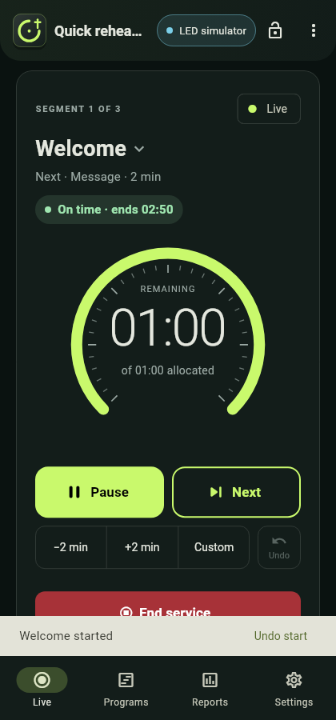

### The top of Live

| Part | What it does |
| --- | --- |
| Logo or mark, top left | Your church logo, or the built-in ring-and-cross mark. Select it to open the church profile. |
| Service name | The loaded or running service. On Programs, Reports or Settings, select the name to go straight back to Live. With no service loaded it reads Church Service Timer and does nothing. |
| Display chip | Where the stage output is going, for example **LED simulator**, **Stage simulator**, **LED sign** or **Stage screens**. Select it to open **Choose display**. Choosing and connecting a display are separate from starting a service. |
| Full screen | During a service or a Quick timer, shows the stage countdown on this device's own screen. On a phone the button is under the display preview instead. See [Second screen and full screen](#09-second-screen-and-full-screen). |
| Lock | During a service, locks every control and key until you **Hold to unlock**. |
| **⋮** menu | **Focused operator view** and **Ready for service**. On a PC it also holds **Mini timer**, **Full screen**, **Commands** and **Keyboard shortcuts**. |

### Three readings to learn first

| Reading | What it tells you |
| --- | --- |
| Main progress arc | The operator's current segment time, allocation and warning/overtime state. |
| Display preview | What the selected output is simulating or last acknowledged. Check its badge and any stale or "Output paused after an interruption" indication. |
| Timing status and Service timing overview | Progress against the whole plan ("On time", "45 min behind" and so on); its estimated finish can change with pauses and manual advances. Select the status line for the full overview. |

**A running arc does not prove the sign is receiving updates.** Likewise, Controller accepted or Stage screens received means the receiving system acknowledged data; it is not a camera view of what a person can see.

Use the labels as well as colour: normal time, warning and overtime have different meanings. In Royal Navy, the normal arc is green while the surrounding theme remains gold; warning is amber and overtime is red.

### Moving around on a phone or tablet

Tap the bar, or swipe left or right anywhere on the page. Each tab keeps its place when you come back to it. While a service is loaded or running, Live stays put: leave it with the bar, and swipe back to it from any other tab. A running-service bar on the other tabs, and **Return to Live** on Settings pages, take you straight back. Swiping is off while the controls are locked or while programs or reports are being selected; a sideways list or slider still scrolls as before, and a swipe from the very edge of the screen is still Android Back. With reduced motion on, the new tab appears at once.

The **Back** key on Programs, Reports or Settings returns to Live. On Live it asks you to press Back again before leaving the app; during a service it asks for confirmation and explains that the timer keeps running.

### Moving around on a PC

In a window at least 1200 wide and 600 tall, Live fills the window with a **desktop layout**. A new install starts in **Mission control**, shown below. Click a tab in the side rail or the header, or click the service name at the top left to return to Live. A smaller window uses the phone and tablet layout, and so does the focused operator view.

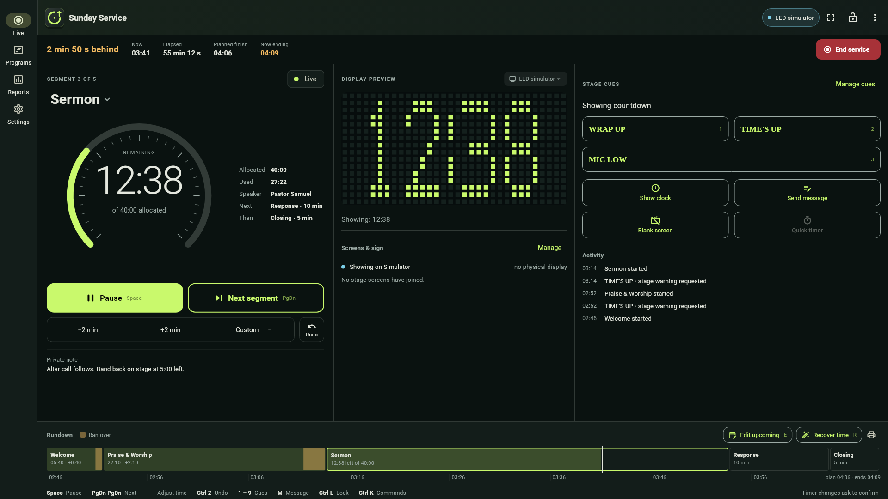

The timer, cues, display preview and rundown are the same ones the phone uses, arranged for a wide screen. The layouts are described in [Run the service from a PC](#11-run-the-service-from-a-pc), and the keys in [Keyboard, clicker and Commands](#12-keyboard-clicker-and-commands).

### Three safety rules that hold everywhere

1. **Every timer action asks you to confirm before anything changes.** That is true of a button, a key, a clicker on a PC and the Commands list.
2. **Lock controls blocks all input.** Buttons and keys do nothing until you **Hold to unlock**. Locking never pauses the timer.
3. **Blank screen hides the output; it does not pause the service.**

## 02 — Get started on Android

The app runs on phones and tablets with **Android 7.0 or later**.

1. On the phone, open the [download page](https://github.com/ImmanuelOkose/church-service-timer-guide/releases/latest) and download the file ending in `.apk`.
2. Open the downloaded file. Android asks whether to allow installs from your browser or file manager; allow it for this install.
3. Open **Church Service Timer**. It starts on Live with the **LED simulator**, so nothing reaches a real stage until you choose a display.
4. Check the version in **Settings › About**. This guide describes 0.34.0.

### Allow what the app asks for

The app asks for each of these only when it is needed. The first three protect warnings during a service.

| Android asks | Why it matters |
| --- | --- |
| Notifications | Shows warnings on the phone, and the lock-screen card with the countdown, Pause and Next. |
| Precise timing | Lets a warning arrive at its exact second. |
| Battery optimisation | Stops Android pausing warnings while the screen is off. **Ready for service** shows a Battery row with **Allow**. |
| Nearby devices or location | Lets the app find and rejoin the LED sign's Wi-Fi. |
| Camera | Only for **Scan QR code instead** when joining a service. |

Settle these before the service, not during it. **Live › ⋮ › Ready for service** lists anything still outstanding.

### Keep every device on the same version

Update every phone, tablet and PC your team uses together.

- Program files, backups and sent programs saved by 0.28 or later cannot be opened by 0.27 or earlier.
- A backup or program file that contains a cue with a screen colour, a banner or its own screen speed needs 0.34 or later to open.
- A paired phone or tablet still on an earlier version shows every cue in white and full screen, at the LED sign's speed.

### Check for updates

**Settings › About › Check for updates** asks GitHub whether a newer version has been published. It checks only when you tap the row, never by itself, and sends nothing about you or your church.

| The row says | What to do |
| --- | --- |
| You have the latest version | Nothing. |
| Version … is available | Tap **Open the download page**, then install as above. The version you have keeps working, so update when it suits you, not during a service. |
| Could not check. This device may be offline. | Try again with an internet connection. The app itself never needs the internet to run a service. |

Installing a newer version over the old one keeps your programs, reports and settings. Export a backup first all the same; see [Protect data and manage the LED device](#20-protect-data-and-manage-the-led-device).

## 03 — Get started on Windows

Church Service Timer also runs on a **Windows 10 or 11 PC** (64-bit), so a service can be run from the laptop at the media desk. It is the same app as on the phone: the same programs, reports, themes and settings. A backup made on a phone restores on the PC, and the other way round.

The Windows app is new. Rehearse on the actual PC, with its projector or screens plugged in, before you rely on it in a service.

### Install it

1. On the PC, open the [download page](https://github.com/ImmanuelOkose/church-service-timer-guide/releases/latest) and download the file ending in `windows-setup.exe`. If the page lists only the Android `.apk`, the Windows installer has not been published for that version yet.
2. Run the installer. Windows may show **Windows protected your PC**, because the installer is not code-signed. Click **More info**, then **Run anyway**.
3. Follow the installer. It installs for your Windows account, so it does not need an administrator password. Tick the desktop icon if you want one.
4. Start **Church Service Timer** from the Start menu.

Some releases also list a file ending in `windows-x64.zip`. Unzip it anywhere and run `church_service_timer.exe`; nothing is installed.

### The first time it opens

The app opens on Live with the **LED simulator**, so nothing reaches a real stage yet. In a wide window you see the Live home: your programs on the left, the chosen program's order of service in the middle, and the display preview and cues on the right.

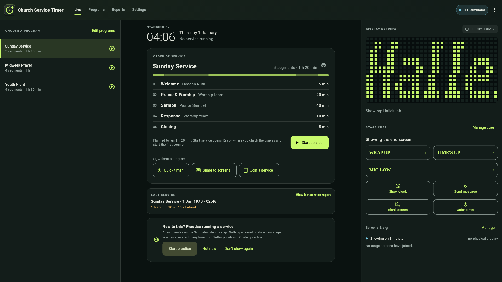

- **The window is yours to arrange.** Resize it or move it to another monitor. It reopens where you left it.
- **Only one copy runs.** Starting the app again brings the open window to the front.
- **Windows may ask about the network.** The first time you share to screens, Windows Defender Firewall asks once whether to allow the app. Allow it on private networks, or phones and browsers cannot reach it.
- **Your data stays when the app is removed.** Uninstalling leaves your programs, reports and settings in place for the next install.

### What is different from the phone

| On a PC | What to know |
| --- | --- |
| Click, not tap | The app's own wording changes to "click", and "press and hold" becomes "click and hold". |
| Keyboard | Space, Page Down and other keys run the service. Every timer key asks first. See [Keyboard, clicker and Commands](#12-keyboard-clicker-and-commands). |
| Files | Import, export, backups and reports use the usual Windows Open and Save windows. Where the phone says Share, the PC saves the file where you choose. |
| Drag and drop | Drag one program file (`.json`) or spreadsheet (`.csv`) from a folder onto the window to import it. It opens in the usual review, and nothing is saved until you confirm. A drop is refused while a service is running or the controls are locked. |
| Open with | Right-click a program file, choose **Open with**, then Church Service Timer. |
| Printing | **Print** opens the Windows print window. |
| It stays awake | While a service runs, or screens are shared, the PC does not go to sleep or turn its screen off. If it does sleep, for example when the lid is closed, the timer is still right when it wakes. |
| Closing the window | During a service the app asks **Close during the service?** Closing stops the timer on stage screens and the LED sign, and stops warnings. The service is saved, and opening the app again carries on from the clock. |
| Second screen | A projector or monitor plugged into the PC can show the stage full screen, with no network or pairing. See [Second screen and full screen](#09-second-screen-and-full-screen). |
| LED sign Wi-Fi | Join the sign's Wi-Fi in Windows' own Wi-Fi settings; the app does not switch networks for you. The PC can be on a network cable and the sign's Wi-Fi at the same time. |
| Not on a PC | Scanning a QR code with a camera (join with the six-digit code instead; the PC can still show a QR code for phones) and the phone's battery settings. |

### Warnings are silent on a PC

At each warning a Windows notification appears and the app's taskbar button flashes. **It makes no sound**, because a PC is often plugged into the sound system.

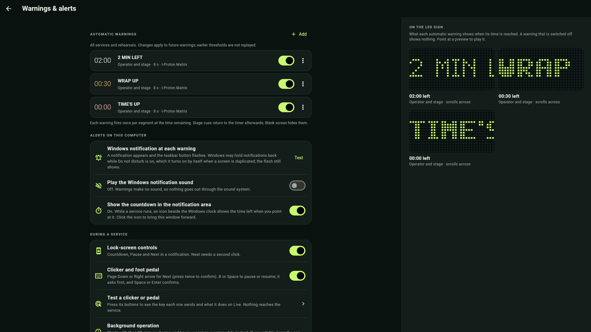

Under **Settings › Warnings & alerts › Alerts on this computer**:

| Row | What it does |
| --- | --- |
| **Windows notification at each warning** | **Test** shows one now. Windows holds notifications back while **Do not disturb** is on, and turns that on by itself when the screen is duplicated to a projector. The taskbar button still flashes. |
| **Play the Windows notification sound** | Off to begin with. Turn it on only if you want each warning to play the sound, through whatever the PC's sound goes to. |
| **Show the countdown in the notification area** | On to begin with. See below. |

These three choices are kept on that computer and are not part of a backup.

### The countdown beside the Windows clock

While a service or Quick timer runs, the app adds its ring-and-cross icon to the notification area, beside the clock.

- **Point at the icon** to read the time, for example "Sermon · 12:34 left", "Sermon · 01:10 over" or "Paused · Sermon · 12:34". This works while your lyrics or slides program is in front.
- **Click the icon** to bring the app's window forward.
- The icon only shows the time. It cannot change the service, and it goes when the service ends.
- Windows 11 puts new icons behind the small arrow beside the clock. Drag the icon out onto the taskbar to keep it in view.

If the same PC runs your slides, the **Mini timer** keeps the countdown and three buttons above them; see [Run the service from a PC](#11-run-the-service-from-a-pc).

### Update the PC

**Settings › About › Check for updates** works as on the phone: it checks only when you click it, then offers **Open the download page**. Download the newer installer and run it; it replaces the old version and keeps your data. Update between services, never during one, and update the team's phones and tablets to the same version.

## 04 — Your first rehearsal

Allow about 15 minutes. Use the simulator so no practice cue reaches a real stage.

**The quickest start is guided practice.** On a new install, Live shows a card: "New to this? Practise running a service". Choose **Start practice**, **Not now** (hides it until the app is next opened) or **Don't show again**. You can start it any time from **Settings › About › Guided practice**.

- Practice loads a built-in 17-minute **Practice service** that runs at 5× speed on the Simulator, so nothing appears on stage. It is never added to Programs, saves no report and leaves your programs, reports and settings alone.
- If another display is in use, practice asks **Practise on the simulator?** before switching, and offers to switch back when practice ends.
- A coach card lists eight steps, ticked off as you do them in any order: start, pause and resume, add and remove 2 min, next and Undo, a cue and the timer, blank and unblank, see overtime, and end. A pulsing ring and a small "Tap" badge show which control the current step needs; it never blocks a tap.
- Use **Skip step** or **Leave practice** at any time. At the end, a summary such as "8 of 8 steps done · about 4 min" offers **Practise again**, and About shows when this device last practised.
- Practice cannot start while a service is loaded or running, or on a device that has joined another device's service.

Then try the full workflow yourself. A step that says "tap" is a click on a PC.

1. Install the app; see [Get started on Android](#02-get-started-on-android) or [Get started on Windows](#03-get-started-on-windows). Check **Settings › About** for its version. This guide describes 0.34.0.
2. Tap the display chip at the top of Live and choose **Simulator**. The chip then reads **LED simulator**, or **Stage simulator** if you have chosen to simulate a stage screen.
3. On Live choose **Start service**, then load **Quick rehearsal** (a Pinned or Recent program card on Live loads straight away). In a wide window on a PC, click the program under **Choose a program**, then **Start service**. Loading a program enters **Ready**; it does not start the countdown.
4. Review the first and next segment. While Ready, choose **Service mode**: **Live timing · 1×** or a **Fast rehearsal** speed. A program's Service/Rehearsal grouping is not its speed setting. **Change** swaps in another program without leaving Ready.
5. Select **Start first segment**. When the display is connected and nothing needs attention, the service starts at once and **Undo start** is offered for 8 seconds; otherwise a confirmation explains what to check.
6. Tap **Pause**, confirm, and observe the held timer. Tap **Resume**, then try **Custom** to add or remove minutes and seconds. Read the proposed result before confirming.
7. Open **Stage & display** and tap one prepared **Stage cue**. It sends immediately. The countdown continues underneath. Choose **Show timer** to restore the current timer, not the original starting time.
8. Tap **Blank screen**, then **Unblank screen**. Blanking hides output; it does not pause the service.
9. Use **Next** (**Next segment** on a tablet or PC) when the current activity is finished. If this was accidental, use **Undo** while it is available and review the confirmation.
10. Allow a segment to reach zero. Observe the operator's red overtime and the shared At zero display behaviour. Reaching zero does not automatically advance the program.
11. Choose **End service** and confirm. Live returns to Standing by after the report saves. On the **Last service** card, tap **View last service report**.
12. Tap **Quick timer** on Live, choose 5 min and start it. Notice there is no Ready step. Tap **End timer** when you have seen it count. See [Operate a live service](#10-operate-a-live-service) for details.
13. On a PC, run one more rehearsal from the keyboard. Press **Space**, then **Space** again, to pause. Press **Page Down** twice for the next segment. Press **?** to see every key.

**You are ready for the next lesson when you can explain:** Ready versus running, Pause versus Blank, Show timer versus Next, a Quick timer versus a service, and a display acknowledgement versus a physical check.

Fast rehearsal accelerates simulated service time (5×, 10×, 30× or 60×). Reports identify it as rehearsal timing, and duration insights exclude rehearsals. Use normal speed for the supported physical LED countdown.

## 05 — Build a reusable program

Open **Programs** and tap **New program**. (With no programs at all, Programs offers **Create program** and **Import**.) In **Program editor**, give the plan a useful **Program name**; “Youth sunday” is the example placeholder, not a mandatory name.

1. Choose Service or Rehearsal as its **Program group**.
2. Use **Add segment** for each activity, in the order it will happen. Enter a **Segment name** and set its duration in minutes and seconds, for example 5 min 30 s. Each segment stays within 59 min 59 s.
3. Add a **Speaker (optional)** and **Private operator notes** where useful: microphone changes, music cues or an agreed finish instruction. Notes are never shown on the sign.
4. Turn on **Protect duration** for a segment that time recovery must not shorten.
5. Reorder segments using the drag handles ("Drag the handle to reorder" appears once there are two or more).
6. Review the **End screen** row. It reads "Uses the current default" until you give this program its own end screen.
7. Choose **Create program** for a new plan, or **Save changes** after editing.

Example practice plan:

| Segment | Duration | Speaker / private preparation note |
| --- | --- | --- |
| Welcome | 2 min | Host · have microphone 1 ready. |
| Worship | 5 min 30 s | Worship lead · confirm final song with the team. |
| Message | 8 min | Speaker · send the agreed wrap-up cue. |
| Closing | 2 min | Host · confirm announcements before closing. |

Open a row in Programs for **Program details**, with **Load into Live** and **Edit program** up front. Its **⋮** menu holds Duplicate, Export JSON, Export CSV, **Print order of service**, **Send to paired phone** (while one is connected), **Version history** and **Delete program**, which asks for confirmation. A duplicate is useful for a special service without overwriting a familiar plan.

In the Programs list, the pin icon marks pinned programs, which Live offers first. **Press and hold** a program (click and hold on a PC) to start selecting; the bar at the bottom then offers **Pin**, **Share**, **Export** and, in red, **Delete** (with a 10-second Undo). Back or **×** finishes selecting.

**Segment library.** For segments you use often, such as Offering or Announcements, open the segment in the editor and tap **Save to library**. It keeps the duration, speaker, notes and protection. **From library** next to Add segment inserts one into any program, with search. Saving the same name again updates it. **Programs › ⋮ › Segment library** lists them and removes one, with Undo. Up to 50 are kept.

**Version history.** Each time you save a change, the version before it is kept, up to the last 10. **Program details › ⋮ › Version history** lists them with what changed (for example “Added “Offering”, +4 min in total”). Tap one to open it as "Earlier version" and choose **Restore this version**, with Undo. Restoring keeps the current name, and the version it replaces stays in history.

Unfinished program edits are saved locally as drafts after a short delay ("Draft saved" appears once you change something). On reopening, choose **Restore draft**, **Discard draft**, or Cancel. Restoring is not the same as saving the program. If a save fails, keep the app open and use its retry action. The latest keystrokes can be lost if the app is closed before a pending write completes.

**Importing.** Use **Programs › ⋮ › Import programs (JSON or CSV)**, or open a program `.json` or `.csv` file shared to the app. On a PC you can also drag one file from a folder onto the app's window. Every import goes to a review ("Preview program import") before you choose **Import program**.

| File | What it carries |
| --- | --- |
| Program JSON | Everything: segments, speakers, notes, protection and end-screen formatting. |
| Simple CSV | The header `Segment Name,Duration (Minutes)`, with an optional `Seconds` column. Names and durations only. |
| Any other spreadsheet (CSV) | Opens **Match spreadsheet columns**. The app guesses which column is the name, duration, speaker, notes or program, and reads durations written as `5`, `5.5`, `05:30`, `5 min` or `90s`. A live preview lists every problem by row number. The choice is remembered, so next week's sheet in the same layout needs one tap. Then **Continue to review**. |

Current limits are 1 MiB and 200 segments. Export Excel files as CSV first. The LED native countdown has its own limit, explained in [Connect the LED sign](#07-connect-the-led-sign).

**Sending a program to another phone.** While sharing to screens, **Program details › ⋮ › Send to paired phone** sends the program to the connected operator and viewer phones you tick (stage screens are left out). Private notes are optional. The other phone shows a "Program received" card with **Review**. If it already has a program with that name, **Update mine** replaces it and keeps its current version in Version history; **Save as copy** adds it with a numbered name. Received programs wait until reviewed, even after leaving the pairing (up to five), and are not included in backups.

### Programs on a PC

In a desktop layout, Programs uses the whole window.

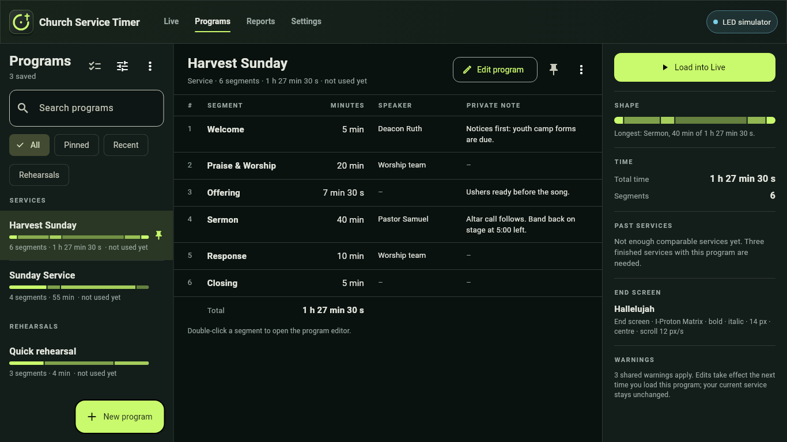

| Column | What it holds |
| --- | --- |
| Left | Your programs, with search and the All, Pinned, Recent and Rehearsals filters. |
| Middle | The chosen program as a table: each segment with its time, speaker and private note. |
| Right | **Load into Live**, the shape of the service, its total time, what past services say about the timings, the end screen and the warnings. |

To change a program, click **Edit program** or double-click a segment. This opens the same Program editor, which shows the running order beside the form: when each segment starts and when the service ends. Changes never touch a service that is already running.

### Shared settings travel with the device, not the program

Global warnings and At zero settings are shared on the receiving device. Importing a program does not establish an independent set of warning rules for it. Keep exports containing private notes within the operator team.

## 06 — Choose the right display

There are several ways to put the timer in front of people. This lesson lists them all, so you can pick the right one before the detail in the next three lessons.

### Every way to show the timer

| Screen | Best use | What it needs | Lesson |
| --- | --- | --- | --- |
| **Simulator** | Training, and checking what the stage will show, on your own device. | Nothing. It does not send to hardware. | This one |
| **LED sign** | A physical red LED countdown and short cues at the front of the church. | The supported W2 profile, the sign's Wi-Fi and its connection password. | [Connect the LED sign](#07-connect-the-led-sign) |
| **Phone or tablet stage screen** | A large stage countdown, rich Quick messages, screen groups and Seen. | The app on that device, pairing, and a network that lets devices reach each other. | [Pair a phone or tablet](#08-pair-a-phone-or-tablet) |
| **Web screen** | A laptop on a projector, a smart TV or people's own phones following in a browser. | Nothing installed; the same Wi-Fi as the host, and a guest or team code. | [Pair a phone or tablet](#08-pair-a-phone-or-tablet) |
| **Second screen** (PC only) | A projector or monitor plugged into the PC running the service. | Windows set to **Extend**. No network and no pairing. | [Second screen and full screen](#09-second-screen-and-full-screen) |
| **Full screen** | When your own screen is the one people watch: a laptop on a lectern, or a tablet on a stand. | A running service or Quick timer. | [Second screen and full screen](#09-second-screen-and-full-screen) |

Stage screens, web screens, a second screen and full screen all draw the same stage picture: a large countdown on black, with cues, warnings, the clock and a blank screen as you send them. This guide calls them "screens" where the LED sign behaves differently.

### Choose display

Select the display chip at the top of Live, or **Change display**, to open **Choose display**. It asks "Where should your stage output appear?" and offers one destination at a time. Each choice shows what is connected, for example "1 paired · 2 web connected".

| Destination | The chip then reads |
| --- | --- |
| **LED sign** | LED sign |
| **Phone, tablet or web screens** | Stage screens, or Waiting for a screen until one joins |
| **Simulator** | LED simulator or Stage simulator |

LED sign and Phone, tablet or web screens are **alternative stage-output destinations**. Sharing to viewers, operators and web screens is separate, so sharing does not itself replace the LED sign. A second screen and full screen are separate too: they work whichever destination is chosen.

Changing destination keeps the service timer running and stops LED reconnect attempts when another destination is chosen. When leaving a connected LED sign, choose whether to **Blank previous sign** or **Leave output**. A sign left displaying a countdown can continue on its own.

### What the Simulator simulates

With no LED sign and no stage screens in use, the Display preview on Live shows a pretend display. You choose which kind:

| Choice | The preview shows | The chip reads |
| --- | --- | --- |
| **LED sign** | The exact 32 × 16 LED layout. A new install starts here. | LED simulator |
| **Stage screen** | The large countdown, cues, clock and blank screen as a phone, tablet, web or second screen would show them. | Stage simulator |

Change it in either place:

- In **Choose display**, under Simulator: **Simulate: LED sign | Stage screen**.
- On Live, select the chip beside **Display preview** and choose **Simulate an LED sign** or **Simulate a stage screen**.

Nothing is asked when you switch. The choice is kept on that device and is not part of backups. Locked controls cannot change it.

### Check the real screen

Always check the badge after changing output. A simulator preview, an authenticated LED connection and an acknowledged stage screen are different states. Use **Test screen** (or **Test 5 s** in the Quick message composer) and have someone confirm the intended physical screen before the service.

If a phone, tablet, PC or browser joins as a stage screen while your display is set to the Simulator or the LED sign, it has nothing to show. Live then shows a note with a **Show on stage screens** button, which sends the timer to those screens in one step. The waiting screen itself says what to do on the host.

## 07 — Connect the LED sign

The hardware path has been tested with **Huidu W2, firmware V6.02.232, 32 × 16 red monochrome**. Do not assume every LED sign or every W2 firmware is supported. The app reads and validates the profile before publishing content.

1. Power the sign and choose **LED sign** in Choose display. The **Connect the LED sign** page walks through three steps.
2. **Join the sign's Wi-Fi**: connect the operator phone to the sign's network in Android (**Wi-Fi settings**), then come back. On a PC, join it in Windows' own Wi-Fi settings; the app opens them for you but does not switch networks itself.
3. **Choose the sign**: tap **Scan for displays** and select the intended display.
4. **Sign in**: enter its connection password (the field is labelled "Display device password"; it may differ from the Wi-Fi password). Leave **Remember password on this phone** ("on this computer" on a PC) checked if this is a trusted operator device. It remembers the connection password, not the Wi-Fi password.
5. Tap **Connect selected display** and check the successful result and preview status.
6. Start a normal-speed service when ready. If restoring a service already in progress after an interruption, review its timer and use **Restore current output** when offered.

Connecting alone does not overwrite what the sign is currently showing. The stored connection password is encrypted on the device: with Android Keystore on a phone, and with Windows' own protection, tied to your Windows account, on a PC. It is left out of backups unless you choose to include saved passwords, encrypted with a passphrase. **Forget this sign** (in LED device management) removes the app's remembered information and saved passwords; it does not reset the sign.

There are two different passwords:

| Password | Where it is used |
| --- | --- |
| Wi-Fi password | Android or Windows uses it to join the sign's wireless network. |
| Connection password | The app uses it to authenticate to the LED controller. |

Supported native countdowns run up to **59:59**. The sign runs an accepted countdown independently and settles at 00:00. The app handles shared At zero output and future segment changes. A brief blink at pause, resume, cue, warning or program replacement is expected on the tested controller; normal counting between replacements should be smooth. The LED sign keeps a steady colon; the blinking colon is for paired and web screens.

**On a PC.** The PC can stay on a network cable while it joins the sign's Wi-Fi, so web screens and the sign can run together. The Tinos font is drawn slightly differently on Windows, most visibly at Short 7 px; check a Tinos cue on the real sign after moving from a phone to a PC.

An uploaded countdown can continue if Wi-Fi is lost. A static pause frame or cue may instead remain visible until it is replaced. Do not infer that the sign is current just because it is still lit. Read [connection recovery](#19-connection-recovery-and-troubleshooting) before using automatic recovery during a service.

## 08 — Pair a phone or tablet

Use one device as the **host**. It owns the clock and saved data. The host can be a phone, a tablet or a PC. Other phones, tablets and PCs join as stage displays, viewers or additional operators; browsers can follow as web screens.

**Network first:** put the devices on the same Wi-Fi or on the host device's own hotspot. Internet is not required. Some sign hotspots, guest Wi-Fi and church networks keep devices apart ("client isolation"), so phones on them cannot reach each other; the app's advice is then to use the host device's hotspot. QR codes do not bypass isolation. If the host moves to another network while sharing, for example when you turn its hotspot on, it shares again at the new address by itself; approved devices, the team code and joined browsers carry over.

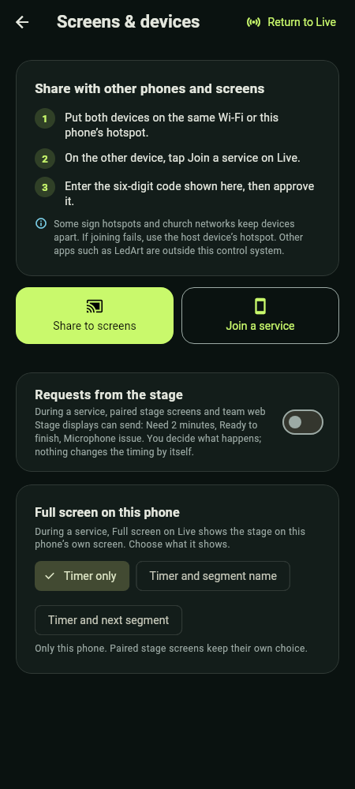

1. On the host, tap **Share to screens** on Live (or **Settings › Screens & devices**). From Choose display › Phone, tablet or web screens, the button is **Share to stage screens**, which also turns on stage output. Sharing to screens alone keeps LED output.
2. On the joining device, tap **Join a service** on Live. Give it a clear **Device name** and choose **Use this device as**: **Service viewer**, **Stage display** or **Additional operator**.
3. Select the host under Nearby hosts and enter its **six-digit code**, including leading zeros, then **Join service**. Alternatively, use **Scan QR code instead** with the host's **Show QR code**. A PC has no camera scanning, so it joins with the code; it can still show a QR code for phones.
4. The host reviews and **Approve**s the joining device. Knowing the code is not enough by itself.
5. A stage display opens in landscape full screen. Tap to reveal its overview and exit tools (**Back to service overview**, **Open stage display**).
6. Check the host's Saved devices list and use **Test screen** before going live. **Return to Live** leaves Screens & devices without ending sharing.

**On a PC.** Screens & devices has three areas: phones and tablets with the app, this computer (its [second screen](#09-second-screen-and-full-screen)), and browsers without the app. **Join a service** is three numbered steps: choose the host, name this device, enter the code. The first time the PC shares, Windows Defender Firewall asks once; allow the app on private networks or other devices cannot reach it.

**If a stage screen joins and shows only a waiting message**, your display is still set to the Simulator or the LED sign. Live shows a note with **Show on stage screens**; select it to send the timer to them.

When joining, a phone can offer **Rejoin this Wi-Fi automatically**: it notes the network it is on (church Wi-Fi, the host's hotspot or the sign's Wi-Fi) and rejoins only that network if the link drops.

Codes expire after ten minutes. If a code expires or its attempts are exhausted, use **New code** on the host. A new code does not remove already approved devices. Never publish a live pairing code or QR image in training materials.

| Role | Capability and privacy |
| --- | --- |
| Host | Owns timing, reports and output; approves devices and can take back control. Keep it powered and connected. |
| Additional operator | Initially observes and can **Request control**; the host must explicitly **Give control**. Only one operator controls at a time. Private notes become visible when control is granted. |
| Service viewer | Observes service information without control or private operator notes. |
| Stage display | Shows large timer/cue/message content; no private notes or prepared-cue library. |

Handing over control does **not** move the service to the other phone. If that operator disconnects, control returns to the host. Reconnection does not silently restore its control grant.

For each saved screen, use **Screen options** to set a recognisable name, a **Screen group** (**General, Preacher, Choir, Media desk**) and a **Screen layout** (**Timer only, Timer + current segment, Timer + next segment**). The host can choose which acknowledged screen to inspect in the preview. In a desktop layout, the screens list under the display preview keeps a paired screen that stops answering as "not answering", shows one you disconnected as "disconnected", and counts people following the order of service on the web on one line.

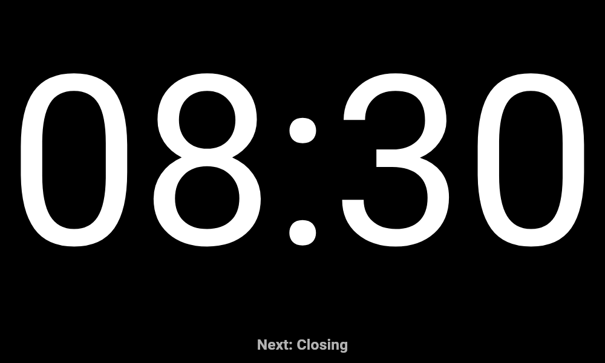

**Disconnect** keeps a device saved but pauses its service access. **Reconnect** on the host can restore it without another code when the receiver app is available on the same reachable network. **Forget device** revokes approval and requires pairing again. If the receiver deliberately leaves, it must choose **Reconnect saved host** to rejoin. **Stop sharing** is deliberate; host sharing does not automatically restart on app launch.

One host with three stage receivers is within the current eight-connection cap for paired devices, which also counts pending connections. That cap is not a guarantee of performance on every router or phone; rehearse the exact setup.

### Web screens in a browser

While sharing, **Settings › Screens & devices › Web screens** shows three ways for a browser on the same Wi-Fi to open the page:

1. **Easy name**, made from the church name, for example `grace-community.local:8080`. iPhones, iPads, Macs and most laptops open it; some Android phones do not. **Change easy name** edits it.
2. **QR code**, which any phone camera reads.
3. **Address**, the host's own address such as `192.168.1.23:8080`, as a last resort.

| Browser view | Shows | Needs |
| --- | --- | --- |
| Order of service | The rundown with the current item marked **NOW**; no times. Speakers only if **Show speakers in the order of service** is on. | The **guest code** (4 digits, the same each week until you tap **Change guest code**), or nothing if set to open. |
| Stage display | The full-screen countdown, cues and Quick messages. | The **team code**. |
| Service overview | Time left, ahead or behind, finish time and the rundown with durations and speakers. | The **team code**. |

The 6-digit team code changes each time you share, or with **New team code**, and unlocks switching between all three views. Order of service access can be **Off**, **Needs the guest code** (the default) or **Open to anyone on this Wi-Fi**. Changing a code signs out the browsers that used the old one. No browser can control the service or see private notes.

**Export join slide** makes an image with the church name, a large QR code, the easy name, the guest code and the address, ready to project. Pick the screen it is for (16:9 HD or 4K, 16:10, 4:3, Portrait 9:16 or Square) and dark or light. If the host's address changes afterwards, the panel says the slide is out of date: export it again. A printed address or QR stops working if the router gives the host a new address, so ask for the address to be reserved on the router, or show the join slide instead.

A browser shows a red "Connection to the host device lost · reconnecting…" banner and fades the countdown within about five seconds of the host going quiet, and picks up again by itself when the host returns. On a web Stage display, the **Full screen** chip becomes **Exit full screen**.

### Requests from the stage

When **Requests from the stage** is switched on in Screens & devices (off by default), a presenter can quietly ask the operator for something during a service, from a paired stage screen or a team-code web Stage display. A small **Request** button offers three fixed choices: **Need 2 minutes**, **Ready to finish** and **Microphone issue**; there is no free text. How the operator answers is in [Operate a live service](#10-operate-a-live-service).

## 09 — Second screen and full screen

Two ways to show the stage countdown without pairing anything. A **second screen** is a projector or monitor plugged into the PC. **Full screen** uses the screen of the device that is running the service.

### Show the stage on a second screen (PC)

1. Plug the projector or monitor into the PC.
2. Press **Windows + P** and choose **Extend**. With Duplicate, Windows sees only one screen, so there is nothing to show the stage on.
3. On Live, look under the Display preview. A line says what the second screen is doing: "Second screen: not showing".
4. Click **Show on second screen**. The stage fills that screen, with no title bar or taskbar. With more than one extra screen, choose which from the list beside the button.
5. The line now reads, for example, "Showing on Screen 2 · 3840 × 2160", and the button becomes **Stop**.

The second screen shows what a paired stage screen shows: the countdown, prepared cues, automatic warnings, messages from **Send message**, the clock and a blank screen. It needs no network or pairing, and it works whichever display you have chosen, the LED sign included.

**To stop**, click **Stop**, press **Esc** on that screen, or unplug it. Closing the app closes it too. With no extra screen connected, the line reads "No second screen connected" and there is no button. **Lock controls** disables the button like every other control.

**Show on second screen** is also in Commands (**Ctrl+K**).

### See the second screen on Live

While the second screen is showing, the Display preview on Live holds a small live copy of it, in that screen's shape and layout.

| Your display | Where the copy appears |
| --- | --- |
| Simulator | It takes the Simulator's place, and the chip beside **Display preview** reads **Second screen**. |
| LED sign, or phone, tablet or web screens | Their preview stays. The copy sits under it with its own **Second screen** heading. |

When the second screen stops, the preview goes back to how it was.

### Second screen settings

**Settings › Screens & devices › Second screen** has the same **Show** and **Stop** for each screen, and two more choices.

| Setting | What it does |
| --- | --- |
| **Open the second screen when a service starts** | Off to begin with. When on, starting a service or a Quick timer shows the stage on the screen you last used. If that screen is not connected, nothing opens and Live says so. It never opens on your own screen by itself, and guided practice does not open it. |
| **What the second screen shows** | **Timer only**, **Timer and segment name**, or **Timer and next segment**. This is the second screen's own choice; paired stage screens keep theirs. |

The app remembers the screen you last showed the stage on and offers it first next time. After changing the resolution or the arrangement of screens in Windows, click **Show** once to choose it again. These choices are kept on that computer and are not part of a backup.

Ending the service leaves the second screen open, showing the program's end screen. Close it with **Stop** when the room no longer needs it.

### Full screen on the device running the service

Use this when your own screen is the one people watch. During a service or a Quick timer, Live can replace itself with the stage picture: the big countdown on black, with warnings and cues as they appear on stage.

| To open it | Where |
| --- | --- |
| The Full screen button | At the top right of Live on a tablet or PC; under the display preview on a phone. |
| **⋮ › Full screen** | The Live menu. |
| **F11** | On a PC. |
| **Full screen** in Commands | On a PC, with **Ctrl+K**. |

**To leave**, press **Esc** or **F11**, or tap or click anywhere and then **Exit full screen**. The Exit control also shows for the first few seconds. On Android, Back leaves it too. Full screen leaves by itself when the service ends.

Nothing changes in what the LED sign, a second screen or paired screens receive.

### Running the service from full screen

On a PC the keys work as they do on Live, with the same safety rules.

- **Every timer action still asks first**, in a small card over the stage. People watching will see that card for a moment.
- **Next segment** still needs its second press.
- With **Lock controls** on, every key is blocked, Esc and F11 included. A tap, a click or Esc shows **Controls locked** and **Hold to unlock** in place of Exit.

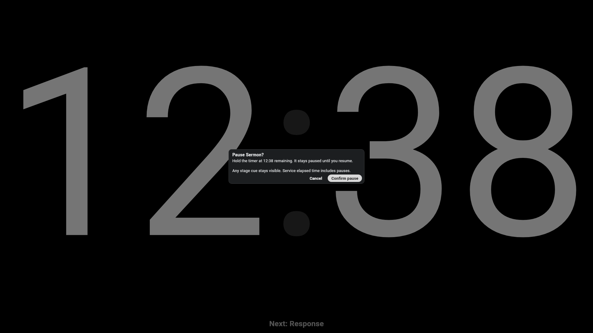

### What full screen shows

The same three choices: **Timer only**, **Timer and segment name**, or **Timer and next segment**.

| Device | Where to choose |
| --- | --- |
| PC | It uses the choice made for the second screen, in **Settings › Screens & devices › Second screen**. |
| Phone or tablet | **Settings › Screens & devices › Full screen on this phone**. It is kept on that device and is not part of a backup. |

A device that has joined another device's service as a stage screen already has its own full-screen stage display, so it is not offered this one. Full screen cannot be opened from the mini timer.

## 10 — Operate a live service

Load the correct program, check its first segment and destination, then **Start first segment**. Program transitions remain manual: the app does not decide when worship, a message or an announcement is finished.

**Before you start.** In Ready you can:

- Use **Change** to swap in another program (pinned first, with search); an 8-second Undo switches back.
- Set a **Pre-service countdown** (**Set time**). The display shows the clock until the last hour, counts down to the start, then holds "STARTING SOON" at 00:00. It never starts the service by itself. Tapping Start first segment early asks "Start now?" first.
- Read the "Last time" review note if the same program has one.

| Control or reading | What to do and expect |
| --- | --- |
| Pause / Resume | Confirm the action. Pause holds the service clock; Resume continues it. LED replacement can blink briefly. |
| −2 min / +2 min | Review the confirmation before changing the current segment's time. |
| Custom | Choose add or remove and set minutes and seconds. Review the resulting timer; time can continue while the dialog is open. |
| Next (Next segment on a tablet or PC) | Confirm when the next real activity begins. It starts that segment's allocation and replaces the previous output. |
| Segment title | Tap the current segment's name to **Jump to segment** further ahead, with a confirmation. |
| Full screen | Shows the stage countdown on this device's own screen. See [Second screen and full screen](#09-second-screen-and-full-screen). |
| Undo | Reverses the supported last segment change when available; it is not a universal undo of every action. Review the confirmation. |
| "of 10:00 allocated" | The current segment's allotted time, not the entire service length. |
| View / Hide operator notes | Opens the current segment's private notes; it does not publish them to stage displays. |
| Focused operator view | In the **⋮** menu. Keeps essential controls, timer, cues and display preview prominent. |
| Lock controls | The lock icon blocks every button and every key. Use **Hold to unlock** to regain local controls. It does not pause time. |

Tap a row in **Service rundown** to inspect its timing, speaker and private note. Opening that information does not advance to the row. The rundown header also holds **Edit upcoming**, **Recover time** and a print icon for **Print order of service**.

At zero, the operator view enters **Overtime** and shows red text while the display stays at 00:00 or the configured At zero text. This is intentional. Start the next segment when appropriate; do not add time merely to hide an overrun from the report.

The **Stage & display** panel holds Stage cues, **Show clock**, **Send message**, **Blank screen** and **Quick timer**, plus the display preview. **Show clock** puts the time of day on the display (12 or 24 hour, set in Display settings › Clock format); **Back to clock** or **Show timer** returns. **Blank screen** is a toggle: tap again as **Unblank screen** to restore current output. It also works after End service. Timing and phone alerts continue while blanked, but automatic stage warnings are suppressed. The preview should remain present and identify intentional blanking.

**Lock-screen controls.** On a phone or tablet, during a service, a notification shows the current segment with a live countdown (counting up in overtime), with Pause/Resume and Next; Next needs a second tap. It is on by default in **Settings › Warnings & alerts › During a service**, and it obeys Lock controls.

**Keyboard, clicker and foot pedal.** On a PC, Space, Page Down and other keys run the service, and each timer key asks first. A clicker or foot pedal can drive Live on a phone, tablet or PC. Both are in [Keyboard, clicker and Commands](#12-keyboard-clicker-and-commands).

**On a PC.** While another program is in front, the countdown is beside the Windows clock, and the mini timer keeps it above your slides. Under the display preview, one line and one button show the stage on a projector or second monitor. See [Get started on Windows](#03-get-started-on-windows), [Run the service from a PC](#11-run-the-service-from-a-pc) and [Second screen and full screen](#09-second-screen-and-full-screen).

**Requests from the stage.** If a presenter sends a request, the phone vibrates briefly and a card on Live shows it with **Acknowledge** and **Dismiss**. "Need 2 minutes" also offers **Add 2 min**, the normal adjustment with Undo; nothing changes the timing by itself. The presenter's screen shows "Sent", then "Seen by operator" or "2 minutes added". One request per screen at a time, at most one every 5 seconds, and requests expire after 2 minutes. The service report lists each request and what you did.

### Quick timer

For a prayer meeting, a break or a talk that isn't a whole service, use **Quick timer** instead of a program. It is available when no service is loaded or running: on the Standing by card next to **Start service**, or as the tile beside Show clock, Send message and Blank screen.

1. Choose **5 min**, **10 min**, **15 min**, **30 min** or **45 min**, or **Custom…** for any length up to 59 min 59 s. Your last three timers appear under **Recent** as one-tap choices.
2. Optionally give it a **Name (optional)**, such as "Prayer meeting".
3. Leave **Save as a report** off unless you want a record. Off, nothing is saved when it ends; on, it is saved in Reports, marked Quick timer.
4. Tap **Start 5 min timer** (the button names the length). It starts straight away, with no Ready step.

It counts down on the LED sign, stage screens, web screens and a second screen together, with Pause, ±2 min, overtime, warnings, full screen and the lock-screen controls as usual. **End timer** stops it and shows the end screen. Saved Quick timers are left out of service averages and length suggestions.

## 11 — Run the service from a PC

In a wide window, on a PC or a large tablet held sideways, Live fills the screen instead of scrolling one column of cards. Everything works as in [Operate a live service](#10-operate-a-live-service): every timer action still asks first, and **Lock controls** still blocks them all. This lesson covers what the wide screen adds.

### The Live home, before a service

With no service loaded, a wide window shows three areas.

| Area | What it holds |
| --- | --- |
| Left: **Choose a program** | Your programs. Click one to see it in the middle. **Edit programs** opens Programs. |
| Middle | The time of day, then the chosen program's order of service with each segment, speaker and length, a small **Print** button beside the summary, and one **Start service** button. Under it: **Quick timer**, **Share to screens** and **Join a service**. The **Last service** card follows. |
| Right | The display preview and stage cues, already open. |

**Start service** opens Ready, where you check the display and start the first segment. Nothing counts until then. The picture of this page is in [Get started on Windows](#03-get-started-on-windows).

### Choose a desktop layout

**Settings › Desktop layout** lists five layouts. Each arranges the same timer, cues, display preview and rundown. Choosing a layout also sets the theme it comes with; you can pick any theme afterwards.

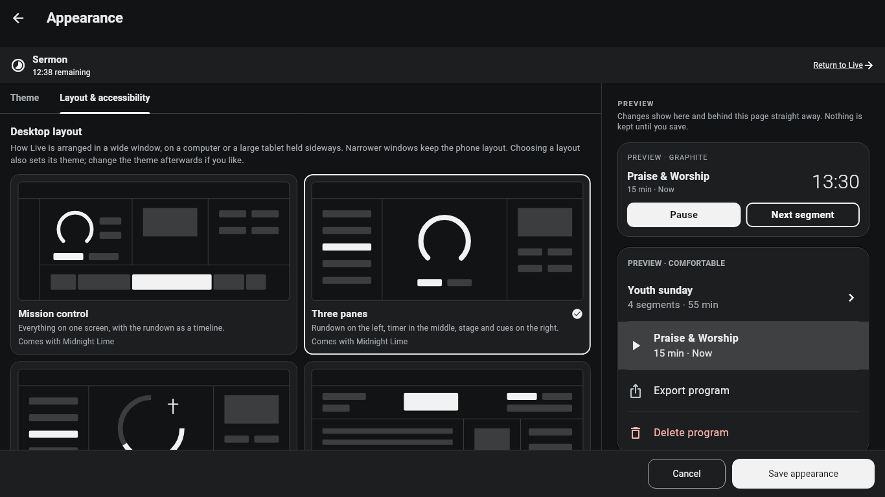

| Layout | What it is like | Comes with |
| --- | --- | --- |
| **Mission control** | Everything on one screen, with the rundown as a timeline. A new install starts here. | Midnight Lime |
| **Three panes** | Rundown on the left, timer in the middle, stage and cues on the right. | Midnight Lime |
| **The dial** | The whole service as a ring, with the countdown inside. | Royal Navy |
| **Keys** | Dense and keyboard-first: the timer in a strip, the rundown as a table. | Graphite |
| **Classic** | One column of cards, as on a tablet. | Your current theme |

Click a layout, then **Save appearance**. If you already used the app before Mission control became the starting layout, your layout stays as it is.

A window narrower than 1200 or shorter than 600 keeps the phone and tablet layout. So does the focused operator view.

### Mission control

For seeing the whole service at a glance.

- **The strip across the top** says how far ahead or behind the service is, the time now, the time elapsed, the planned finish and when it is now set to end, with **End service** beside it.
- **The timer, the display preview and the cues** sit side by side.
- **The rundown is a timeline** along the bottom. Each segment is as wide as the time it takes. Finished segments show how long they really took, with the part that ran over marked. A line shows where the service is now. Click a segment for its details.
- **The keys** that work on Live are listed along the bottom edge.
- In a tall window it also lists the screens that have joined, under the display preview, and the service's latest activity, under the cues.

### Three panes

The whole rundown is on the left, with how long each finished segment really took and how far ahead or behind the service is running. The timer and its controls are in the middle, with the private note in view. The display preview, cues and messages are on the right. Live, Programs, Reports and Settings become tabs in the header.

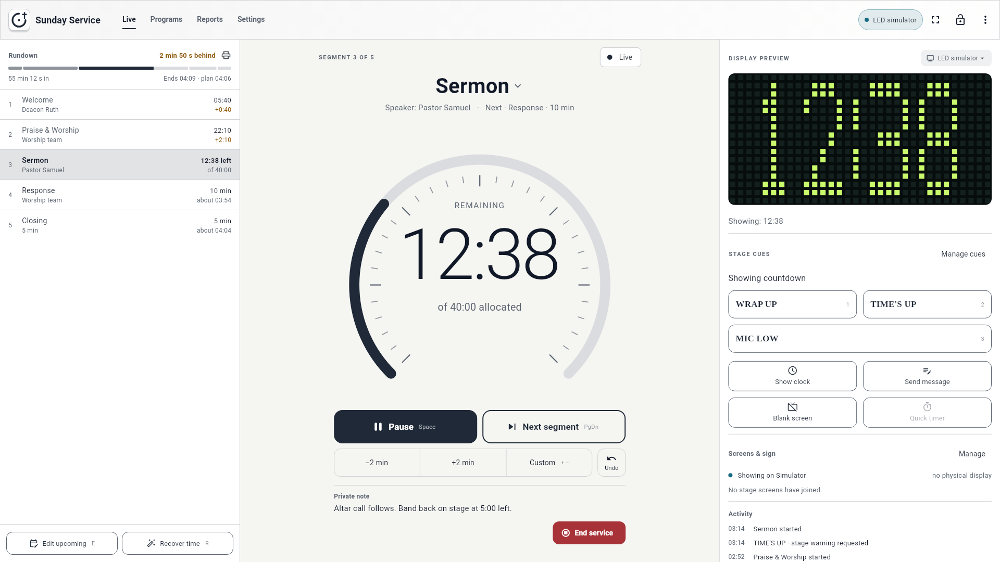

### The dial

Built around the app's own mark. The whole service is a ring, with a piece for each segment, running round to end at the cross. Finished segments fill in, with any overrun marked. Inside it, a second ring shows the time left in the running segment, with the countdown in the middle and the time the service is now set to end beside the cross. An **Up next** box above the rundown gives the next item, its length, who leads it and roughly when it starts. Click any part of the ring for that item's details.

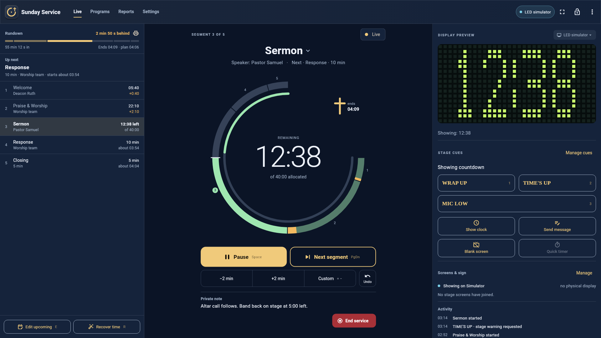

### Keys

Dense, and made to be run from the keyboard. The running segment is one strip across the top: its name, a large countdown, how far ahead or behind the service is, when it will end, and the timer controls. Below it the rundown is a table, with a column each for speaker, planned time, start, actual time, how far over or under, and state. The private note sits underneath. A status line along the bottom shows where the output is going and whether the controls are locked.

Before the first segment starts, Keys shows the three panes, which have room for the start controls.

### Classic

The side rail and one column of cards, as before the desktop layouts. In a very wide window the rundown has a column of its own beside the timer and the display, so the whole service is in view without scrolling.

### On a large monitor

The layouts grow with the window. A 1366 × 768 laptop window looks as described above.

| Layout | In a larger window |
| --- | --- |
| Three panes and The dial | From about 1920 × 1080 the ring grows to fill the height, with the buttons straight under it. In a wider window, such as 2560 × 1440, the ring sits at the left with the segment name, the controls, the private note and End service in a column at its right. |
| Mission control | In a tall window the ring is larger, the timeline is taller and each block adds the speaker, the planned time and how long the segment took or when it should start. |
| Classic | From about 1840 wide, the rundown gets its own column. |

### Keys on the buttons

On a PC, Pause, Next segment, Custom and the cue buttons show the key that presses them. Turn this on or off with **Show keyboard keys on buttons**, under **Settings › Desktop layout**.

### Saved looks

**Save this look** keeps the layout, theme, spacing, contrast and key labels together under a name, such as "Sunday morning", so you can go back to it in one step. Up to 8 are kept, and they are included in backups. **Reset to default** returns to Mission control with Midnight Lime.

### The mini timer (Windows)

If the same PC runs your lyrics or slides, the mini timer keeps the countdown in view above them.

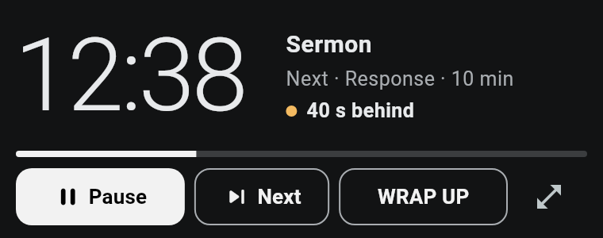

**To open it** during a service, click the mini timer button at the top right of Live, beside Lock controls. You can also choose **⋮ › Mini timer**, press **Ctrl+M**, or pick it from Commands.

The app shrinks to a small window that stays on top of other programs. It shows:

- the current segment and the time left, amber near the end and red with a "+" when over;
- what is next, and whether the service is ahead or behind;
- **Pause** or **Resume**, **Next**, your first prepared cue, and **Expand**.

Pause, Next and closing the window ask before acting, as usual, in a compact form. The cue button turns into **Show timer** while that cue is on stage. Adjusting time needs the full window. With **Lock controls** on, the buttons give way to **Hold to unlock**. Dragged very narrow, the window shows only the name and the countdown.

**To leave it**, click **Expand** or press **Ctrl+M** again. The full window comes back exactly where it was. It also comes back by itself when the service ends.

Test the mini timer with your slides program on your PC before relying on it in a service.

### Programs, Reports and Settings in a wide window

- **Programs** lists your programs on the left, the chosen program's segments as a table in the middle, and a summary with **Load into Live** on the right. See [Build a reusable program](#05-build-a-reusable-program).
- **Reports** lists saved services down the left and opens the chosen one beside them. See [Read, export and print reports](#17-read-export-and-print-reports).
- **Settings** sets its groups in two columns, and most pages put a preview or a summary beside the settings. See [Make the workspace yours](#18-make-the-workspace-yours).
- Quick timer, Print, Export, Version history, Segment library, Recover time and Edit upcoming open as dialogs in the middle of the window, not as sheets across the bottom.

## 12 — Keyboard, clicker and Commands

On a PC the whole service can be run from the keyboard. Two rules hold for every key:

1. **Every timer action asks you to confirm before anything changes.**
2. **Lock controls blocks every key until you hold to unlock.** <kbd>Ctrl</kbd> <kbd>L</kbd> locks; it cannot unlock.

### Keys on Live

| Keys | What it does | How it confirms |
| --- | --- | --- |
| <kbd>Space</kbd> or <kbd>B</kbd> | Pause or resume | Asks first |
| <kbd>Page Down</kbd> or <kbd>→</kbd> | Next segment | Press twice to confirm |
| <kbd>+</kbd> or <kbd>−</kbd> | Adjust time | You choose, then confirm |
| <kbd>Ctrl</kbd> <kbd>Z</kbd> | Undo the last segment change | Asks first |
| <kbd>J</kbd> | Jump to a later segment | You choose, then confirm |
| <kbd>R</kbd> | Recover time | You choose, then confirm |
| <kbd>E</kbd> | Edit upcoming | You edit, then save |
| <kbd>Ctrl</kbd> <kbd>L</kbd> | Lock controls | At once; hold to unlock |
| <kbd>1</kbd> to <kbd>9</kbd> | Show a prepared cue | At once; press again to go back to the timer |
| <kbd>M</kbd> | Send message | You type, then send |
| <kbd>Ctrl</kbd> <kbd>K</kbd> | Commands | A list of everything you can do now |
| <kbd>Ctrl</kbd> <kbd>M</kbd> | Mini timer | A small window on top; press again to leave it |
| <kbd>F11</kbd> | Full screen | The stage on this screen; press again, or Esc, to leave it |
| <kbd>?</kbd> or <kbd>F1</kbd> | Keyboard shortcuts | Opens the list of keys |
| <kbd>Enter</kbd> or <kbd>Space</kbd> | Confirm the question on screen | Not End service, which must be clicked |
| <kbd>Esc</kbd> | Cancel or close | Nothing is changed |

**Pausing takes two presses.** <kbd>Space</kbd> asks, for example, “Pause Sermon?”; a second <kbd>Space</kbd>, or <kbd>Enter</kbd>, confirms; <kbd>Esc</kbd> cancels. **End service** and the other destructive questions must be clicked, so a stray key can never end a service.

### When the keys work

- **Timer and stage keys** (from Space down to M in the table) work on Live while a service is running, with no question or other page on top. The cue numbers and <kbd>M</kbd> also need a display connected.
- <kbd>Ctrl</kbd> <kbd>Z</kbd> needs a segment change to undo. <kbd>J</kbd> needs a later segment to jump to.
- <kbd>Ctrl</kbd> <kbd>K</kbd> and <kbd>?</kbd> work on any tab, but not under a dialog.
- <kbd>Ctrl</kbd> <kbd>M</kbd> and <kbd>F11</kbd> work whenever a service is running. In full screen, the timer and stage keys work as they do on Live.
- **No key does anything while you are typing in a field.** A question mark typed into a field is still a question mark.
- The <kbd>+</kbd> key works without Shift, and the number pad's keys work too.

### The shortcuts list

Press <kbd>?</kbd> or <kbd>F1</kbd> to see every key and what it does, grouped as **During a service**, **Stage** and **Moving around**. It is also under **Keyboard shortcuts** in Commands, in the Live **⋮** menu and in Settings search. <kbd>Esc</kbd> closes it. It does not open while the controls are locked.

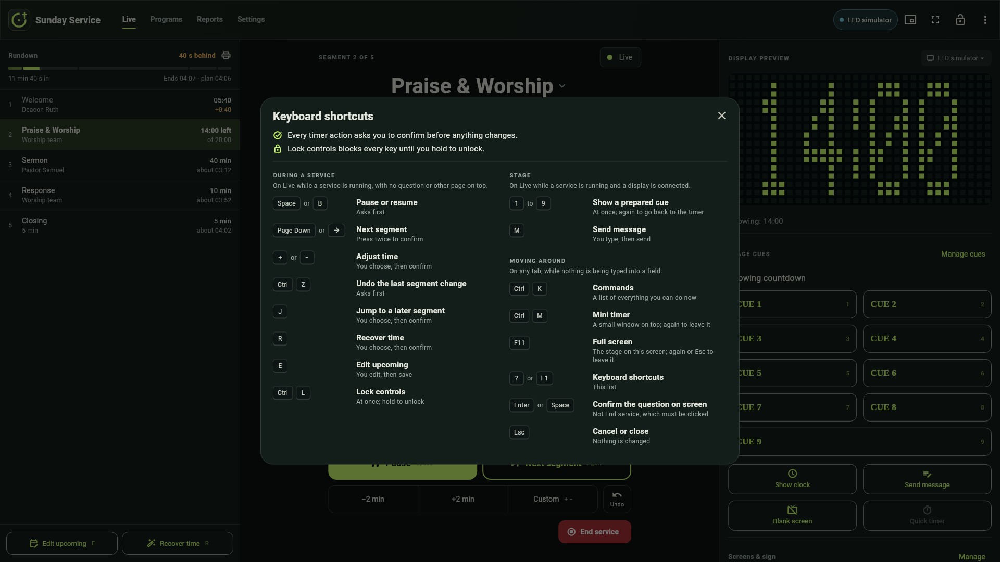

### Commands

Press <kbd>Ctrl</kbd> <kbd>K</kbd>, or choose **Commands** in the **⋮** menu on Live, to open a list of everything you can do right now.

1. Start typing, for example "pause", "wrap up" or "settings".
2. Use the arrow keys to move, and press <kbd>Enter</kbd> to choose.
3. <kbd>Esc</kbd> closes the list.

What is most likely needed is suggested first, such as **Recover time** when the service is running behind. Each command shows its key. A command is listed only while its button would work, and anything that changes the timer still asks you to confirm, exactly as its button does.

### Clicker and foot pedal

A clicker or pedal works like a small keyboard: each button sends one key.

| The clicker sends | On a PC | On a phone or tablet |
| --- | --- | --- |
| Page Down or Right arrow | Next segment: press twice to confirm | Next segment: press twice, within 4 seconds, to confirm |
| B or Space | Pause or resume: asks first, and Space or Enter confirms | Pause or resume **at once, without asking** |
| Page Up, Left arrow, F5 and others | Nothing | Nothing |

- **On a PC** these keys always work on Live; there is nothing to turn on.
- **On a phone or tablet** a Bluetooth clicker needs **Settings › Warnings & alerts › Clicker and foot pedal** switched on. A clicker's pause acts at once there, because there is no screen in the hand to confirm on. Give the clicker only to someone who understands that.

### Test a clicker or pedal

Before the service, find out what each button really sends.

1. Open **Settings › Warnings & alerts › Test a clicker or pedal**.
2. Press each button on the clicker or pedal.
3. The page names the key ("Page Down", "Right arrow", "F5") and says what that key does on Live, or that the app does not use it. It keeps the last few presses.

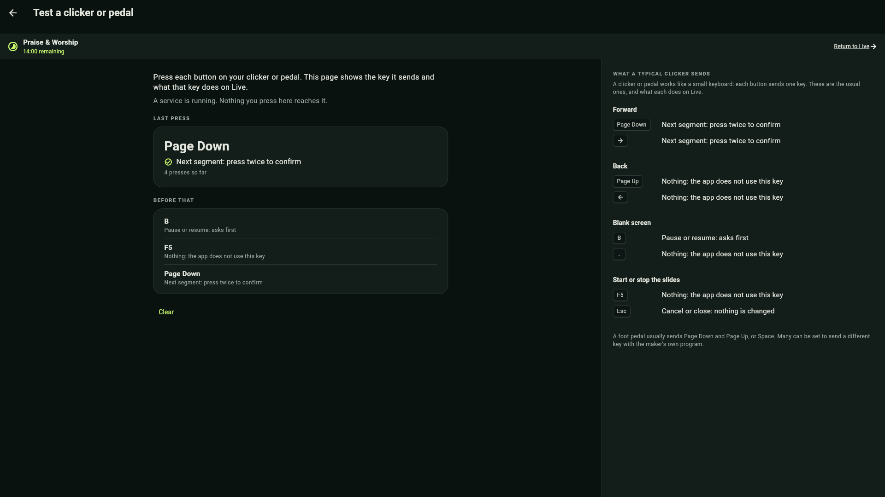

**Nothing pressed on that page reaches a running service**, so it is safe to test mid-service. The page works on phones, tablets and PCs. Many pedals can be set to send a different key with the maker's own program.

## 13 — Prepared cues and automatic warnings

Prepared **Stage cues** are short reusable instructions such as WRAP UP or AMEN. Configure them before the service in **Settings › Stage cues**, or use the **Manage cues** link on Live.

1. Create or edit a cue's text, font, height, bold/italic, alignment and effect (static, scroll or flash). Then set how it looks on screens; see below.
2. Save it. The Live cue buttons share this saved set across services.
3. During the service, **tap the cue once to send**. On a PC, the keys **1** to **9** send the first nine cues, and pressing the number of the cue that is showing goes back to the timer. There is no editing step on Live; choose deliberately. Before a service starts, Stage cues says "Cues work once the service starts".
4. Select **Show timer** when the instruction has served its purpose. The timer has continued beneath the cue.

Changing the saved cue later does not rewrite content already on stage. Deleting an individual cue or warning offers an **eight-second Undo**, preserving its formatting. This Undo does not apply to deleting reports.

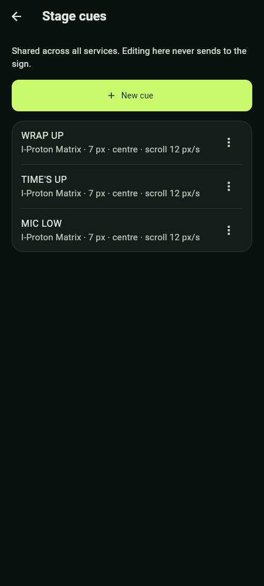

### How a cue looks on screens

The LED sign is small, red and one colour. Stage screens, web screens, a second screen and full screen are large and can do more. The cue editor has a group called **On screens** for them. Nothing in it changes the LED sign.

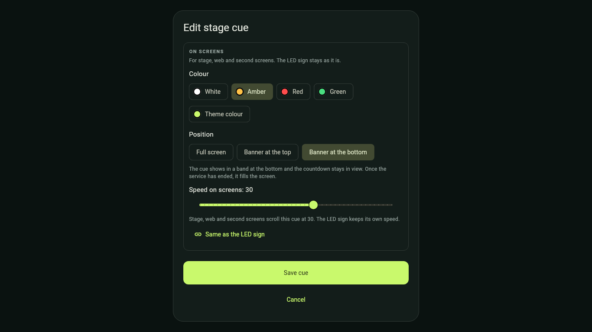

| Setting | Choices |
| --- | --- |
| **Colour** | **White** (as before), **Amber**, **Red**, **Green** or **Theme colour**. They are fixed colours chosen to read clearly on the black stage background. |
| **Position** | **Full screen**: the cue takes the place of the countdown. **Banner at the top** or **Banner at the bottom**: the cue shows in a band and the countdown, or the clock, stays in view. |
| **Speed on screens** | How fast a scrolling cue moves on screens, up to 48, twice the sign's fastest. Until you move it, screens follow the sign. **Same as the LED sign** puts it back. |

The sign's own speed is the slider above it, **Speed on the LED sign**. A speed that suits the sign is slow on a big screen, which is why there are two.

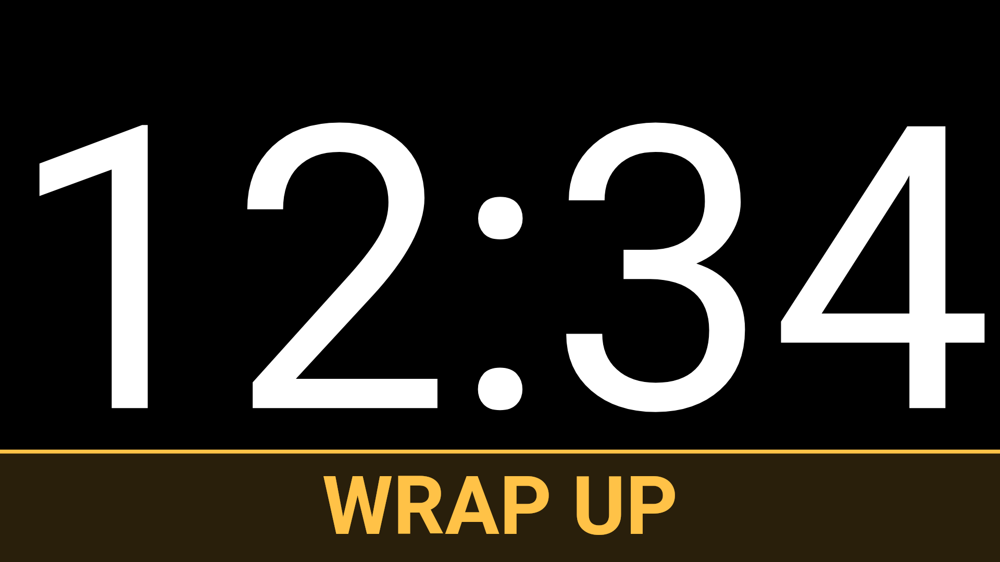

A banner needs a running service to sit over. After the service has ended, a banner cue fills the screen. Bold, italic, flashing and scrolling work in a banner too.

**Preview it both ways.** Over the editor's preview is a small switch, **LED sign | Stage screen**. It starts on the display you are using, and changing it only changes the preview. The editor for a warning's text has the same switch, so a warning can have its own colour, banner and screen speed.

In a wide window, the pane beside **Settings › Stage cues** and beside **Warnings & alerts** shows every cue and warning as your display will show it: **On the LED sign** with an LED sign or the LED simulator, and **On the stage screen** with stage screens or the Stage simulator. Point at a scrolling cue to play it.

Cues, backups and program files you already have look the same as before. A paired phone or tablet still on an earlier version shows every cue in white and full screen, at the sign's speed.

### Text for the LED sign

For LED text, choose **I-Proton Matrix**, **I-Proton Sq-Matrix**, or bundled **Tinos**. Matrix countdown digits are unchanged. Tinos has regular, bold, italic and bold-italic faces; no font import is needed. Tall 14 px preserves more serif detail. Short 7 px fits a smaller line. Static/flashing text must fit the LED width; scroll longer text. Changing square/circular LED preview cells does not change the actual sign's physical LEDs or glyph data.

### Automatic warnings

Automatic rules live in **Settings › Warnings & alerts** and apply to **all services and rehearsals**. They trigger at **time remaining**, not time elapsed. In a ten-minute segment, a 01:30 rule triggers when 8 min 30 s have elapsed under ordinary uninterrupted timing. **Use suggested warnings** adds a starting set.

For each rule set the **Remaining time**, the warning text and **Where to show**: **Operator + phone notification** or **Operator and stage**. Choose **Show for** 1–120 seconds, or **Scroll once, then return** for scrolling text wider than the display. A stage warning returns to the current countdown, or At zero, after its duration. On the LED path, that duration begins after the controller acknowledges it.

New manual cues, Blank, Next and End service supersede a warning. Passed thresholds are not replayed retroactively when rules change. If a manual Quick message covers every connected stage screen, automatic stage cues are consumed while it is present; phone warnings continue. With a targeted Quick message, other stage screens can still show warnings.

### Alerts on the phone

Under **Phone alerts**, **Clear phone warnings after** is separate: choose **15, 30, 60 seconds or Until dismissed**, with 30 seconds as default. A segment change or service end clears obsolete warning notices. This does not shorten stage warning duration or remove the active-service notification. Phone warnings use a distinct vibration pattern, which Wear OS watches mirror.

Turn on Android notifications (**Turn on**) and **Precise timing** (**Allow**) where offered, then use **Test** on the **Sound and vibration** row. Volume, the notification channel and Do Not Disturb still affect sound. **Background operation** starts with the LED sign or sharing and keeps warnings running while locked; if Live says background operation is unavailable, keep the app open. Ready for service also shows whether Android **battery optimisation** could pause warnings with the screen off, with **Allow** to fix it. Force-stopping the app is not a supported way to silence a service.

### Alerts on a PC

A PC shows a Windows notification at each warning and flashes the app's taskbar button. **It plays no sound unless you turn on Play the Windows notification sound.** The details are in [Get started on Windows](#03-get-started-on-windows).

## 14 — Send rich Quick messages

Quick messages are for paired and web stage screens, with **Phone, tablet or web screens** as the destination. They are not for the LED sign. They let you send a longer, formatted instruction without changing the program. (The **Send message** tile in Stage & display is different: it sends a simple text message to whichever display is selected, the LED sign included. On a PC, **M** opens it.)

1. Confirm sharing is on and the intended stage screens are approved and connected.
2. On Live, in the **Quick message** section of Stage & display (shown while Phone, tablet or web screens is the destination), tap **Write a message**. In **Send to**, choose **All connected stage screens**, one screen, or a screen group. Only connected screens are listed; one that drops off while you write stays listed as "offline" and can't be picked.
3. Write an optional headline and a message, or use **Choose a preset** and adapt it. The combined limit is **160 characters**, with a headline of at most 48 and up to six message lines.
4. Under **Style**, choose bold/italic, alignment, colour and text size. Set **Show for** on the wheel, or 00:00 for Until cleared. For a longer message, consider 15 or 30 seconds.
5. Inspect the preview and recipient count. Optionally tick **Request Seen acknowledgement**. Use **Test 5 s** to check it reaches the screens in Send to, then tap **Send message**.

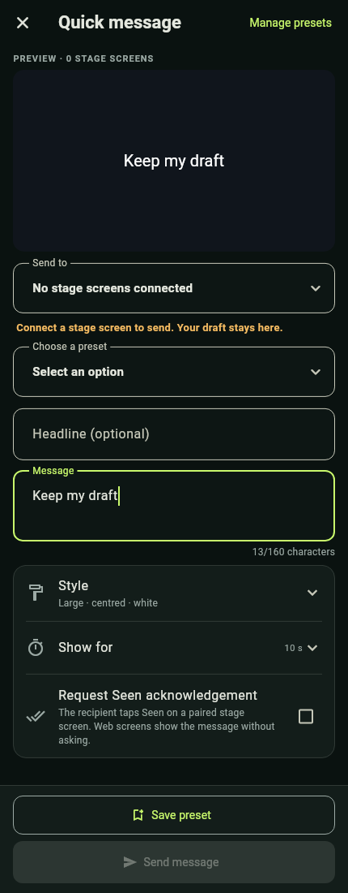

The recipients are fixed when you send. Newly joined or reconnected screens do not receive a replay of an earlier message. Other screens keep their normal output. When the message expires or you clear it, its recipients return to their current timer or preceding end/blank output. A segment change, manual cue, Blank, End service or disconnection can supersede the message. If Send is unavailable, the composer says why.

**Seen means a person tapped Mark seen.** A transport acknowledgement only says the app received data. If you require acknowledgement, watch the "Seen N of M" count and per-recipient status. Web screens show the message but have no Seen button; they are listed as "On screen (web, no Seen)" and left out of the count. Do not assume silence means agreement, and do not repeatedly resend without checking the recipient list.

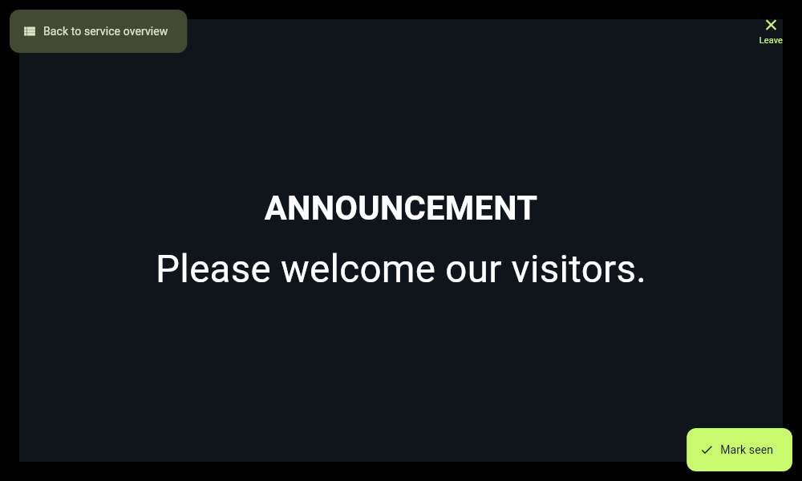

Use **Save preset**, or **Manage presets** and **Settings › Quick message presets**, for repeatable messages with their formatting. Unsent Quick message drafts can be restored locally; restoring a draft never sends it. Sent messages are temporary and are not restored after restarting the app.

After End service, messages can still be sent while approved stage screens remain connected and this device has control. The app asks you to confirm because the service has ended. Sending does not restart the service or change its report. Before any service has run, use **Test 5 s** or **Test screen** for setup rather than a normal Quick message.

## 15 — Adjust the plan without losing control

Use **Service timing overview** to notice drift early. Its estimated finish assumes future segments use their allocations; pauses, overtime and manual advances can change the actual finish.

**Edit upcoming** (**E** on a PC) changes only future segments in this running service. It does not rewrite the current/completed segments, saved program or historical reports. Confirm changes with the service leader before shortening important activities.

For a structured reduction, open **Recover time** from the Live rundown (**R** on a PC). When the service is running behind, Commands suggests it first.

1. Set **Time to recover**.
2. Protect segments that must retain their duration (segments with **Protect duration** start protected).
3. Choose **Review adjustments** and check each proposed before/after duration. Each remaining segment keeps at least one minute.
4. Choose **Apply reviewed adjustments** only after the proposal is suitable. If the service/control state has changed, review again.

Recover time changes allocations of upcoming segments for this running service only; it does not automatically move to the next segment or guarantee a finish time. The current segment keeps running. Future program defaults remain unchanged.

After several comparable services, open **Reports › ⋮ › Timing insights**. The app requires at least three suitable observations and uses up to the five most recent comparable services for a program. It excludes rehearsals, Quick timers, incomplete/uncertain records, ambiguous segment names and paused time. **Open in program editor** appears when there is a suggestion.

Suggestions use median active duration rounded up. In **Program editor › Learn from previous services** (offered only when past services can suggest a duration), select only the suggestions you want and **Apply to draft**, then save. These are planning aids, not instructions to rush a speaker or evidence of why a service ran long.

## 16 — Finish and hand over cleanly

1. Confirm the service really is complete.
2. Choose **End service** and confirm.
3. Wait for the completed report to save. Live returns to the **Standing by** card ("Ready when you are") with **Start service**, **Quick timer**, **Share to screens** (or **Manage sharing** while sharing) and **Join a service**, and a **Last service** card with **View last service report**. The active rundown and timing overview disappear.
4. Check the selected screen's program-specific end output. It remains connected. The **Stage & display** panel starts closed after a service; open it to blank or unblank, or to send a message or cue after the service.
5. Open View last service report, check the service date and segment timings, add a review note if useful, and export or print if required.
6. **Stop sharing** when the stage, viewer and web devices are no longer needed. Deliberately disconnect the LED if the equipment is being handed over or powered down.
7. On a PC, a second screen stays open on the end screen until you click **Stop**. Full screen and the mini timer close by themselves when the service ends, and the countdown icon beside the Windows clock goes.

If saving fails, the app retains the completed information and offers **Retry saving report**. Retry rather than starting a duplicate service. It preserves the original finish time and saves one report; a successful retry restores the Standing by card automatically. A pending save failure blocks service changes. Do not clear app storage to remove the message.

An end screen belongs to the selected program. The **Default end screen** in Settings › Display settings seeds new programs; changing that default does not overwrite existing program-specific end screens.

## 17 — Read, export and print reports

Reports lists completed services as rows with a date badge, the length and start time, and an outcome chip: **On time**, **N min over** (amber) or **N min under** (blue), or "Partial" for an incomplete record. Rehearsals and saved Quick timers are labelled so they are not confused with real service timing. A finished service or segment is always on time, over or under in Reports; Live keeps "ahead" and "behind" for a service still running.

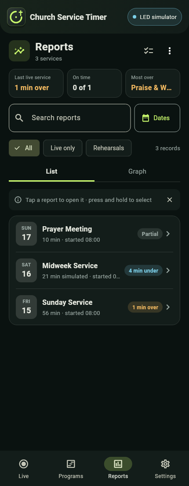

Above the list:

| Part | What it shows |
| --- | --- |
| **Last live service** tile | How the latest live service compared with its plan, for example "1 min over". With several services it reads "Last N live services" and adds "avg". It leaves rehearsals out. |
| **On time** tile | How many of those services finished on time, for example "0 of 1". |
| **Most over** tile | The segment that ran over most. |
| Search and **Dates** | Find a service by name, or limit the date range. On a PC, Dates opens a calendar; see below. |
| Filters | **All**, **Live only**, **Rehearsals**, and **Quick timers** once one has been saved. |
| **List** / **Graph** | The Graph starts with bars of minutes over or under plan for the last few services, each date under its own bar. Tap a bar to see that service, for example "Ran 21 min · planned 25 min" with "4 min under", and **Open report**. Planned-vs-actual rows follow below. |

Open a row for its **Service report**: planned, actual, variance, paused time and time adjustments, then **Print report** at the foot of that summary card, **Review notes**, the **Segment breakdown** and the **Activity timeline**.

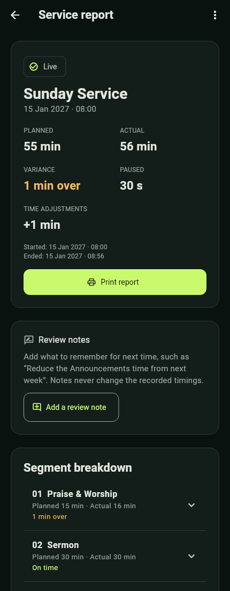

### Reports on a PC

In a desktop layout, your saved services are listed down the left, and the one you choose opens beside them. The newest report shows until you choose another.

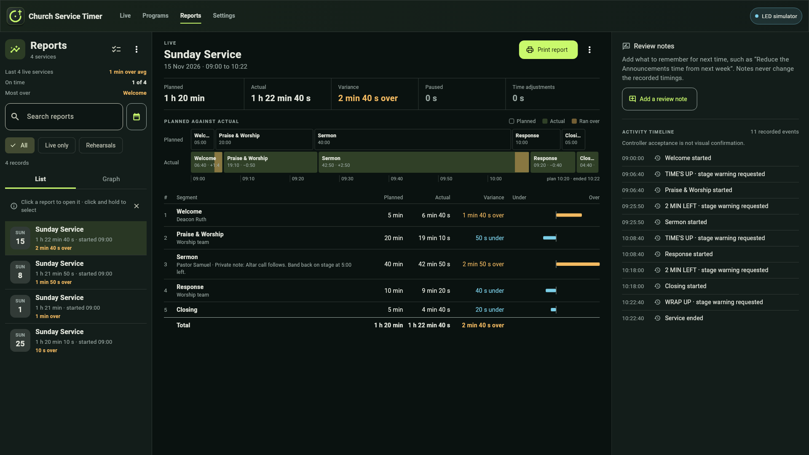

- **At the top:** planned and actual time, how far over or under it ran, paused time and time adjustments.
- **Planned against actual:** a planned row above an actual row, with the part that ran over marked. With The dial layout it is a ring ending at the cross.
- **The table:** every segment with its planned time, actual time and a small bar showing whether it ran under or over.
- **In a large window:** review notes and the activity timeline sit beside the timings, and the Graph tab puts its summary beside the charts.

**Print report**, export and review notes are all still there.

### Filter by date on a PC

In a wide window, **Dates** opens a small calendar, **Filter service dates**, with two months side by side.

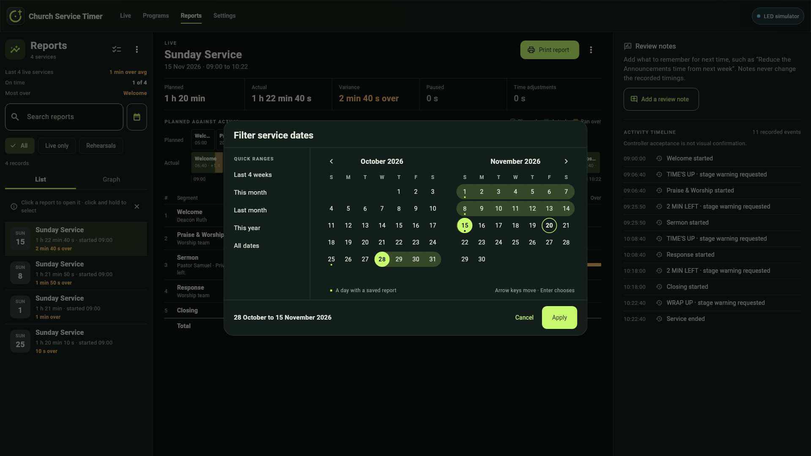

1. Click the first day, then the last. The days between fill in, and the range is written out in words above **Apply**.
2. Or click a ready-made range: **Last 4 weeks**, **This month**, **Last month**, **This year**, or **All dates**, which clears the filter.
3. Click **Apply**.

A dot marks each day that has a saved report. The arrows beside the month names move between months. From the keyboard, the arrow keys move between days, Enter chooses, Page Up and Page Down change the month, and Esc cancels. A phone or a narrow window keeps the picker it had.

### Reading a report

Read actual duration alongside planned and paused time. Activity records can help explain when an operator adjusted time, changed segment, answered a stage request or experienced a send failure; they do not prove what a person on stage saw. "Partial or uncertain timing" means the record should be reviewed before comparing it.

**Review notes** are an after-service reflection, such as “Reduce the Announcements time from next week”, kept apart from the recorded timings. Use **Add a review note** (or **Edit**). The note shows as "Last time" when the same program is next loaded into Ready, and is optional when exporting or printing.

**Export and share.** A report's **⋮** menu has **Export report CSV**, **Export report JSON** and **Delete report**. To handle several, press and hold a row (click and hold on a PC) to select, then use **Share** (Bluetooth, messaging or email) or **Export**: pick a format (report file, spreadsheet or printable PDF) and whether to include review notes. JSON keeps richer report details. **Reports › ⋮ › Export all reports** covers every saved report. On a PC, Share and Export open the Windows Save window: one file is saved where you choose, and several go into a folder you choose. Deleting selected reports offers a 10-second Undo; **Delete report** and **Delete all reports** cannot be undone, so export first if you need a permanent copy.

**Print report** is on a report; **Print order of service** is on program details and on Live (the print icon in the Service rundown header, and the **Print** button beside the program's summary on the Live home in a wide window). From a report, choose the **Document**: Service report or Service rundown. New records preserve the program snapshot, service date and church name used for that service, so editing today's program does not rewrite old speakers or notes. Older records may explicitly lack historical details.

Print choices open as a sheet:

| Option | Meaning |
| --- | --- |
| Stage copy | Excludes private notes. This is the appropriate starting point for distribution beyond the operator team. |
| Operator copy | Enables private notes; you may still untick **Include private operator notes** before printing. Review the content before sharing. |
| Ink-saving | Omits banner and watermark for this output. It is remembered from your last print. |
| Church-name watermark | A faint bold diagonal church name, used when a name exists. Ticking it turns Ink-saving off. |
| Include church banner | Uses the current configured banner; a historical service snapshot does not freeze the old image. Ticking it turns Ink-saving off. |
| Include review notes | Offered for a report that has one. |

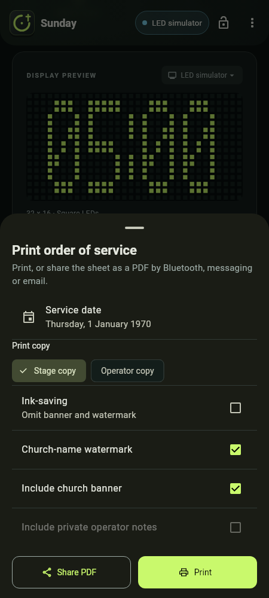

The PDF repeats table headings and reserves footer space on every page for **Church Service Timer · I-Proton** and **Page N of M**. Service date and the document's preparation date/time/timezone are separate. Rundowns omit Planned start; historical reports retain useful planned/actual/paused columns.

Choose **Print** to continue to Android's print screen, or the Windows print window on a PC, and select a printer or **Save as PDF**, or **Share PDF** to send the sheet directly. Review the destination and final pages. Printing a program before it has run offers a service date. A PDF is an exported copy; later app changes do not update a file already shared.

## 18 — Make the workspace yours

Open **Settings › Church profile**, or tap the logo or mark at the top left of any page. A preview of the page header sits at the top, then three sections and one **Save church profile** button.

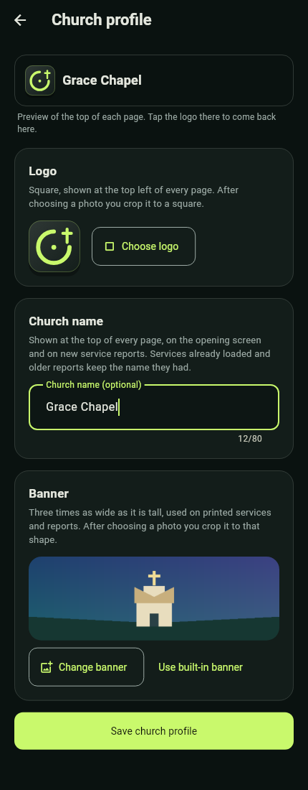

| Section | What to do |
| --- | --- |
| **Logo** | **Choose logo**, then crop it to a square: drag to move, pinch to zoom, then **Use logo**. It replaces the built-in mark at the top left of every page. **Use built-in mark** puts the original back. The home-screen app icon is unchanged. |
| **Church name** | Shown at the top of every page, on the opening screen and on new service reports. Services already loaded and older reports keep the name they had. |
| **Banner** | **Choose banner**, then crop it to its 3:1 shape (three times as wide as it is tall), so you choose which part of the photo shows. It is used on printed services and reports. **Use built-in banner** is always available. |

Choose a JPEG, PNG or WebP photo up to 5 MB and 40 megapixels. The app saves exactly what is inside the crop frame, and a transparent background stays transparent. Keep essential details away from the edges. The logo and banner are included in backups.

**Appearance** offers thirteen preset themes and **Create custom theme**: Midnight Lime, Royal Navy, Warm Ivory, Deep Plum, Slate Teal, Morning Sky, Sage Linen, Ocean Deep, Cobalt Night, Graphite (clean white, for dark booths), Paper & Ink (near-black ink, for well-lit rooms), **Paper & Ink (blue)** (ink-blue buttons) and Meadow. Preview the choice, then **Save appearance**; Cancel or Back discards the preview. Test readability in the actual room, including overtime and warning labels. A beautiful palette is not useful if the operator cannot distinguish a warning at a glance.

The **Layout & accessibility** tab sets the **Desktop layout**, **Show keyboard keys on buttons** and **Saved looks** (all three are described in [Run the service from a PC](#11-run-the-service-from-a-pc)), then **Layout density** (Compact, Comfortable, Spacious or Automatic, the default), **High contrast**, **Reduced motion** and the divider style. **Settings › Desktop layout** opens straight on this tab and names the layout in use; the Theme tab's **Desktop layout and spacing** button switches to it.

Other useful settings:

| Setting | Scope |
| --- | --- |
| At zero | Display settings. Shared by every service: **Show 00:00** or **Custom text**. |
| Default end screen | Display settings. Starting value for new programs; existing programs keep their own setting. |
| Clock format | Display settings. 12 or 24 hour, and the **Blinking colon** on paired and web screens (on by default). |
| LED preview shape | Display settings. Square or circular visual cells; does not reconfigure physical hardware. |
| Desktop layout | How Live is arranged in a wide window: Mission control, Three panes, The dial, Keys or Classic. |
| Warnings & alerts | Shared rules; phone alerts, or Alerts on this computer on a PC; lock-screen controls; clicker and foot pedal, and its test page. |
| Stage cues | Shared prepared cue buttons, with their formatting for the LED sign and for screens. |
| Quick message presets | Saved rich messages for stage screens. |
| Screens & devices | Pairing, saved devices, web screens, Requests from the stage, the Second screen on a PC, and Full screen on this phone. |
| Keep screen awake | Prevents sleep while the app is visible; it is not a guarantee against force-stop or power loss. |
| Settings PIN | Optional lock for Settings, deleting and sign administration. See [Protect data and manage the LED device](#20-protect-data-and-manage-the-led-device). |
| About | Installed version, creator I-Proton, What's new, Check for updates, Your data, Privacy policy, Guided practice, Diagnostics and the open-source licences. |

Use **Search settings** at the top of Settings to find a page by name; "layout" finds Desktop layout and "keyboard" finds Keyboard shortcuts.

**Settings in a wide window.** The groups sit in two columns. Appearance keeps its preview beside the themes and layouts. Display settings lists its sections down the left. Warnings & alerts and Stage cues show what your display will show. Church profile, Backup & restore, Feedback centre, Settings PIN, About, Diagnostics and Ready for service each put a preview or a summary beside the settings.

The simulator display profile is a preview assumption until supported hardware is connected and validated. Do not interpret a manually set preview width as a measurement of an unknown sign.

## 19 — Connection recovery and troubleshooting

Start with the destination badge, not repeated button presses. Identify whether the problem is the device's network, the app's connection, a held output, or the receiver itself.

### Displays, pairing and timing

| Symptom | Check / next action |
| --- | --- |
| Arc counts, LED is unchanged | Confirm LED sign is selected, the device is on sign Wi-Fi, and the connection is authenticated. Inspect "Output paused after an interruption"; review and **Restore current output** when offered. |
| App disconnects while the device remains on Wi-Fi | Live shows "Reconnecting to LED sign" with **Reconnect display** and **Stop trying**; timer controls and cues stay usable, and the sign receives current output when it returns. Re-enter credentials only if missing or rejected; do not change passwords as the first troubleshooting step. |
| LED counts after Wi-Fi is off | Expected for an accepted native countdown. Reconnect before expecting new cues, pause/resume or a new segment to reach it. |
| One brief blink at a change | Expected on the tested W2 during program replacement. Repeated blinking while a steady timer should run needs investigation. |
| The sign did not acknowledge | "Blanking was not acknowledged" means the previous sign may still show its last output; you can still switch with **Leave output**. A cue showing "Not sent" did not reach the sign. Check the sign itself and its connection before resending. |
| Timing was recovered with uncertainty | After a restart or long interruption the app asks you to **Verify remaining time**. Check and correct it, then **Verify & restore**. The service report keeps its uncertainty marker. |
| Pairing host is not found | Same Wi-Fi, host sharing on, no client isolation. Try **Scan QR code instead** if discovery alone fails. QR cannot fix blocked phone-to-phone traffic. |
| Phones on a hotspot can't see each other | Some sign hotspots, guest Wi-Fi and church networks keep devices apart. Use the host device's own hotspot and join the other devices to it. The host shares again at the new address by itself. |
| A browser can't open the web screen | Use the QR code or the address instead of the easy name (some devices do not open `.local` names). Check the browser is on the same Wi-Fi and the host is still sharing. On a Windows laptop, the easy name may not work while its Wi-Fi is set to a **Public network**; use the address, or set that network to Private in Windows settings. If a printed address stopped working, the host got a new address: export the join slide again. |
| A stage screen shows only a waiting message | The display is still set to the Simulator or the LED sign. Select **Show on stage screens** in the note on Live. |
| Mobile preview looks frozen/stale | Receiver may be disconnected. Keep its app open, check network and Saved devices, then reconnect. Do not treat stale output as a live countdown. |
| Cue command is rejected | Check who has control and whether the program, segment or selected cue changed. Review the current service instead of repeatedly pressing an old control. |
| Warning not visible on stage | Check enabled rule, time-remaining threshold, Where to show and connection. Intentional Blank suppresses stage warnings; all-screen Quick messages can take priority. |
| No notification sound | Check Android permission, channel sound, volume, Do Not Disturb and Precise timing. Use **Test** under Sound and vibration. |
| Warnings stop or the timer notification goes quiet with the screen off | Battery optimisation may pause warnings. Tap the battery hint on Live, or **Allow** on the Battery row in Ready for service, to open the Android setting. If background operation is unavailable, keep the app open. |
| Screen is blank but timer runs | Check for intentional Blank. Tap **Unblank screen**, or choose **Show timer** as appropriate. |
| Quick message send is disabled | Phone, tablet or web screens destination, sharing, connected recipients in Send to and control are needed. The composer says which is missing. Before the first run, use **Test 5 s**. |
| Controller administration is disabled | Connect to sign Wi-Fi and authenticate the supported LED display; end the service and stop sharing. |
| Report save fails | Use **Retry saving report**. Keep the completed information; do not clear data or create a duplicate run. |
| Cannot find timing suggestions | At least three comparable completed services are needed. Rehearsals, Quick timers, ambiguous names and incomplete/uncertain records are excluded. |

### On a Windows PC

| Symptom | Check / next action |
| --- | --- |
| Windows protected your PC | The installer is not code-signed. Click **More info**, then **Run anyway**. |
| Live looks like the phone app | The window is narrower than 1200 or shorter than 600, or the focused operator view is on. Widen or maximise the window. |
| "No second screen connected" | Check the cable, then press **Windows + P** and choose **Extend**. With Duplicate there is only one screen to show on. |
| The second screen did not open when the service started | Live says why: no screen has been chosen yet, or the screen used last time is not connected. Click **Show on second screen** once to choose it. |
| A key does nothing | Check the controls are not locked, the cursor is not in a text field, Live is the page showing, no dialog is open, and a service is running. Press **?** for the list. |
| A clicker does nothing | On a phone or tablet, turn on **Clicker and foot pedal**. Then open **Test a clicker or pedal** to see which key each button sends. |
| No warning notification | Windows holds notifications back under **Do not disturb**, which it turns on by itself when the screen is duplicated. The taskbar button still flashes. Use **Test** in Warnings & alerts. |
| Warnings make no sound | That is the default on a PC. Turn on **Play the Windows notification sound** if you want it. |
| The countdown icon is missing beside the clock | It shows only while a service or Quick timer runs. On Windows 11 look behind the small arrow and drag it out. Check **Show the countdown in the notification area** is on. |
| A dropped file is refused | Drop one program file (`.json` or `.csv`) at a time. A drop is refused while a service is running or the controls are locked. |
| Phones cannot reach the PC host | Allow the app through Windows Defender Firewall on private networks, and check the PC's network is set to Private. |
| The mini timer or full screen will not open | Both need a running service, and neither opens from the other. Unlock the controls first. |

### How recovery works

The LED connection tolerates brief health-check misses before reconnecting. Retry delay rises from about two to thirty seconds. Within the same trusted active service, recovery restores the latest intended output against the original deadline; it does not replay every missed update.

**Deliberate Disconnect, Forget this sign, or another output selection stops LED retries.** A saved credential does not override that choice. Restarting the app, uncertain timing, a long absence or an existing output hold can require review before restoration.

For an interruption during worship: keep one responsible operator in control, establish what the stage is actually seeing, restore connectivity, check the timer against the real activity, and restore current output once. A second person should not open another independent LED app and compete for the sign.

## 20 — Protect data and manage the LED device

Use **Settings › Backup & restore › Export backup** before changing devices or replacing a setup. Backups include saved programs (with version history), the segment library, cues, reports, preferences, saved looks and the church profile, including the logo and reduced banner.

**A backup moves between a phone and a PC.** One made on either restores on the other, so you can build programs on the office PC and run them from a phone, or the other way round. Keep exports containing private notes in an appropriate place.

Saved sign passwords are left out unless you tick **Include saved passwords**, which encrypts them with a **Passphrase** you choose. Restoring asks for that passphrase; skipping it or a wrong passphrase still restores everything else.

Restoring replaces saved data on the target device after review (**Restore and replace**). Export its current setup first if it should be kept. Backups do **not** transfer an active clock, phone permissions, pairing approvals, the Settings PIN, received programs waiting for review, local editing drafts or a live display connection. Some choices also stay with the device: the desktop layout in use, what the Simulator simulates, the second screen and full screen choices, and a PC's notification sound and countdown icon switches. Reconnect and approve equipment again as needed.

**Settings PIN** (optional, 4–8 digits) locks Settings, deleting programs and reports, and LED sign administration; Live, Programs and Reports stay open. Setting it shows a one-time recovery code that removes the PIN if forgotten (**Forgot PIN?**). Settings lock again whenever the app leaves the screen. **Turn off PIN** removes it.

**LED device management is for the sign, not the phone, tablet or PC.** It shows the saved **Wi-Fi password** and **Connection password**, with **Show** on each row and change or forget in the row's **⋮** menu. Once connected, **Open Wi-Fi** and **Details** help reach the correct network and controller. Revealing a saved password shows the app's local copy; it does not retrieve an unknown current password from the sign. Saving a known Wi-Fi password locally does not change the sign's Wi-Fi configuration.

Changing the sign's Wi-Fi name or passwords requires a supported authenticated LED connection, the correct Wi-Fi, an ended service and stopped sharing. Reserve this for the equipment administrator outside a live service. Keep the current and intended new details available until reconnection verifies the change.

The administration setters have automated/packet validation, but physical password/Wi-Fi write-and-reconnect acceptance remains outstanding for this build. A controller acknowledgement is not proof that a new password works after reconnection. If there is "No acknowledgement", the setting may have changed: rejoin using the new details first, and do not repeatedly apply the change. Do not alter scan, polarity or firmware settings as part of normal operator onboarding.

For help, open **Settings › Feedback centre**. Enter a title, a message and your contact. **Include optional diagnostics** can be reviewed before inclusion. **Open email app** opens a draft to **immanuelproton@gmail.com**; you must send it in your email app. On a PC it opens the PC's email program, and a long message is put on the clipboard with a note to paste it. **Copy feedback** is the fallback. No automatic support delivery or response time is promised.

Describe the app version, output type, steps, expected result and actual result. Avoid including passwords, pairing QR codes or private speaker notes. Copy important text before closing the form.

For a performance problem, **Settings › About › Diagnostics › Record service metrics** records the next service on this device (memory, battery, smoothness, timer accuracy, warning timing and reconnections), then switches itself off. It records no service content or people, and nothing leaves the device until you tap **Share recording**.

## 21 — Trainer session and readiness checklist

Suggested coached session: 10 minutes explaining roles and output, 15 minutes of simulator practice (guided practice is a good start), 15 minutes on the actual connected equipment (the PC, projector and clicker included, if you use them), then 10 minutes of recovery and reporting. These are teaching estimates, not app timers.

### Before the service

- Confirm the installed version on every phone, tablet and PC, and the program, speakers, allocations and end screen.
- Choose the intended destination and confirm the physical screen with another person.
- Check power, battery optimisation on phones, network reachability and notification sound.
- On a PC: set Windows to **Extend**, click **Show on second screen** and look at the projector. Decide whether warnings should play the Windows sound; they are silent unless you turn it on.
- Test the clicker or pedal on **Test a clicker or pedal**, and tell whoever holds it what each button does.
- Review shared warning thresholds and prepared cues with the service leader.
- Agree who hosts and who has control; name and approve receivers deliberately.
- If browsers will follow, check the guest code, team code and join slide are current.
- Open **⋮ › Ready for service** on Live to review the app checklist. An isolated simulator test is not proof of physical delivery.
- Review stage-message recipients and screen groups; do not use a real congregation-facing screen for an unannounced test.

### During the service

- Watch both the current segment and the whole-service timing overview.
- Use Next when the real activity changes; do not rely on automatic advance.
- Read confirmation dialogs before time adjustments or ending. On a PC, a key asks first too.
- Lock the controls when you step away; unlock with Hold to unlock.
- Keep cues concise; target rich messages carefully and distinguish delivery from Seen.
- Answer stage requests promptly with Acknowledge, Dismiss or Add 2 min.
- Check any disconnected/stale/held indication before assuming output is current.
- Keep the host powered; control handover does not move the service to another device. Do not close the app's window on a PC during the service.

### After the service

- End once, confirm the report saved, and inspect View last service report. Add a review note while it is fresh.
- Print or export the right copy; inspect private-note inclusion before distribution.
- Stop sharing, stop the second screen, and deliberately disconnect equipment when appropriate.
- Record an issue or useful program improvement.
- Back up the configuration after significant changes.

### Competency drills

Ask the learner to demonstrate each task with the simulator first:

| Drill | Successful result |
| --- | --- |
| Load without starting | Explains Ready and starts only after checking the destination. |
| Pause versus blank | Shows that Pause stops time while Blank only hides output. |
| Cue and return | Sends a prepared cue and returns to the current countdown. |
| Overtime transition | Recognises red overtime and starts the next segment correctly. |
| Quick timer | Starts a named 10 min timer, explains Save as a report, and ends it with End timer. |
| Message targeting | Names the recipients, sends a temporary message and explains Seen. |
| Recover time | Protects a segment, reviews changes and explains that the saved program is unchanged. |
| Connection interruption | Distinguishes network from app state and reviews before restoring output. |
| Close and print | Saves a single report and produces a Stage copy without private notes. |
| Keyboard run (PC) | Pauses with Space and confirms, advances with Page Down twice, sends cue 1 and returns to the timer, and shows that Lock controls blocks every key. |
| Second screen (PC) | Shows the stage on the projector, changes what it shows, and stops it with Stop or Esc. |
| Full screen | Opens full screen, answers a timer question in the card over the stage, and leaves with Esc or Exit full screen. |
| Cue on screens | Makes a cue an amber banner at the bottom and checks it with the LED sign and Stage screen preview switch. |

The learner should be able to perform the routine controls and explain when to call the experienced operator. Repeat the exact church equipment setup before independent operation; a simulator pass alone is not the equipment check.

## 22 — Quick reference and knowledge check

| Term | Remember it as |
| --- | --- |
| Program | The reusable plan, not the running service. |
| Segment | One timed activity inside a program. |
| Ready | Loaded and reviewed, but not counting yet. |
| Quick timer | A single countdown with no program or Ready step; saved only if you choose. |
| Host | The device that owns the service clock, saving and output: a phone, a tablet or a PC. |
| Stage cue | A prepared one-tap instruction with saved formatting, for the LED sign and for screens. |
| Quick message | A richer temporary message for selected stage screens. |
| Web screen | A browser on the same Wi-Fi following the service; it cannot control it. |
| Second screen | A projector or monitor plugged into the PC, showing the stage full screen with no pairing. |
| Full screen | The stage countdown on the screen of the device running the service. |
| LED simulator / Stage simulator | The Simulator pretending to be an LED sign or a stage screen. Neither sends to hardware. |
| Desktop layout | How Live is arranged in a wide window: Mission control, Three panes, The dial, Keys or Classic. |
| Mini timer | A small always-on-top window on a PC with the countdown, Pause, Next and one cue. |
| Commands | A searchable list of everything you can do now, opened with Ctrl+K on a PC. |
| Banner | A cue shown in a band at the top or bottom of a screen while the countdown stays in view. |
| Guest code / team code | The guest code opens Order of service and stays the same each week; the team code also opens Stage display and Service overview, and changes each time you share. |
| At zero | Shared output behaviour when a segment expires. |
| End screen | The selected program's output after End service. |
| Controller accepted / Stage screens received | Data acknowledged by the receiver; not optical verification. |
| Seen | An explicit human acknowledgement on a paired stage screen. |
| Disconnect | Pause access/connection without necessarily forgetting saved identity. |
| Forget | Remove saved approval or credentials; setup is needed again. |

### Check your understanding

1. If the main arc moves, does that prove the LED sign is current? **No. Check connection/acknowledgement and the physical output.**
2. Does Blank screen pause the countdown? **No. It hides output while time continues.**
3. A ten-minute segment has a warning at 01:30. When does it trigger? **At 1 min 30 s remaining, normally 8 min 30 s after starting.**
4. Will a newly reconnected receiver replay a Quick message sent earlier? **No. Recipients are fixed at send time and missed messages are not replayed.**
5. Does changing the default end screen update all saved programs? **No. Edit an existing program's own end screen.**
6. Can a second operator take control just by pairing? **No. The host must approve it and grant control explicitly.**
7. What do you do if End service cannot save its report? **Use Retry saving report; preserve the completed information.**
8. Should a Stage print copy include private notes? **No. Operator copy is a separate deliberate choice.**
9. Does a Quick timer appear in Reports? **Only if Save as a report was turned on; then it is marked Quick timer.**
10. Can someone with the guest code see the stage countdown in a browser? **No. The guest code opens only Order of service; Stage display needs the team code.**
11. On a PC, does pressing Space pause the service at once? **No. It asks first; Space or Enter confirms and Esc cancels.**
12. With Lock controls on, which keys still work? **None. Every key is blocked until you Hold to unlock.**
13. Does a warning play a sound on a PC? **Not unless Play the Windows notification sound is turned on. A notification appears and the taskbar button flashes.**
14. Does a projector plugged into the PC need pairing? **No. Set Windows to Extend and click Show on second screen.**
15. A cue is set to Banner at the bottom. What does the LED sign show? **The cue as before. Colour, banners and Speed on screens change screens only.**
16. The chip reads Stage simulator. Is anything reaching the stage? **No. Either simulator is a preview on your own device.**

### Current scope

This guide covers version 0.34.0 on Android and Windows. An iOS or Mac app and universal LED compatibility are not provided; browsers can only follow a service as web screens, never control it. The original Matrix glyphs and square-matrix glyphs are unchanged. Tinos is bundled; installed/imported font loading is not part of the workflow. LED countdowns, segments and Quick timers stay within 59:59.

Physical checks have established the supported W2 countdown, expected one-blink transitions, scrolling warnings returning to the current timer, and Next segment after overtime. Full-service endurance, power-loss acceptance and controller administration writes still require controlled hardware validation. Web screens, guided practice, Quick timer, stage requests and the other features added from 0.19 to 0.34 are described here from the app's release notes and on-screen wording; behaviour on your phones, PCs, routers, browsers and projectors has not been verified by this handbook, so hands-on testing of that release remains the user's responsibility.

**The Windows app is new.** Its installer is not code-signed, so Windows warns before it runs. The second screen, the mini timer, full screen and the countdown beside the clock depend on how Windows, your graphics driver and your screens behave. Rehearse the exact PC, projector and clicker before a service, and keep a phone with the same programs as a fallback.

The online handbook and this Markdown guide are training materials, not a remote-control interface. Nothing in the handbook can connect to a sign, start a service or send a stage cue.
